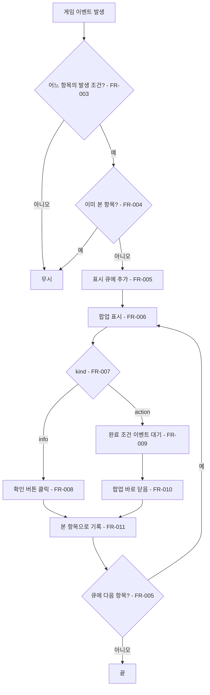
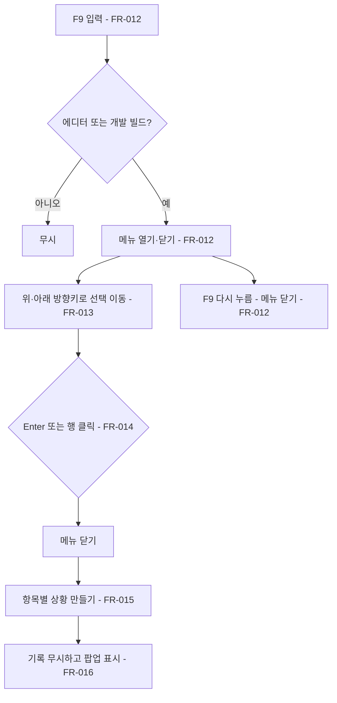
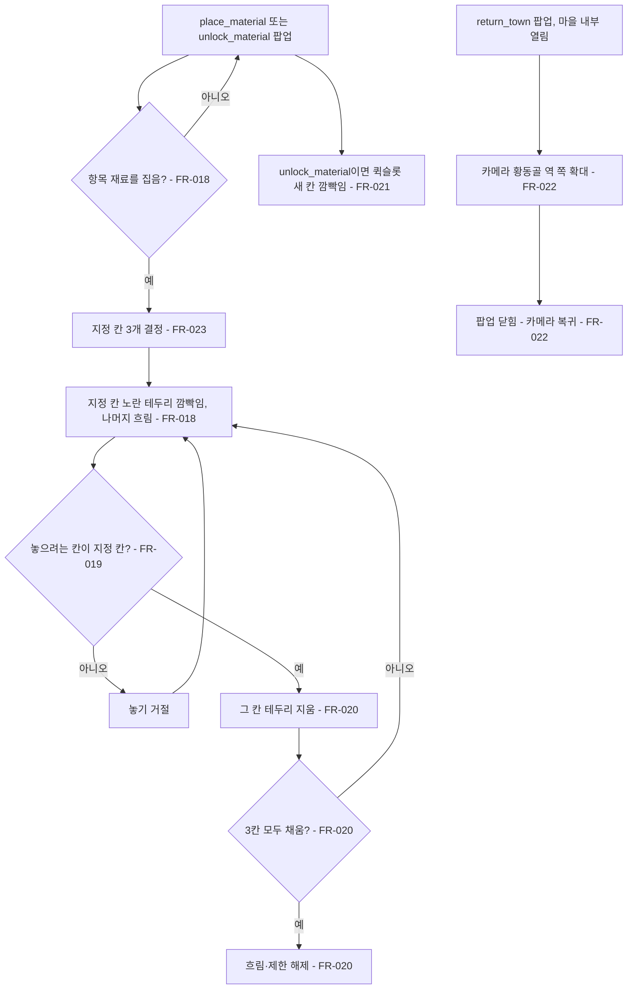

# 온보딩 팝업과 개발자 상황 메뉴

## 1. 개요

- 목적: 별도 튜토리얼 스테이지 없이, 플레이어가 어떤 상황을 처음 만날 때 마스코트 팝업이 뜨고 그 행동을 직접 해 보게 해서 게임 규칙을 하나씩 익히게 한다. 이 흐름은 일반 플레이로 재현하기 어려우므로, 개발자 메뉴(F9)로 각 상황을 즉시 만들어 팝업을 확인할 수 있게 한다.
- 대상: 플레이어(팝업을 보고 행동), 제작자(F9 메뉴로 상황 재현·문구 확인).

## 2. 범위

- 포함:
  - 학습 항목 15개(아래 「학습 항목표」)의 첫 발생 감지, 팝업 표시, 행동 완료 감지
  - 마스코트 그림·말풍선 문구·확인 버튼이 있는 팝업 화면 `Onboarding`
  - 안내 배치: 재료를 집으면 지정 칸 3개만 노란 테두리로 깜빡이고 그 칸에만 놓을 수 있으며, 나머지 칸은 회색으로 흐려진다(`place_material`, `unlock_material`)
  - 퀵슬롯 강조: 새 재료가 들어간 퀵슬롯 칸 노란 테두리 깜빡임(`unlock_material`), 카메라 강조: 지도 카메라 확대(`return_town`)
  - 본 항목을 한 번 보면 다시 띄우지 않는 기록(게임 동안 메모리에 두고 저장 슬롯에 함께 저장, 스펙 003)
  - F9 개발자 상황 메뉴 화면 `DevSituations`: 방향키·Enter·클릭으로 항목을 골라 그 상황을 만들고 팝업을 띄움
  - 팝업 문구의 `ko.json` 키(문구 값은 사용자 검수 뒤 넣는다)
- 제외:
  - 출발 버튼 등 그 밖의 UI 요소를 가리키는 화살표·하이라이트
  - 완료 칭찬 문구, 「직접 해 보세요」 안내 줄
  - 마스코트 그림 제작(세션 B 담당, 이 스펙은 결과 파일 경로만 쓴다)
  - 온보딩 끄기 옵션, 다시 보기 메뉴
  - 게임 규칙 변경(온보딩은 기존 규칙을 설명만 한다)

## 3. 기술 방향

- 사용 기술/API: Unity Input System(`Keyboard.current`, `Mouse.current`), UGUI + TextMeshPro, `Resources.Load<TextAsset>`, 저장 슬롯 참여 계약 `ISaveParticipant`(스펙 003)
- 핵심 방식:
  - 학습 항목 정의는 `Assets/Scripts/Onboarding/Resources/Onboarding/OnboardingTopics.json`에 둔다. 항목마다 `id`, `order`, `kind`(`action` = 행동하면 닫힘, `info` = 확인 버튼으로 닫힘), `textKey`, `mascot`(`default`·`happy`·`alert`)를 가진다.
  - `OnboardingDirector`(일반 C# 클래스)가 각 시스템 이벤트를 구독해 항목의 발생 조건과 완료 조건을 판정한다. 화면은 이벤트만 받아 그린다.
  - 팝업은 화면 아래 왼쪽에 띄우고 입력을 막지 않는다(`action` 항목은 팝업이 떠 있는 동안 그 행동을 해야 하므로).
  - 동시에 여러 항목이 발생하면 큐에 넣고 `order` 순으로 하나씩 띄운다.
  - 개발자 메뉴는 `Application.isEditor || Debug.isDebugBuild`일 때만 F9에 반응한다.
  - 상황 재현은 `OnboardingSituations`가 항목 id별로 공개 서비스(`GameServices.Get<T>()`)를 호출해 만든다. 재현 뒤에는 기록과 관계없이 해당 팝업을 강제로 띄운다.
- 선택하지 않은 방식:
  - 별도 튜토리얼 씬·스테이지는 만들지 않는다.
  - 런타임에 UI를 코드로 만들지 않는다(화면은 생성기로 프리팹을 만든다).
  - 게임 시간을 멈추지 않는다(`Time.timeScale`을 바꾸지 않는다).
- 외부 의존성: `GameServices`, `IItemPlacement`, `IHabitatClusters`, `IHabitatCodex`, `IMoney`, `ITrackRuntime`, `IHubDevelopment`, `IWaypointResolver`, `IPassengers`, `INpcRecruiter`, `INpcInteraction`, `ILedger`, `ILineOpener`, `IHubStateSystem`, `PhaseLoop`, `TownTiers`, `HotbarScreen`, `CodexScreen`, `PassengersScreen`, `PlacementGhost`, `HubInteriorView`, `Strings`, 마스코트 그림 `Assets/Art/Generated/mascot/mascot_default.png`·`mascot_happy.png`·`mascot_alert.png`

## 4. 구조

| 구분 | 이름 | 역할 |
|------|------|------|
| 클래스 | `OnboardingTopic` / `OnboardingTopicsData` | JSON 항목 정의와 파싱 |
| 클래스 | `OnboardingProgress` | 본 항목 기록을 메모리에 두고 조회·전체 꺼내기(`All`)·통째로 되돌리기(`RestoreAll`) |
| 클래스 | `OnboardingDirector` | 이벤트 구독, 발생·완료 판정, 표시 큐, `Shown`·`Completed`·`Closed` 이벤트 |
| 클래스 | `OnboardingSituations` | 항목 id별 개발자 상황 재현 |
| 클래스 | `OnboardingCellHighlight` (MonoBehaviour) | 지정 칸 노란 테두리 깜빡임, 나머지 칸 흐림, 놓기 제한 켜기·끄기 |
| 클래스 | `OnboardingCameraFocus` | 귀환 안내 때 열린 마을 내부의 카메라를 역 쪽으로 옮기고 확대했다가 원래 상태로 되돌림 |
| 클래스 | `OnboardingInstaller` | `GameServices.Composing`에서 `OnboardingDirector` 등록, `Ready` 뒤 구독 시작 |
| 클래스 | `OnboardingScreen` (MonoBehaviour) | 팝업 표시·닫기, 마스코트 표정 교체, 새 게임 때 본 기록 지우기, 저장 슬롯 참여자(키 `onboarding`, 스펙 003) |
| 클래스 | `DevSituationsScreen` (MonoBehaviour) | F9 메뉴, 방향키·Enter·클릭 선택 |
| 클래스 | `OnboardingScreenBuilder` / `DevSituationsScreenBuilder` (Editor) | 두 화면 프리팹 생성 |
| 프리팹 | `Assets/Prefabs/UI/Screens/Onboarding.prefab` | 마스코트 이미지, 말풍선 글, 확인 버튼, 행동 대기 표시 |
| 프리팹 | `Assets/Prefabs/UI/Screens/DevSituations.prefab` | 항목 목록(16행), 선택 표시, 안내 줄 |
| 프리팹 | `Assets/Prefabs/Interior/OnboardingCellHighlight.prefab` | 칸 강조 테두리(SpriteRenderer, 노란색), `Story012Build.Generate`가 만든다 |
| 씬 | `Assets/Scenes/Main.unity` | `MainCanvas` 생성기로 두 화면 인스턴스가 들어간다 |
| 데이터 | `OnboardingTopics.json` | 학습 항목 15개 정의 |

- 오브젝트 구성: 두 화면은 `MainCanvas` 아래 화면 프리팹이다. 서비스 객체는 MonoBehaviour가 아니다.
- 클래스 간 관계: `OnboardingInstaller` → `OnboardingDirector` 생성. `OnboardingScreen` → `OnboardingDirector` 이벤트 구독. `DevSituationsScreen` → `OnboardingSituations.Run(id)` → 각 서비스 호출 → `OnboardingDirector.ForceShow(id)`.
- 실행 순서 의존성: 이벤트 구독은 `GameServices.Ready` 뒤에 한다. 화면은 `OnEnable`에서 `GameServices.Ready` 여부를 확인하고, 준비 전이면 준비 이벤트에서 구독한다.
- 기존 코드와의 접점:
  - `BuildMainCanvas.SCREEN_IDS` 끝에 `"Onboarding"`, `"DevSituations"` 추가
  - 이벤트가 없는 행동은 팀원 코드에 이벤트를 추가하지 않고 `OnboardingDirector.Tick`이 매 프레임 상태를 살펴 판정한다: `CodexScreen.IsOpen`·`PassengersScreen.IsOpen`(열림), `NpcDialogScreen.IsBoardingOpen`(합류 대화 열림·닫힘), 마우스 휠 입력(UI 위가 아닐 때, 휠 확대), `HotbarScreen.FilledSlotCount`(퀵슬롯 9칸 참·비움). 재료 선택은 기존 `PlacementGhost.SelectionChanged`, 되돌리기는 기존 `PlacementGhost.Undone`, 설계 단서는 기존 `HabitatCodex.HintUnlocked`(구현 클래스로 형변환)를 쓴다.
  - 팀원 코드에 추가한 공개 멤버: `HotbarScreen.FilledSlotCount`, `HotbarCellView.Frame`·`Entry`, `InteriorCellView.TileRenderer`·`BuildableMarker`, `NpcDialogScreen.IsBoardingOpen`. 각 줄에 무엇을 추가했는지 한 줄 주석을 단다.
  - 카메라 강조(`OnboardingCameraFocus`)는 도착하면 자동으로 열리는 황동골 마을 내부에서 카메라(`Camera.main`)를 열차 앵커 쪽으로 옮기며 확대하고, 팝업이 닫히면 되돌린다. 팀원 코드는 고치지 않는다.
  - 안내 배치: `ItemPlacement`에 놓기 허용 판정 `Func<string, int, string, bool> PlacementGate`(기본 null = 제한 없음)를 추가하고 `CanPlace`에서 확인한다. 칸 강조·흐림은 `InteriorCellView`의 렌더러 색을, 퀵슬롯 강조는 `HotbarCellView.Frame` 색을 `OnboardingGuide`가 직접 바꾸고 끝나면 원래 색으로 되돌린다. 퀵슬롯은 칸을 매 프레임 다시 칠할 수 있으므로 퀵슬롯 강조는 `LateUpdate`에서 칠한다.
  - 저장 슬롯(스펙 003): `OnboardingScreen`이 `ISaveParticipant`(키 `onboarding`, Order 87)와 `ISaveDefault`를 구현해 본 항목 기록을 슬롯에 저장·복원한다. 씬의 MonoBehaviour라 `SaveInstaller`가 FR-020 경로로 모은다.
  - 저장 불러오기(스펙 003) 중에는 `SaveSlots.IsRestoring`이 true인 동안 `OnboardingDirector.Trigger`가 발생을 무시한다(보드 복원이 일으키는 완성·해금은 학습 상황이 아님).
  - 개발자 메뉴가 열려 있는 동안 입력 차단: `HotbarScreen.ReadDigitKeys`(숫자키)와 `TrainController`(Space 출발)가 `DevSituationsScreen.IsOpen`을 확인한다.
  - `Assets/Scripts/Localization/Resources/ko.json` 끝에 항목별 문구 키 추가(검수 뒤)

## 5. 동작 플로우차트

일반 플레이:

개발자 상황 메뉴:

안내 배치·강조:

## 6. 요구사항

- FR-001: 게임이 시작될 때 `OnboardingInstaller`는 `OnboardingTopics.json`을 읽어 학습 항목 15개를 `order` 순으로 `OnboardingDirector`에 등록한다.
- FR-002: `GameServices.Ready`가 되면 `OnboardingDirector`는 「학습 항목표」의 발생 조건·완료 조건에 쓰이는 이벤트를 모두 구독한다.
- FR-003: 구독한 이벤트가 오면 `OnboardingDirector`는 그 이벤트가 어느 항목의 발생 조건에 맞는지 판정한다.
- FR-004: 발생 조건에 맞은 항목이 이미 본 항목(`OnboardingProgress.IsSeen(id)`가 true)이면 `OnboardingDirector`는 그 항목을 띄우지 않는다.
- FR-005: 띄울 항목이 생기면 `OnboardingDirector`는 표시 큐에 넣고, 지금 떠 있는 팝업이 없을 때 큐에서 `order`가 가장 작은 항목을 `Shown` 이벤트로 내보낸다.
- FR-006: `Shown`을 받으면 `OnboardingScreen`은 항목의 `mascot` 표정 그림과 `textKey` 문구를 화면 아래 왼쪽 팝업에 보여 준다.
- FR-007: `kind`가 `info`이면 `OnboardingScreen`은 확인 버튼을 보이고, `action`이면 확인 버튼을 숨긴다.
- FR-008: `info` 팝업의 확인 버튼을 누르면 `OnboardingDirector`는 그 항목을 닫는다.
- FR-009: `action` 팝업이 떠 있는 동안 그 항목의 완료 조건 이벤트가 오면 `OnboardingDirector`는 그 항목을 `Completed`로 내보낸다.
- FR-010: `Completed`를 받으면 `OnboardingScreen`은 칭찬 문구 없이 팝업을 바로 닫는다.
- FR-011: 항목이 닫히면 `OnboardingProgress`는 그 id를 본 항목으로 기록하고, `OnboardingDirector`는 큐의 다음 항목을 띄운다.
- FR-012: 에디터 또는 개발 빌드에서 F9를 누르면 `DevSituationsScreen`은 메뉴를 열고, 열린 상태에서 F9를 한 번 더 누르면 닫는다(Esc는 게임 메뉴가 쓰므로 쓰지 않는다).
- FR-013: 메뉴가 열려 있을 때 위·아래 방향키를 누르면 `DevSituationsScreen`은 선택 행을 한 칸 옮긴다(맨 위·맨 아래에서는 반대 끝으로 돈다).
- FR-014: 메뉴에서 Enter를 누르거나 행을 클릭하면 `DevSituationsScreen`은 메뉴를 닫고 그 항목 id로 `OnboardingSituations.Run`을 부른다.
- FR-015: `Run(id)`가 불리면 `OnboardingSituations`는 `OnboardingDirector.Rehearse(id)`로 그 항목의 본 기록을 지우고(기본 학습 묶음 순서 제한에서도 그 항목만 예외), 「학습 항목표」의 개발자 재현 방식대로 팝업이 뜨기 직전 상황을 실제 서비스 호출로 만든다. 팝업은 실제 이벤트나 플레이어 행동으로 감지되어 떠야 하며, 로그 `ONBOARDING DEV: <id> ready -> <플레이어가 할 행동>`을 남긴다. 연습을 시작할 때 떠 있던 팝업은 큐 맨 앞에 되돌리고, 연습 항목이 뜰 때까지 다른 항목은 띄우지 않는다(마을 화면이 다시 열려도 기본 학습이 끼어들지 않는다). 연습 항목이 닫히면 순서 제한 예외도 풀린다.
- FR-016: 상황을 만들 수 없을 때(예: 이미 돌이 해금됨, 열 잠긴 마을이 없음)만 `OnboardingSituations`는 로그 `ONBOARDING DEV: <id> fallback`을 남기고 `OnboardingDirector.ForceShow(id)`로 팝업을 강제로 띄운다.
- FR-017: 메뉴가 열려 있는 동안 방향키·Enter·숫자키·Esc 입력은 다른 화면(퀵슬롯 숫자키 선택, 열차 출발 Space)에 전달되지 않는다.
- FR-018: 안내 배치가 켜진 항목에서 플레이어가 그 항목의 재료를 집으면, `OnboardingCellHighlight`는 지정 칸 3개에 노란 사각형 테두리를 0.5초 간격으로 깜빡이게 그리고, 나머지 마을 칸은 채도를 낮춰 회색으로 보이게 한다.
- FR-019: 안내 배치 중에는 `ItemPlacement`가 지정 칸에만 놓기를 허락하고, 다른 칸에 놓으려 하면 거절한다.
- FR-020: 지정 칸에 재료가 놓이면 `OnboardingCellHighlight`는 그 칸의 테두리만 지우고, 3칸이 모두 채워지면 흐림과 놓기 제한을 모두 푼다.
- FR-021: `unlock_material` 팝업이 뜨면 `OnboardingScreen`은 새 재료가 들어간 퀵슬롯 칸에 노란 테두리를 깜빡이게 하고, 팝업이 닫히면 지운다. 퀵슬롯 강조와 안내 칸 강조는 그 팝업이 화면에 떠 있는 동안만 보이고, 팝업이 닫히거나 다른 팝업이 뜨면 함께 꺼진다.
- FR-022: `return_town` 팝업이 뜬 뒤 황동골 마을 내부가 열리면 `OnboardingCameraFocus`는 카메라를 그 마을의 역(열차 앵커) 쪽으로 `_focusSeconds`(기본 0.6초) 동안 옮기며 `_focusZoomRatio`(기본 0.7)배 크기로 확대하고, 팝업이 닫히면 강조 전 위치와 크기로 같은 시간 동안 되돌린다. 강조 중 마을 내부가 닫히거나 다른 마을로 바뀌면 되돌리지 않고 끝낸다.
- FR-023: 안내 배치 칸은 항목마다 이렇게 고른다. `place_material`은 개간지(땅×3) 3칸, `unlock_material` 뒤에는 벌목터(땅×2 + 돌×1) 3칸이며, 둘 다 현재 마을에서 역에 가장 가까운 줄부터 위로 찾아 가로로 이어진 빈 설치 가능 칸 3개(가운데 열에 가장 가까운 것)로 정한다. 벌목터는 가운데 칸이 돌, 양 끝이 땅이다. 고르는 칸은 가운데와 네 모서리 중 어느 점도 화면 밖이거나 화면 UI(팝업 상자, 퀵슬롯, 그 밖에 클릭을 받는 UI)에 가려지면 안 되며, 화면의 `_ignoreUiAreaRatio`(기본 0.5)보다 넓게 덮는 배경 UI는 무시한다.
- FR-024: 기본 학습 묶음(`_chain` 항목: `select_material`, `place_material`, `build_combo`, `buy_material`, `pick_up`, `undo`, `camera_zoom`)은 `order` 순서를 지킨다. `OnboardingDirector`는 묶음 항목의 앞 순서 묶음 항목을 모두 본 뒤에만 그 항목을 띄우고, 그 전에 발생한 묶음 항목은 큐에서 기다리게 한다. 기다리는 동안 한 행동은 미리 완료로 치지 않는다(뜬 뒤 다시 해야 닫힌다).
- FR-025: Main 씬이 새 게임으로 열리면(`OnboardingScreen.Awake`에서 `SaveSlots.PendingLoadSlot`이 0) `OnboardingScreen`은 본 항목 기록을 모두 지워 처음부터 순서대로 나오게 한다. 이어하기(1 이상)면 지우지 않고, 슬롯의 `onboarding` 항목이 기록을 통째로 되돌린다(스펙 003 FR-017). 슬롯에 그 항목이 없으면 기본 학습 묶음(`_chain` 항목)을 모두 본 것으로 기록한다.
- FR-026: 할 일이 없는 안내(`buy_material`)는 `info`로 두어 확인 버튼으로 닫는다.
- FR-027: `action` 팝업이 뜬 뒤 `_skipDelaySeconds`(기본 5초) 동안 완료되지 않으면 `OnboardingScreen`은 확인 버튼 자리에 "건너뛰기"(`onboarding_skip`) 버튼을 보인다. 누르면 `OnboardingDirector.Skip()`이 그 항목을 본 것으로 기록하고 닫는다(`Completed`는 내보내지 않는다). 그 전에 행동하면 지금처럼 바로 닫힌다.
- FR-028: 기본 학습 묶음 항목이 닫히거나(완료·확인·건너뛰기) 마을 내부가 열리면, `OnboardingDirector`는 마을 내부가 열려 있을 때 아직 보지 않은 묶음 항목 중 order가 가장 작은 것을 발생시킨다. 그래서 건너뛴 뒤에도, 이어하기로 진행 중이던 항목이 사라진 뒤에도 기본 학습이 끝까지 이어진다.
- FR-030: 마을 내부 화면에서만 할 수 있는 항목(`_town`: 행동형 `select_material`, `place_material`, `pick_up`, `undo`, `clear_slot`, `camera_zoom`과 설명형 `codex`, `passengers`)은 마을 내부가 열려 있을 때만 띄운다. 그 밖에서 발생하면 큐에서 기다렸다가 마을 내부가 열리면 띄운다.
- FR-031: 마을 주민 대화 안내(`npc_interact`)와 NPC 합류 안내(`npc_join`)는 두지 않는다. NPC가 합류해도 팝업이 뜨지 않는다.
- FR-029: 새 재료 해금 안내(`unlock_material`)는 기본 학습 묶음에서 빠진다. 돌이 처음 해금될 때 일반 항목으로 발생하고, 출발 제한(기본 학습 완료)에 들지 않는다.
- FR-032: 중간역 승객 대화 안내(`boarding_dialog`)는 두지 않는다. 그 안내가 감지하던 탑승 대화창은 더 이상 열리지 않고, 합류는 사건 선택창이 맡는다.
- FR-033: 도감 안내(`codex`)와 승객 안내(`passengers`)는 설명형(`info`)이다. 확인 버튼을 누르거나 해당 창을 열면(C·P 키 또는 상단 바 아이콘) 바로 닫힌다. 창이 떠 있는 동안에는 다음 안내를 띄우지 않고, 창이 닫히면 띄운다.
- FR-034: 팝업 상자는 520×132, 마스코트는 104, 확인·건너뛰기 버튼은 100×32로 둔다(`OnboardingScreenBuilder` 상수). 글자 크기는 그대로다.
- FR-035: 잿골 개통 안내(`line_open`)는 개통 이벤트를 받은 뒤 바로 띄우지 않는다. 개통 배너(`PhaseBannerScreen.IsBusy`)와 지도의 잿골 등장 연출(`MapLockedHub.Revealing`)이 모두 끝나면 띄운다.

### 학습 항목표

| id | 순서 | 종류 | 마스코트 | 가르치는 기능 | 발생 조건 | 완료 조건 | 강조 | 개발자 재현 |
|---|---:|---|---|---|---|---|---|---|
| `select_material` | 1 | action | default | 퀵슬롯에서 재료 고르기(클릭·숫자키 1~9) | 마을 내부에 처음 들어옴 | 퀵슬롯 재료 선택 | 없음 | 마을 내부를 열고 선택을 비움 |
| `place_material` | 2 | action | default | 고른 재료를 빈 칸에 놓기 | 재료를 처음 선택함 | 개간지 완성(`HabitatCompleted`) | 안내 배치(땅 3칸) | 마을 내부를 열고 땅 선택 |
| `build_combo` | 3 | info | happy | 재료를 정해진 수만큼 이으면 지역·건물 완성 | 첫 건물 완성(`HabitatCompleted`) | 확인 | 없음 | 땅 3개로 개간지 완성 |
| `unlock_material` | 4 | info | happy | 생산 건물 첫 완성 = 새 재료 해금 | 처음 새 재료가 해금됨(`TileUnlocked`) | 확인 | 퀵슬롯 새 칸 깜빡임, 새 재료를 집으면 안내 배치(벌목터 3칸) | 땅 3개로 개간지 완성(이미 돌이 열렸으면 팝업만) |
| `buy_material` | 5 | info | default | 재료 설치 비용과 우측 상단 잔고 | 값이 있는 재료를 처음 선택함 | 확인 | 없음 | 돌 해금, 동전 지급, 돌 선택 |
| `pick_up` | 6 | action | default | 마을 칸 우클릭 회수, 비용 전액 환급 | 값이 있는 재료를 처음 놓음 | `IItemPlacement.ItemRemoved` | 없음 | 돌 1개를 놓아 둠 |
| `undo` | 7 | action | default | Ctrl+Z 되돌리기 | 회수를 처음 함 | `PlacementGhost.Undone` | 없음 | 땅 1개를 놓은 뒤 회수 |
| `clear_slot` | 8 | action | alert | 퀵슬롯 슬롯 우클릭으로 배정 비우기 | 퀵슬롯 9칸이 처음 다 참 | `HotbarScreen` 슬롯 비우기 알림 | 없음 | 재료를 9종 이상 해금해 퀵슬롯을 채움 |
| `camera_zoom` | 9 | action | default | 휠로 마을 확대·축소 | 되돌리기 안내(`undo`)를 닫은 뒤 | `HubInteriorView` 확대 알림 | 없음 | 마을 내부를 엶 |
| `codex` | 10 | info | happy | 설계 도감(책 아이콘·C 키)에서 단서 보기 | 첫 설계 단서를 얻음(`HabitatCodex.HintUnlocked`) | 확인 또는 `CodexScreen`을 엶 | 없음 | 아직 없는 건물 단서 1개 공개 |
| `passengers` | 11 | info | happy | 승객 목록(아이콘·P 키) | 첫 승객이 탐(`IPassengers.Boarded`) | 확인 또는 `PassengersScreen`을 엶 | 없음 | 승객 1명 강제 탑승(`TryBoard(force)`) |
| `depart` | 12 | action | default | 출발 버튼·Space로 열차 출발 | 첫 건물 완성 뒤 건설 페이즈에서 마을 내부를 닫음 | `IHubDevelopment.PhaseChanged`(순환) | 없음 | 개간지를 완성하고 건설 페이즈로 둠 |
| `return_town` | 13 | info | happy | 마을로 돌아올 때마다 설계 단서와 수입을 얻음 | 첫 바퀴를 마치고 마을에 도착(`LapCompleted`) | 확인(도착하면 내부가 자동으로 열리므로) | 지도 카메라 확대(황동골 역) | 단서 1개 공개·정산 1회 후 마을 도착 상태로 둠 |
| `line_open` | 17 | info | happy | 잿골 지역 선로 개통(디펜스 숨김 중에는 구리 갱도 완성, 디펜스가 켜져 있으면 정차역 보스 처치) | 잠긴 마을이 처음 열리고 개통 배너와 지도 등장 연출이 끝남(`ILineOpener.HubOpened`, FR-035) | 확인 | 없음 | 잿골을 엶 |
| `run_danger` | 18 | info | alert | 번영 하락과 마을 폐허 위험 | 번영이 처음 떨어짐(`ProsperityChanged` 감소) | 확인 | 없음 | 팝업만 띄움 |

### 팝업 문구

| 키 | 문구 |
|---|---|
| `onboarding_select_material` | 하단 퀵슬롯에서 재료를 고를 수 있어요. 숫자키 1~9와 클릭으로 선택할 수 있어요. 한 번 해보시겠어요? |
| `onboarding_place_material` | 좋아요! 이제 잡은 재료를 빈 칸에 놓아보세요! |
| `onboarding_build_combo` | 지금 한 것처럼 재료를 특정 갯수만큼 이으면 지역이나 건물이 생성되게 돼요! |
| `onboarding_unlock_material` | 생산 건물을 처음 지으면 새 재료가 열려요. 퀵슬롯에 새 재료가 생겼어요. |
| `onboarding_buy_material` | 재료를 설치할 때는 돈이 들어가요. 화면 우측 상단에서 내가 보유한 돈을 확인할 수 있으니, 효율적으로 관리해봐요! |
| `onboarding_pick_up` | 재료를 잘못 놓았다면 우클릭으로 회수할 수 있어요. 비용은 그대로 돌려드려요. 건물이 된 칸을 회수하면 건물이 사라지니 조심하세요! |
| `onboarding_undo` | 내가 한 행동을 취소하고 싶다면 Ctrl+Z를 눌러보세요! 물론 책임은 본인의 몫이랍니다~ :) |
| `onboarding_clear_slot` | 이런! 퀵슬롯이 가득찼어요! 우클릭을 눌러서 비우고 싶은 물건을 없애보세요! |
| `onboarding_camera_zoom` | 마우스 휠을 굴려 마을을 크게, 작게 볼 수 있어요. |
| `onboarding_codex` | 새 설계 단서를 얻었어요! 책 아이콘이나 C 키로 도감을 열어 확인해 보세요. |
| `onboarding_passengers` | 승객이 탔어요! 승객 아이콘이나 P 키로 누가 무엇을 원하는지 확인해 보세요. |
| `onboarding_depart` | 준비가 됐다면 오른쪽 아래 출발 버튼이나 Space로 열차를 출발시켜요. |
| `onboarding_return_town` | 고생하셨어요! 다시 마을로 돌아오셨네요! 마을로 돌아올 때마다 수입을 얻고, 새 건물의 설계 단서도 하나씩 얻을 수 있어요! |
| `onboarding_line_open` | 잿골 지역으로 가는 선로가 열렸어요! 이제 잿골 지역에도 들러 건물을 지을 수 있어요. |
| `onboarding_run_danger` | 이런! 마을의 번영도가 떨어지고 있어요! 이대로가면 마을이 황폐해져서 결국 폐허가 되고 말거예요! 빠른 조치가 필요해요!! |
| `onboarding_ok` | 확인 |
| `dev_situations_title` | 개발자: 온보딩 상황 만들기 (↑↓ 선택, Enter 실행, F9 닫기) |

### 상태와 데이터

| 이름 | 타입 | 설명 | 초기값 |
|------|------|------|--------|
| `_topics` | `List<OnboardingTopic>` | JSON에서 읽은 항목, `order` 순 | 15개 |
| `_queue` | `List<string>` | 띄울 항목 id | 빈 목록 |
| `_current` | `string` | 지금 떠 있는 항목 id | `null` |
| `OnboardingProgress._seen` | static HashSet<string> | 현재 게임에서 본 항목 id. 저장 슬롯 키 `onboarding`에 `{string[] Ids}`로 저장 | 비어 있음 |
| `_menuOpen` | `bool` | 개발자 메뉴 열림 | `false` |
| `_selected` | `int` | 메뉴 선택 행 | 0 |

### 예외 및 경계 조건

- 같은 프레임에 여러 항목이 발생: 모두 큐에 넣고 `order` 순으로 하나씩 띄운다.
- 큐에 같은 id가 이미 있음: 다시 넣지 않는다.
- `action` 팝업이 떠 있는데 완료 조건이 오기 전에 다른 항목이 발생: 큐에 넣고 기다린다.
- 팝업이 뜨기 전에 완료 조건이 이미 충족됨(예: 선택과 동시에 놓기): 팝업을 띄운 직후 완료로 처리한다.
- 마스코트 그림 파일이 없음: 이미지 칸을 숨기고 말풍선만 보인다.
- 문구 키가 `ko.json`에 없음: `Strings.Get`의 기본 처리(키 그대로 표시)를 따른다.
- 개발자 재현이 현재 상태에서 불가능(예: 이미 해금됨): 가능한 부분만 만들고 팝업은 띄운다. 콘솔에 `ONBOARDING DEV: <id> partial`을 남긴다.
- 릴리스 빌드: F9 메뉴가 열리지 않는다.

## 7. Inspector 노출값

| 필드 | 타입 | 기본값 | 설명 |
|------|------|--------|------|
| `OnboardingScreen._mascotDefault` / `_mascotHappy` / `_mascotAlert` | Sprite | 마스코트 그림 3종 | 표정별 그림 |
| `DevSituationsScreen` 열기 키 | - | F9 | 코드 고정(에디터·개발 빌드에서만 반응) |
| `OnboardingScreen._guideColor` / `_dimColor` | Color | (1, 0.82, 0.1) / (0.22, 0.22, 0.22) | 지정 칸·퀵슬롯 강조색 / 나머지 칸 흐림색 |
| `OnboardingScreen._pulseSeconds` | float | 0.8 | 강조 깜빡임 한 주기(초) |
| `OnboardingScreen._ignoreUiAreaRatio` | float | 0.5 | 안내 칸 고를 때 이 비율보다 화면을 넓게 덮는 UI는 배경으로 보고 무시 |
| `OnboardingScreen._popSeconds` / `_popStartScale` | float | 0.3 / 0.6 | 팝업 등장 효과 시간 / 시작 크기 비율 |
| `OnboardingScreen._focusSeconds` / `_focusZoomRatio` | float | 0.6 / 0.7 | 귀환 카메라 강조 시간 / 확대 크기 비율 |
| `OnboardingScreen._skipDelaySeconds` | float | 5 | 행동형 팝업에 건너뛰기 버튼이 나오기까지 기다리는 시간(초) |
| `DevSituationsScreen._selectedColor` | Color | (1, 0.82, 0.1) | 선택된 행 바탕색 |

## 8. 인수 조건

- FR-001: Play Mode 시작 후 콘솔에 `ONBOARDING: topics=16`이 찍힌다.
- FR-002: 같은 로그 줄에 `subscribed=true`가 찍힌다.
- FR-003: 새 게임에서 마을에 들어가면 `select_material` 팝업이 뜬다.
- FR-004: 같은 항목을 끝낸 뒤 같은 게임에서 같은 행동을 다시 해도 팝업이 뜨지 않는다. 저장 → 이어하기 뒤에도 뜨지 않는다(새 게임은 FR-025대로 처음부터).
- FR-005: 새 게임에서 마을에 들어가 `select_material`이 뜬 상태로 숫자키 1을 누르면, `select_material`이 닫히고 `place_material`이 이어서 뜬다.
- FR-006: 팝업에 마스코트 그림과 해당 항목 문구가 보인다(캡처).
- FR-007: `unlock_material` 팝업에는 확인 버튼이 보이고, `place_material` 팝업에는 확인 버튼이 없다.
- FR-008: `unlock_material` 팝업의 확인을 누르면 팝업이 닫힌다.
- FR-009: `place_material` 팝업이 뜬 상태에서 땅 3개로 개간지를 완성하면 콘솔에 `ONBOARDING: completed place_material`이 찍힌다.
- FR-010: 위 경우 칭찬 문구 없이 팝업이 바로 닫힌다.
- FR-011: 닫힌 뒤 저장하면 슬롯 파일 `onboarding` 항목의 `Ids`에 `place_material`이 있다.
- FR-012: Play Mode에서 F9로 메뉴가 열리고, F9를 한 번 더 누르면 닫히며, Esc로는 닫히지 않는다.
- FR-013: 위·아래 방향키로 선택 표시가 움직이고 맨 끝에서 반대 끝으로 돈다.
- FR-014: Enter와 행 클릭 둘 다 메뉴를 닫고 상황을 만든다.
- FR-015: 15개 항목을 하나씩 실행해 표의 「개발자 재현」 상태가 화면에 만들어진다(항목별 캡처를 `production/qa/evidence/001/`에 둔다).
- FR-016: 이미 본 항목도 F9로 실행하면 상황이 만들어지고, 로그의 행동을 하면(자동 항목은 바로) 팝업이 뜬다. 상황을 만들 수 없는 경우만 fallback 로그와 함께 팝업이 강제로 뜬다.
- FR-017: 메뉴가 열린 상태에서 숫자키 1을 눌러도 퀵슬롯 선택이 바뀌지 않고, Space를 눌러도 열차가 출발하지 않는다.
- FR-018: F9로 `place_material`을 실행하고 땅을 집으면 역 쪽 줄의 빈 칸 3개에 노란 테두리가 0.5초 간격으로 깜빡이고, 나머지 칸은 회색으로 흐려진다(캡처).
- FR-019: 강조되지 않은 칸을 클릭하면 재료가 놓이지 않고, 강조된 칸에 놓으면 그 칸의 테두리만 사라진다.
- FR-020: 강조한 3칸을 모두 채우면 흐림과 놓기 제한이 풀린다.
- FR-021: F9로 `unlock_material`을 실행하면 새 재료가 들어간 퀵슬롯 칸에 노란 테두리가 깜빡이고, 그 재료를 집으면 다음 건물 3칸이 강조된다(캡처).
- FR-022: F9로 `return_town`을 실행하면 한 바퀴를 돌아 황동골에 도착하고, 열린 마을 내부에서 카메라가 역 쪽으로 0.6초 동안 옮겨 가며 확대되며, 확인을 누르면 원래 위치와 크기로 돌아온다(캡처).
- FR-023: `place_material`은 땅 3칸 가로, `unlock_material` 뒤에는 땅·돌·땅 가로 3칸이 강조되고, 그대로 채우면 각각 개간지·벌목터가 완성된다. 강조된 칸이 팝업이나 퀵슬롯에 가려지지 않는다.
- FR-024: 기록을 지운 새 게임에서 땅(값 있음)을 고르면 `place_material`만 뜨고, `buy_material`은 `build_combo`(와 그 사이 해금됐으면 `unlock_material`)를 닫은 뒤에 뜬다.
- FR-025: 새 게임으로 시작하면 `select_material`부터 뜬다. 기본 학습을 마치고 저장 → 타이틀 → 이어하기하면 학습 팝업이 처음부터 다시 뜨지 않고 출발 버튼·Space 출발이 바로 된다.
- FR-026: 값 있는 재료를 고르면 뜨는 돈 안내에 확인 버튼이 있고, 누르면 닫힌다.
- FR-027: `select_material` 팝업이 뜬 뒤 5초 동안 아무것도 안 하면 "건너뛰기" 버튼이 나오고, 누르면 닫히며 `place_material`이 이어서 뜬다. 5초 안에 재료를 고르면 버튼 없이 닫힌다.
- FR-028: `camera_zoom` 팝업이 떠 있을 때 저장 → 타이틀 → 이어하기하면 마을 화면이 열리며 `camera_zoom`이 다시 뜬다.
- FR-029: 첫 건물을 짓지 않고 기본 학습을 모두 건너뛰면 출발 버튼이 켜진다. 개간지를 처음 지으면 `unlock_material`이 뜬다.
- FR-030: 정차역에서 첫 승객이 타도 `passengers` 팝업은 뜨지 않고, 황동골에 도착해 마을 화면이 열리면 뜬다.
- FR-031: NPC가 합류해도 합류 안내와 주민 대화 안내가 뜨지 않는다.
- FR-032: 출발해 중간역 합류 사건을 겪어도 승객 대화 안내 팝업은 뜨지 않는다.
- FR-033: 도감 안내가 뜬 뒤 C를 한 번 누르면 도감이 열리면서 팝업이 닫힌다. 승객 안내도 P로 같다. 확인 버튼으로 닫아도 된다. 창이 열려 있는 동안 다음 팝업은 뜨지 않고 창을 닫은 뒤에 뜬다.
- FR-034: 첫 안내 팝업 캡처에서 상자가 글 두 줄과 버튼을 담고도 빈 공간이 많지 않다.
- FR-035: F9로 `line_open`을 실행하면 "선로가 열렸습니다 — 잿골" 배너와 지도 잿골 등장이 먼저 보이고, 배너가 사라진 뒤에 안내 팝업이 뜬다.

## 9. 미결 사항

- 없음
