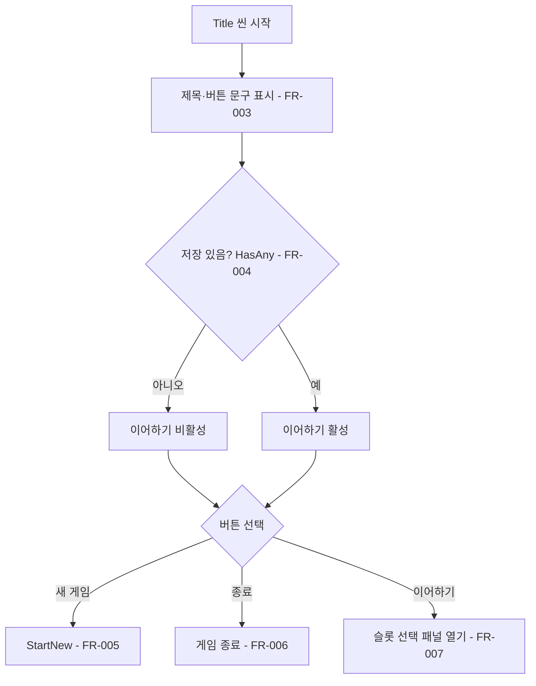
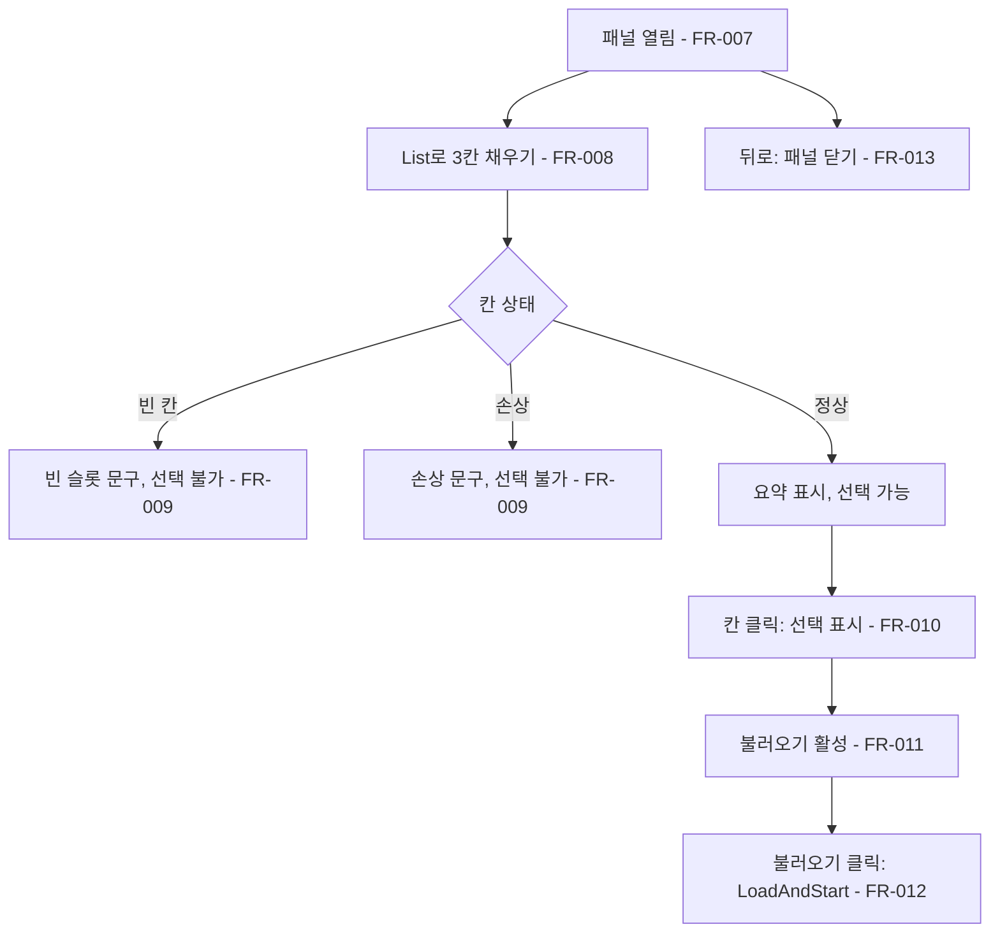
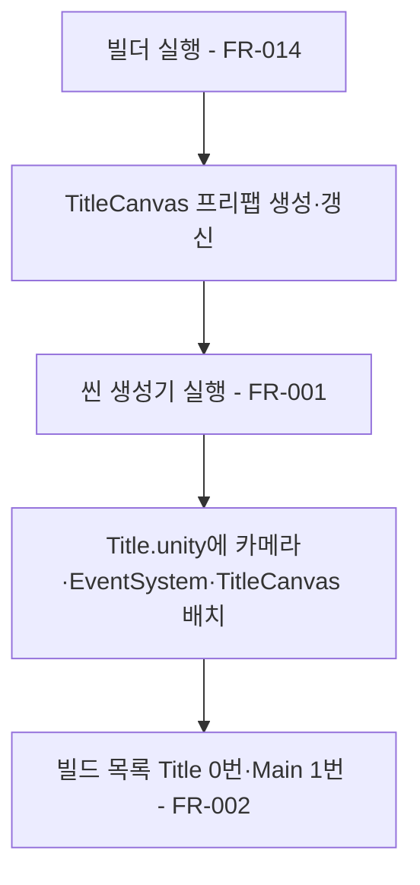

# 타이틀 화면

## 1. 개요

- 목적: 게임을 켜면 먼저 타이틀 화면이 나와 새 게임, 이어하기(저장 슬롯에서 불러오기), 종료를 고르게 한다. 지금은 Main 씬이 바로 시작되어 저장된 게임을 고를 곳이 없다.
- 대상: 플레이어(시작 메뉴 선택), 저장 시스템(스펙 003 `IronRing.Save.SaveSlots`, 슬롯 목록과 씬 전환을 제공).

## 2. 범위

- 포함:
  - 별도 씬 `Assets/Scenes/Title.unity`와 이 씬을 만드는 편집기 생성기, 빌드 목록 순서(Title 0번, Main 1번)
  - 타이틀 화면(초안 A안): 하단 선로와 정차 열차(기관차와 화물칸 두 량), 왼쪽 마스코트, 위 가운데 게임 제목, 오른쪽 세로 버튼 3개(새 게임·이어하기·종료)
  - 이어하기 슬롯 선택 화면: 슬롯 3칸, 고른 뒤 불러오기, 뒤로
  - 화면 문구의 ko.json 키(값은 사용자 검수 뒤에 넣는다)
- 제외:
  - 저장·불러오기 자체, 슬롯 요약 문자열 만들기, 씬 이름 상수(스펙 003, 세션 C)
  - 게임 안 메뉴바의 "타이틀 화면으로"(스펙 003)
  - Main 씬을 편집기에서 바로 Play했을 때의 새 게임 처리(스펙 003의 `PendingLoadSlot` 판정. 4절 접점에 요구만 적는다)
  - 열차·연기 애니메이션, 배경 음악, 설정·크레딧 메뉴

## 3. 기술 방향

- 사용 기술/API: UGUI(`Canvas`, `CanvasScaler`, `Button`, `Image`), TextMeshPro, `EditorSceneManager`·`EditorBuildSettings`(생성기), `UiTheme.asset`(버튼·패널·슬롯 스프라이트, 글꼴, 색), `IronRing.Localization.Strings.Get`.
- 핵심 방식:
  - 타이틀은 Main과 다른 씬이다. Main 씬에는 `GameServices` 조립과 `MainCanvas`가 묶여 있어, 타이틀을 Main 안의 화면으로 두면 메뉴만 보이는 동안에도 게임 서비스가 모두 시작된다. 타이틀 씬에는 카메라, `EventSystem`, `TitleCanvas` 프리팹 인스턴스만 둔다.
  - UI는 프리팹과 편집기 빌더로 만든다. 런타임에는 미리 만든 오브젝트의 글자·활성 상태·스프라이트만 바꾼다.
  - 문구는 `TitleScreen`·`SlotSelectPanel`이 켜질 때 `Strings.Get(key)`로 넣는다.
  - 슬롯 칸은 프리팹에 3칸을 미리 만들어 둔다. 슬롯 수가 바뀌면 빌더의 칸 수 상수를 고친다.
- 선택하지 않은 방식:
  - Main.unity 안의 화면으로 두는 방식(위 이유).
  - `MainCanvas` 아래 화면 프리팹으로 두는 방식. 타이틀 씬에는 MainCanvas가 없으므로 `TitleCanvas`를 따로 둔다.
  - 런타임에 버튼을 코드로 만드는 방식.
- 외부 의존성: 스펙 003의 `IronRing.Save.SaveSlots`(`List()`, `HasAny()`, `StartNew()`, `LoadAndStart(int)`), `SaveSlotInfo`(`Slot`, `IsEmpty`, `IsCorrupt`, `Summary`), `IronRing.Save.SceneNames`(`Title`, `Main`). 문구 키 `save_slot_label`·`save_slot_empty`·`save_slot_corrupt`는 003이 ko.json에 넣는다.

## 4. 구조

| 구분 | 이름 | 역할 |
|------|------|------|
| 클래스 | `IronRing.Title.TitleScreen` | 새 게임·이어하기·종료 버튼 처리, 이어하기 활성 판정, 슬롯 선택 패널 열기 |
| 클래스 | `IronRing.Title.SlotSelectPanel` | 슬롯 3칸 채우기, 선택 상태, 불러오기·뒤로 |
| 클래스 | `IronRing.Title.SlotRowView` | 슬롯 한 칸의 버튼·번호·요약 글자·테두리 |
| 클래스 | `IronRing.Title.Editor.TitleCanvasBuilder` | `TitleCanvas` 프리팹 생성(멱등, GUID 유지) |
| 클래스 | `IronRing.Title.Editor.TitleSceneBuild` | `Title.unity` 생성·갱신과 빌드 목록 순서 맞추기(멱등) |
| 프리팹 | `Assets/Prefabs/UI/Title/TitleCanvas.prefab` | 타이틀 화면과 슬롯 선택 패널 전체 |
| 씬 | `Assets/Scenes/Title.unity` | 게임 첫 씬(빌드 0번) |
| ScriptableObject | `UiTheme`(기존) | 스프라이트·글꼴·색 참조 |

- 오브젝트 구성: `TitleCanvas`(Canvas Screen Space Overlay, CanvasScaler 기준 1920×1080, `TitleScreen`) 아래에 `Background`(돌바닥 타일), `Rail`, `Train`(기관차·화물칸 Image), `Mascot`(Image, `mascot_default`), `GameTitle`(TMP), `MenuButtons`(버튼 3개), `SlotSelectPanel`(처음엔 꺼짐. `Dim`, `Frame`, `Header`, `Slot0~2`(`SlotRowView`), `LoadButton`, `BackButton`)을 둔다.
- 클래스 간 관계: `TitleScreen`이 `SlotSelectPanel`을 직렬화 참조로 열고 닫는다. `SlotSelectPanel`이 `SlotRowView` 3개를 직렬화 참조로 채운다. 두 화면 클래스는 `SaveSlots` 정적 API를 호출만 하고, 씬 전환은 SaveSlots가 한다.
- 실행 순서 의존성: 타이틀 씬에는 `GameServices`가 없다. `TitleScreen.OnEnable`에서 `SaveSlots.HasAny()`를 바로 부를 수 있어야 한다(003은 파일만 읽고 서비스에 기대지 않는다).
- 기존 코드와의 접점:
  - 기존 스크립트는 고치지 않는다. 생성기가 `EditorBuildSettings`의 씬 목록만 바꾼다(Title 0번, Main 1번, 그 밖의 씬은 뒤에 그대로).
  - 스펙 003에 대한 요구: Main 씬이 `PendingLoadSlot` 없이 시작되면(편집기에서 Main을 바로 Play한 경우 포함) 이전 진행 데이터를 버리고 새 게임으로 시작한다. 저장 슬롯 파일은 지우지 않는다.

## 5. 동작 플로우차트

## 6. 요구사항

- FR-001: `TitleSceneBuild.Generate`를 실행할 때 생성기는 `Title.unity`에 카메라, `EventSystem`(InputSystemUIInputModule), `TitleCanvas` 인스턴스 중 없는 것만 만들고 씬을 저장한다. 열린 Main 씬은 바꾸지 않는다.
- FR-002: `TitleSceneBuild.Generate`를 실행할 때 생성기는 빌드 목록을 Title 0번, Main 1번으로 맞추고 그 밖의 씬은 원래 순서대로 뒤에 둔다.
- FR-003: 타이틀 화면이 켜질 때 `TitleScreen`은 제목과 버튼 3개의 문구를 ko.json 키 `title_game_name`·`title_new_game`·`title_continue`·`title_quit`로 채운다.
- FR-004: 타이틀 화면이 켜질 때 `SaveSlots.HasAny()`가 false면 `TitleScreen`은 이어하기 버튼을 비활성으로 둔다.
- FR-005: 새 게임 버튼을 누를 때 `TitleScreen`은 `SaveSlots.StartNew()`를 부른다.
- FR-006: 종료 버튼을 누를 때 `TitleScreen`은 확인 창 없이 게임을 끝낸다(빌드는 `Application.Quit()`, 편집기는 Play 중지).
- FR-007: 이어하기 버튼을 누를 때 `TitleScreen`은 `SlotSelectPanel`을 켠다.
- FR-008: 슬롯 선택 패널이 켜질 때 `SlotSelectPanel`은 `SaveSlots.List()` 결과로 3칸을 채운다. 번호는 `save_slot_label`, 정상 칸의 요약은 `SaveSlotInfo.Summary`를 그대로 쓴다.
- FR-009: 칸이 `IsEmpty`나 `IsCorrupt`일 때 `SlotRowView`는 각각 `save_slot_empty`·`save_slot_corrupt` 문구를 흐린 색으로 보여 주고 버튼을 비활성으로 둔다.
- FR-010: 정상 칸을 누를 때 `SlotSelectPanel`은 그 칸만 선택 테두리(`UiTheme.SlotSelectedSprite`)로 바꾸고 나머지 칸은 기본 테두리로 둔다.
- FR-011: 고른 칸이 있을 때만 불러오기 버튼이 활성이다(패널이 켜질 때는 비활성).
- FR-012: 불러오기 버튼을 누를 때 `SlotSelectPanel`은 불러오기 버튼을 비활성으로 바꾸고 고른 칸 번호로 `SaveSlots.LoadAndStart(slot)`를 한 번 부른다.
- FR-013: 뒤로 버튼을 누를 때 `SlotSelectPanel`은 선택을 지우고 패널을 끈다.
- FR-014: `TitleCanvasBuilder.Generate`를 실행할 때 빌더는 A안 배치(하단 선로·열차, 왼쪽 마스코트, 위 가운데 제목, 오른쪽 세로 버튼)와 슬롯 선택 패널을 가진 `TitleCanvas.prefab`을 만든다. 이미 있으면 GUID를 유지하며 다시 만든다.

### 상태와 데이터

| 이름 | 타입 | 설명 | 초기값 |
|------|------|------|--------|
| `SlotSelectPanel._selectedSlot` | int | 슬롯 패널에서 고른 칸 번호(없으면 -1) | -1 |
| ko.json `title_game_name` | string | 게임 제목 | 사용자 검수 뒤 입력 |
| ko.json `title_new_game` | string | 새 게임 버튼 | 사용자 검수 뒤 입력 |
| ko.json `title_continue` | string | 이어하기 버튼, 슬롯 패널 제목 | 사용자 검수 뒤 입력 |
| ko.json `title_quit` | string | 종료 버튼 | 사용자 검수 뒤 입력 |
| ko.json `title_load` | string | 슬롯 패널 불러오기 버튼 | 사용자 검수 뒤 입력 |
| ko.json `title_back` | string | 슬롯 패널 뒤로 버튼 | 사용자 검수 뒤 입력 |

### 예외 및 경계 조건

- 저장이 모두 비었거나 손상됨: `HasAny()`가 false이므로 이어하기 버튼이 비활성이고 패널을 열 수 없다.
- 패널을 연 사이 저장 상태가 바뀜: 타이틀에서는 저장하지 않으므로 패널을 열 때 한 번만 `List()`를 읽는다.
- `List()`가 3칸보다 적게 돌려줌: 남는 칸은 빈 칸으로 보여 준다. 많으면 앞 3칸만 쓴다.
- 새 게임을 눌렀는데 저장이 있음: 확인 없이 새 게임을 시작한다. 저장 슬롯은 그대로 남는다.
- 마스코트·열차 스프라이트가 없음: 빌더가 예외를 내고 프리팹을 만들지 않는다.

## 7. Inspector 노출값

| 필드 | 타입 | 기본값 | 설명 |
|------|------|--------|------|
| `SlotRowView._mutedColor` | Color | `UiTheme.Muted` | 빈 칸·손상 칸 글자색 |
| `SlotRowView._normalSprite` | Sprite | `UiTheme.SlotSprite` | 고르지 않은 칸 테두리 |
| `SlotRowView._selectedSprite` | Sprite | `UiTheme.SlotSelectedSprite` | 고른 칸 테두리 |

- 열차·마스코트·제목·버튼의 위치와 크기는 프리팹의 RectTransform 값으로 둔다. 빌더는 처음 만들 때만 A안 값을 넣는다.

## 8. 인수 조건

- FR-001: `TitleSceneBuild.Generate`를 실행한 뒤 Title.unity에 카메라·EventSystem·TitleCanvas가 하나씩 있고, 두 번 실행해도 늘지 않는다. `scene list_open`에서 Main.unity가 `isDirty:false`다.
- FR-002: Build Settings 목록 0번이 Title, 1번이 Main이다.
- FR-003: Title.unity에서 Play하면 제목과 버튼 3개에 ko.json 값이 보인다(키 이름이 보이지 않는다).
- FR-004: 저장 파일이 없을 때 Play하면 이어하기 버튼이 흐리고 눌리지 않는다.
- FR-005: 새 게임을 누르면 Main 씬으로 넘어가 새 게임이 시작된다.
- FR-006: 편집기에서 종료를 누르면 Play가 멈춘다.
- FR-007: 저장이 하나 있을 때 이어하기를 누르면 슬롯 선택 패널이 뜬다.
- FR-008: 슬롯 1에 저장한 상태로 패널을 열면 1칸에 슬롯 번호와 요약 한 줄이 보인다.
- FR-009: 빈 칸과 손상 칸(파일을 일부러 깨뜨림)이 흐린 문구로 보이고 클릭해도 반응이 없다.
- FR-010: 정상 칸을 누르면 그 칸만 선택 테두리로 바뀐다.
- FR-011: 패널을 막 열었을 때 불러오기가 비활성이고, 칸을 고르면 활성이 된다.
- FR-012: 불러오기를 누르면 Main 씬으로 넘어가 저장한 마을 상태로 시작한다. 연달아 눌러도 한 번만 넘어간다.
- FR-013: 뒤로를 누르면 패널이 닫히고, 다시 열면 고른 칸이 없다.
- FR-014: 빌더를 두 번 실행해도 `TitleCanvas.prefab` GUID가 같고, Play 캡처가 초안 A안(`Assets/Art/Generated/title/title_a.png`) 배치와 같다. 캡처는 `production/qa/evidence/`에 둔다.

## 9. 미결 사항

- 없음
