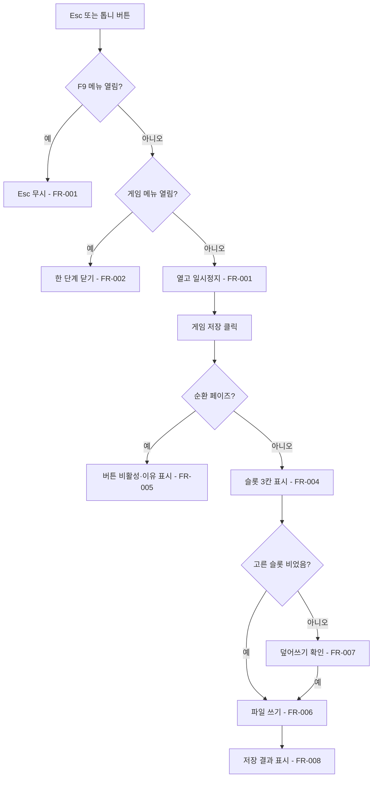
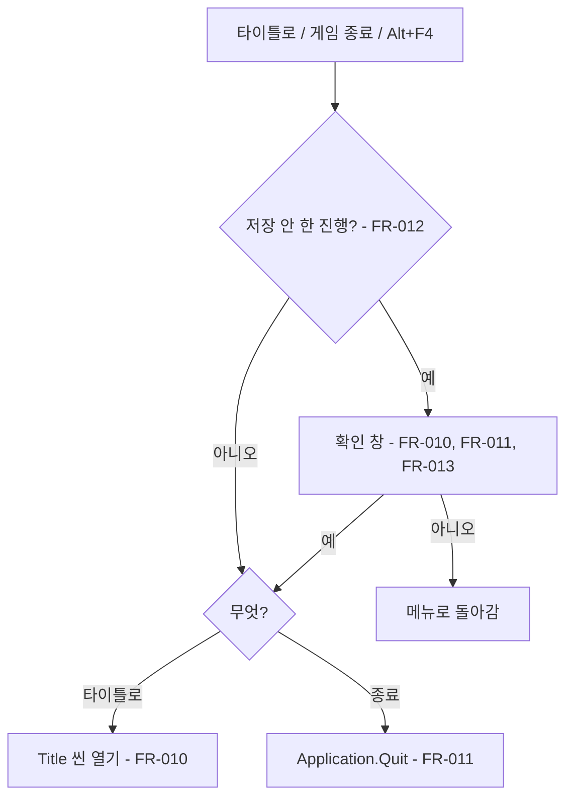
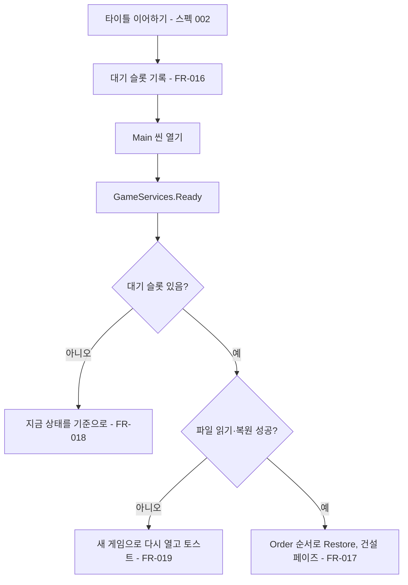

# 게임 메뉴·저장 슬롯·백그라운드 실행

## 1. 개요

- 목적: 플레이 중에 메뉴바를 열어 게임을 저장하고, 타이틀 화면으로 돌아가거나 게임을 끌 수 있게 한다. 저장은 슬롯 3개에 마을 전체 상태를 파일로 남기고, 타이틀 화면(스펙 002)의 이어하기가 그 슬롯을 골라 불러온다. 저장하지 않은 진행을 실수로 잃지 않도록 나가기 전에 확인 창을 띄우고, 창이 포커스를 잃어도 게임이 계속 돌게 하는 백그라운드 실행 토글을 둔다.
- 대상: 플레이어(메뉴·저장·종료), 타이틀 화면(스펙 002: 슬롯 목록·불러오기·새 게임 API 사용), 저장 대상 시스템(상태 꺼내기·되돌리기 구현).

## 2. 범위

- 포함:
  - 게임 메뉴 화면 `GameMenu`: Esc 키와 TopBar 톱니 버튼으로 열고 닫음, 열린 동안 일시정지
  - 메뉴 항목 4개: 게임 저장, 백그라운드 실행 토글, 타이틀 화면으로, 게임 종료
  - 슬롯 고르기 패널(3칸, 칸마다 요약), 덮어쓰기 확인, 순환 페이즈 중 저장 비활성
  - 저장하지 않은 진행이 있을 때 나가기 확인 창(타이틀로·게임 종료·Alt+F4·창 닫기)
  - 저장 시스템 `SaveSlots`: 슬롯 목록·저장·불러오기·새 게임 API, 슬롯 파일 형식
  - 저장 참여 계약 `ISaveParticipant`와 저장 대상 시스템들의 꺼내기·되돌리기 구현
  - 씬 이름 상수 `SceneNames`(Title·Main)
  - 백그라운드 실행 토글(`Application.runInBackground`, PlayerPrefs 기억)
  - 전투 씬이 Main의 Canvas를 끈 동안에는 Esc로 메뉴를 열지 않고, Alt+F4는 확인 창을 보여 줄 수 없으므로 막지 않는다
  - 이 기능의 `ko.json` 키(문구 값은 사용자 검수 뒤 넣는다)
- 제외:
  - 타이틀 화면 자체와 슬롯 고르기 화면 UI(스펙 002)
  - 자동 저장 슬롯
  - 순환 페이즈(원정·운행) 중 상태 저장: 열차 위치, 진행 중 사건, 탑승 중 승객 위치
  - 슬롯 삭제, 슬롯 이름 바꾸기
  - 클라우드 저장, 저장 파일 암호화
  - PlayerPrefs에 이미 있는 기록(승객 발견 `PassengerDiscovery`, 온보딩 열람 `OnboardingProgress`)의 슬롯 이전: 기기 단위 기록으로 그대로 둔다

## 3. 기술 방향

- 사용 기술/API: UGUI(`Button`, `TMP_Text`), `JsonUtility`, `System.IO.File`, `Application.persistentDataPath`, `Application.wantsToQuit`, `Application.Quit`, `Application.runInBackground`, `SceneManager.LoadScene`, `Time.timeScale`, `PlayerPrefs`, Input System `Keyboard.current.escapeKey`.
- 핵심 방식:
  - 저장 파일은 슬롯마다 `persistentDataPath/saves/slot{n}.json` 하나다(n은 1~3). 내용은 `SaveFile { int Version; string SavedAt; SaveHeader Header; SaveEntry[] Entries; }`이고, `SaveEntry { string Key; string Json; }`에 참여 시스템마다 자기 상태 JSON을 담는다.
  - 쓰기는 `slot{n}.json.tmp`에 쓴 뒤 `File.Replace`(처음이면 `File.Move`)로 바꿔 끼워서, 쓰다 끊겨도 기존 파일이 깨지지 않게 한다.
  - 저장 대상 시스템은 `ISaveParticipant`를 구현한다. `SaveInstaller`가 `GameServices.Ready` 뒤에 등록된 서비스 가운데 `ISaveParticipant`인 것을 모아 `Order` 순서로 둔다.
  - 불러오기는 씬을 넘는다. `LoadAndStart(slot)`이 `SaveSlots.PendingLoadSlot`에 슬롯 번호를 적고 Main 씬을 연다. Main의 `SaveInstaller`가 `GameServices.Ready` 뒤에 그 파일을 읽어 참여자마다 `Restore`를 `Order` 순서로 부르고, `PendingLoadSlot`을 비운다.
  - 저장하지 않은 진행의 판정은 상태 비교로 한다. 저장하거나 불러온 순간의 `Entries` 직렬화 문자열을 `_lastSavedState`에 두고, 판정 때 지금 `Capture` 결과와 비교한다(`SavedAt`은 비교에 넣지 않는다). 새 게임 시작 직후 상태도 `_lastSavedState`로 둔다.
- 선택하지 않은 방식:
  - PlayerPrefs에 게임 상태 저장: 크기 제한과 슬롯 구분이 어려워서 쓰지 않는다.
  - 변경 이벤트마다 더티 플래그 세우기: 시스템마다 이벤트를 빠짐없이 달아야 해서 쓰지 않는다.
  - `BinaryFormatter`: 보안 경고 대상이라 쓰지 않는다.
  - 씬을 다시 읽지 않고 그 자리에서 상태만 바꿔 끼우기: 화면·뷰가 모두 다시 그려져야 해서 쓰지 않는다.
- 외부 의존성: `GameServices`(Bootstrap), `UiTheme`, `BuildMainCanvas`, `Localization`, 토스트 화면 `Toast`, 스펙 002 `Title` 씬, 스펙 001 `IronRing.Hud.Onboarding.DevSituationsScreen.IsOpen`.

## 4. 구조

| 구분 | 이름 | 역할 |
|------|------|------|
| 클래스 | `IronRing.Save.SceneNames` | 씬 이름 상수 `Title = "Title"`, `Main = "Main"` |
| 클래스 | `IronRing.Save.SaveSlots` (static) | `SlotCount`, `List()`, `HasAny()`, `Save(slot)`, `LoadAndStart(slot)`, `StartNew()`, `HasUnsavedProgress()`, `PendingLoadSlot` |
| 클래스 | `IronRing.Save.SaveSlotInfo` | 슬롯 표시 정보: `Slot`, `IsEmpty`, `IsCorrupt`, `SavedAt`, `TownTier`, `TownTierName`, `Coins`, `Lap`, `Summary` |
| 클래스 | `IronRing.Save.SaveFile`, `SaveHeader`, `SaveEntry` | 슬롯 파일 직렬화 형식 |
| 클래스 | `IronRing.Save.SaveInstaller` | 참여자 수집, 불러오기 대기 슬롯 복원, `Application.wantsToQuit` 등록·해제 |
| 클래스 | `IronRing.Save.BackgroundRunSetting` (static) | PlayerPrefs `settings_run_in_background` 읽기·쓰기, `Application.runInBackground` 적용 |
| 계약 | `ISaveParticipant` (IronRingContracts.cs 끝에 추가) | `string SaveKey { get; }`, `int Order { get; }`, `string Capture()`, `void Restore(string json)` |
| 클래스 | `IronRing.Hud.GameMenuScreen` | 메뉴 열기·닫기, 일시정지, 항목 버튼, 슬롯 패널, 확인 창 |
| 클래스 | `IronRing.Hud.Editor.Screens.GameMenuScreenBuilder` | `GameMenu` 화면 프리팹 생성 |
| 프리팹 | `Assets/Prefabs/UI/Screens/GameMenu.prefab` | 메뉴 패널·슬롯 패널(3칸)·확인 창 |
| 씬 | `Main.unity` | `MainCanvas` 아래 `GameMenu` 인스턴스(생성기로 추가) |
| ScriptableObject | 해당 없음 | |

- 오브젝트 구성: `MainCanvas/GameMenu` 루트에 `GameMenuScreen`. 자식은 `Dim`(반투명 배경), `MenuPanel`(버튼 4개), `SlotPanel`(슬롯 버튼 3개·닫기), `ConfirmPanel`(문구·예·아니오)이다. 세 패널 가운데 하나만 켠다. TopBar 오른쪽 위에 `GameMenuButton`(톱니)을 두고, 오른쪽 아래 출발 버튼 위치는 바꾸지 않는다.
- 클래스 간 관계: `GameMenuScreen` → `SaveSlots`(저장·판정), `BackgroundRunSetting`, `IPhaseLoop.Phase`(저장 가능 여부). `SaveSlots` → `SaveInstaller`가 모은 `ISaveParticipant` 목록. `SaveInstaller` → `GameServices`. 타이틀(스펙 002) → `SaveSlots.List/HasAny/LoadAndStart/StartNew`.
- 실행 순서 의존성: `SaveInstaller`의 복원은 `GameServices.Ready` 뒤, 화면(View)들이 첫 상태를 그리기 전에 끝나야 한다. 복원이 끝나면 전체 변경 이벤트가 있는 참여자는 그 이벤트를 내서 화면이 다시 그려지게 한다. 항목별 이벤트만 있는 참여자(`HabitatCodex`·`Passengers`·`Ledger`)는 해금 토스트·온보딩이 다시 뜨지 않도록 이벤트를 내지 않고, 화면은 다음에 열거나 그릴 때 새 상태를 읽는다. `BackgroundRunSetting.Apply()`는 `RuntimeInitializeOnLoadMethod(BeforeSceneLoad)`에서 부른다.
- 기존 코드와의 접점(팀원 코드, 수정한 곳마다 무엇을 바꿨는지 한 줄 주석):

| 파일 | 바꿀 내용 |
|------|-----------|
| `Assets/Scripts/Contracts/IronRingContracts.cs` | 끝에 `ISaveParticipant` 계약 추가 |
| `Assets/Scripts/Hud/Editor/BuildMainCanvas.cs` | `SCREEN_IDS`의 `"Onboarding",` 뒤에 `"GameMenu",` 추가 |
| `Assets/Scripts/Hud/Editor/Screens/TopBarScreenBuilder.cs` | 오른쪽 위 톱니 버튼 `GameMenuButton` 추가 |
| `Assets/Scripts/Hud/TopBarScreen.cs` | 톱니 버튼 클릭 시 `GameMenuScreen` 열기 |
| `Assets/Scripts/Interior/HubInterior.cs` | `ISaveParticipant`: 칸 상태(빈칸·잔해 등)와 조사 남은 횟수 |
| `Assets/Scripts/Items/ItemPlacement.cs` | `ISaveParticipant`: 칸에 놓인 아이템과 `_stockPaid` |
| `Assets/Scripts/Items/ItemInventory.cs` | `ISaveParticipant`: 아이템 재고 `_counts` |
| `Assets/Scripts/Inventory/ResourceInventory.cs` | `ISaveParticipant`: 자원 재고 `_stock` |
| `Assets/Scripts/Items/TileStock.cs` | `ISaveParticipant`: 퀵슬롯 재고 `_counts`·`_order` |
| `Assets/Scripts/Economy/MoneyStore.cs` | `ISaveParticipant`: `Balance`와 장부 `_entries` |
| `Assets/Scripts/Habitats/HabitatCodex.cs` | `ISaveParticipant`: 해금 조합·출처·NPC·해금 타일 |
| `Assets/Scripts/Habitats/ClusterHabitatSystem.cs` | `ISaveParticipant`: 잠긴 묶음·플래그. 완성 묶음은 복원된 보드에서 다시 계산 |
| `Assets/Scripts/Npc/NpcRecruiter.cs` | `ISaveParticipant`: 합류한 NPC |
| `Assets/Scripts/Npc/NpcHomes.cs` | `ISaveParticipant`: 숙소 기록·합류 순서 |
| `Assets/Scripts/Npc/Passengers.cs` | `ISaveParticipant`: 방문 횟수 `_visits`(탑승 중 승객은 저장하지 않음) |
| `Assets/Scripts/Economy/Population.cs` | `ISaveParticipant`: 마을별 주민 기록 |
| `Assets/Scripts/Economy/TownTiers.cs` | `ISaveParticipant`: 마을 단계·해금 조합·업그레이드·정류장·열린 거점 |
| `Assets/Scripts/Hub/RunState.cs` | `ISaveParticipant`: 거점 상태·정착 여부·닫힌 거점·마을 연결 |
| `Assets/Scripts/Track/RingTrack.cs` | `ISaveParticipant`: 바퀴 수 `LapCount`. 복원 때 열차를 거점 정차 위치에 둔다 |
| `Assets/Scripts/Track/PhaseLoop.cs` | `ISaveParticipant`: 바퀴 수 `Lap`. 복원 때 건설 페이즈로 둔다 |
| `Assets/Scripts/Hud/Hotbar/HotbarScreen.cs` | `ISaveParticipant`: 퀵슬롯 배정 `_slots`(FR-020) |
| `Assets/Scripts/Economy/MoneyStore.cs`의 `Ledger` | `ISaveParticipant`(키 `ledger`, Order 81): 장부 항목과 현재 바퀴 |
| `Assets/Scripts/Combat/TrainArmament.cs`, `BattleHintJournal.cs` | 저장용 꺼내기·되돌리기·새 게임 초기화 메서드. `Save/CombatSaveParticipants.cs` 래퍼가 `ISaveParticipant`(키 `trainArmament` Order 85, `battleHintJournal` Order 86)로 참여시키고, 새 게임 때 `SaveInstaller`가 비운다 |
| `Assets/Scripts/Track/LineOpener.cs` | `ISaveParticipant`(키 `lineOpener`, Order 65): 열린 선로. 복원 때 `Open()`으로 거점 열기·마을 연결을 다시 붙인다 |
| `Assets/Scripts/Hub/HubState.cs` | 복원용 internal 메서드 |
| `Assets/Scripts/Hud/Ui/ToastScreen.cs` | 복원 중(`SaveSlots.IsRestoring`)에는 토스트를 띄우지 않음 |
| `Assets/Scripts/Save/MainSceneReentry.cs`(새 파일) | Main 재진입 때 설치기·화면의 초기화 훅을 첫 진입과 같은 순서로 다시 부름(FR-021) |
| `GameServices.Composing`·`Ready`를 구독하는 설치기 전부 | Main 재진입 때 다시 구독하고 설치 표시를 지우는 경로(FR-021) |

  위 표의 필드 가운데 다른 값에서 계산되는 값은 저장하지 않고 `Restore` 뒤에 다시 계산한다. 구현 중 표에 없는 상태 보유 클래스를 찾으면 구현을 멈추고 이 표에 추가하는 스펙 수정을 제안한다.

- 참여자 복원 순서(`Order`): 10 `HubInterior` → 20 `ResourceInventory` → 21 `ItemInventory` → 22 `TileStock` → 30 `ItemPlacement` → 40 `ClusterHabitatSystem` → 50 `HabitatCodex` → 55 `HotbarScreen` → 60 `NpcRecruiter` → 61 `NpcHomes` → 62 `Passengers` → 65 `LineOpener` → 70 `RunState` → 71 `Population` → 72 `TownTiers` → 80 `MoneyStore` → 81 `Ledger` → 85 `TrainArmament` → 86 `BattleHintJournal` → 90 `RingTrack` → 91 `PhaseLoop`.

## 5. 동작 플로우차트

### 메뉴 열기와 저장

### 나가기 확인

### 불러오기

## 6. 요구사항

- FR-001: 게임 메뉴가 닫혀 있고 `DevSituationsScreen.IsOpen`이 false일 때 Esc를 누르거나 TopBar 톱니 버튼을 누르면 `GameMenuScreen`은 메뉴 패널을 열고 `Time.timeScale`을 0으로 둔다. `DevSituationsScreen.IsOpen`이 true이면 Esc를 무시한다.
- FR-002: 게임 메뉴가 열려 있을 때 Esc나 톱니 버튼을 누르면 `GameMenuScreen`은 열린 패널을 한 단계 닫는다. 확인 창과 슬롯 패널은 메뉴 패널로, 메뉴 패널은 메뉴 전체 닫기로 간다. 메뉴 전체를 닫을 때 `Time.timeScale`을 열기 전 값으로 되돌린다.
- FR-003: 메뉴 패널이 열릴 때 `GameMenuScreen`은 "게임 저장", "백그라운드 실행: 켜짐/꺼짐", "타이틀 화면으로", "게임 종료" 버튼 4개를 이 순서로 보여 준다.
- FR-004: "게임 저장"을 누르면 `GameMenuScreen`은 슬롯 패널을 열고 `SaveSlots.List()` 결과로 3칸을 채운다. 빈 칸은 `save_slot_empty`, 손상된 칸은 `save_slot_corrupt`, 그 밖에는 `Summary`를 보여 준다.
- FR-005: `IPhaseLoop.Phase`가 `Circulate`일 때 `GameMenuScreen`은 "게임 저장" 버튼을 비활성으로 두고 그 아래에 `game_menu_save_blocked` 문구를 보여 준다.
- FR-006: 슬롯 칸을 고르고 그 슬롯이 비었거나 덮어쓰기를 확인했을 때 `SaveSlots.Save(slot)`은 참여자마다 `Capture()`를 불러 `SaveFile`을 만들고, 임시 파일에 쓴 뒤 `slot{n}.json`으로 바꿔 끼운다.
- FR-007: 고른 슬롯에 저장이 있을 때(손상 포함) `GameMenuScreen`은 `game_menu_overwrite_confirm` 확인 창을 띄우고, "예"일 때만 FR-006을 실행한다.
- FR-008: 저장이 성공하면 `GameMenuScreen`은 슬롯 칸 요약을 새로 그리고 `game_menu_saved` 토스트를 띄운다. 입출력 예외로 실패하면 `game_menu_save_failed` 토스트를 띄우고 기존 파일을 그대로 둔다.
- FR-009: "백그라운드 실행" 버튼을 누르면 `BackgroundRunSetting`은 값을 뒤집어 `Application.runInBackground`에 적용하고 PlayerPrefs `settings_run_in_background`(1/0)에 저장한다. 버튼 문구는 `game_menu_background_on`/`game_menu_background_off`로 바뀐다. 게임 시작 때 저장값이 없으면 1(켜짐)로 적용한다.
- FR-010: "타이틀 화면으로"를 누르면 `GameMenuScreen`은 FR-012 판정이 참일 때 `game_menu_leave_confirm` 확인 창을 띄우고, 거짓이거나 "예"를 누르면 `Time.timeScale`을 1로 되돌린 뒤 `SceneManager.LoadScene(SceneNames.Title)`을 부른다.
- FR-011: "게임 종료"를 누르면 `GameMenuScreen`은 FR-012 판정이 참일 때 `game_menu_quit_confirm` 확인 창을 띄우고, 거짓이거나 "예"를 누르면 종료 허용 표시를 세운 뒤 `Application.Quit()`을 부른다. 편집기에서는 `EditorApplication.isPlaying = false`로 Play Mode를 멈춘다.
- FR-012: 나가기 판정 때 `SaveSlots.HasUnsavedProgress()`는 `IPhaseLoop.Phase`가 `Circulate`이면(운행 진행은 저장되지 않으므로) true를, 그 밖에는 지금 참여자 `Capture()`로 만든 `Entries` 직렬화 문자열이 `_lastSavedState`와 다르면 true를 돌려준다.
- FR-013: Alt+F4나 창 닫기로 `Application.wantsToQuit`이 불렸을 때 `SaveInstaller`는 종료 허용 표시가 없고 FR-012가 참이면 false를 돌려줘 종료를 막고, 게임 메뉴를 FR-011과 같은 확인 창 상태로 연다.
- FR-014: `SaveSlots.List()`는 슬롯 1~3마다 `SaveSlotInfo`를 돌려준다. 파일이 없으면 `IsEmpty=true`, 읽거나 해석하지 못하면 `IsCorrupt=true`, 그 밖에는 `Header`에서 `SavedAt`·`TownTier`·`TownTierName`·`Coins`·`Lap`을 채우고 `Summary`를 `save_slot_summary` 형식으로 만든다.
- FR-015: `SaveSlots.HasAny()`는 `IsEmpty`도 `IsCorrupt`도 아닌 슬롯이 하나라도 있으면 true를 돌려준다. `List()`와 `HasAny()`는 타이틀 씬에서 `GameServices` 없이 불리므로 슬롯 파일과 `Localization`만 쓰고 서비스에 기대지 않는다.
- FR-016: `SaveSlots.LoadAndStart(slot)`은 `PendingLoadSlot`에 슬롯 번호를 적고 `SceneManager.LoadScene(SceneNames.Main)`을 부른다. `SaveSlots.StartNew()`는 `PendingLoadSlot`을 0으로 두고 같은 씬을 연다.
- FR-017: Main 씬에서 `GameServices.Ready` 뒤 `PendingLoadSlot`이 1 이상이면 `SaveInstaller`는 그 파일의 `Entries`를 참여자 `Order` 순서로 `Restore`하고, 열차를 거점에 정차한 건설 페이즈로 두고, `_lastSavedState`를 불러온 상태로 두고, `PendingLoadSlot`을 0으로 되돌린다. 파일에 없는 키의 참여자는 건드리지 않는다.
- FR-018: Main 씬에서 `GameServices.Ready` 뒤 `PendingLoadSlot`이 0이면(새 게임, 또는 편집기에서 Main을 바로 Play) `SaveInstaller`는 아무것도 복원하지 않은 새 게임 상태로 두고, 그 상태를 `_lastSavedState`로 둔다. 슬롯 파일은 지우지 않는다.
- FR-019: 불러오기 중 파일을 읽지 못하거나 `Restore`가 예외를 내면 `SaveInstaller`는 남은 복원을 멈추고 `StartNew()`로 Main 씬을 다시 연 뒤 `save_load_failed` 토스트를 띄운다.

- FR-020: 참여자를 모을 때 `SaveInstaller`는 서비스 외에 씬의 `MonoBehaviour` 가운데 `ISaveParticipant`를 구현한 것도 모은다. `HotbarScreen`은 `ISaveParticipant`(키 `hotbar`, Order 55, 도감 복원 뒤)를 구현해 퀵슬롯 9칸 배정 `_slots`를 저장·복원하고 칸을 다시 그린다.
- FR-021: 같은 플레이 세션에서 Main 씬을 다시 열 때(타이틀에서 새 게임·이어하기, 불러오기 실패 뒤 새 게임) 모든 설치기는 처음 열 때와 같이 `GameServices.Composing`·`Ready`에 다시 구독하고 설치 여부 표시를 지운 상태에서 조립된다. `GameServices.Reset()`이 구독을 지우므로, `SceneManager.sceneLoaded`에서 Main이 열릴 때 설치기마다 구독·설치 표시를 다시 세우는 재진입 경로를 둔다.

### 상태와 데이터

| 이름 | 타입 | 설명 | 초기값 |
|------|------|------|--------|
| `SaveSlots.SlotCount` | const int | 슬롯 수 | 3 |
| `SaveSlots.PendingLoadSlot` | static int | 씬을 넘어 전달하는 불러올 슬롯(0이면 새 게임) | 0 |
| `SaveSlots._lastSavedState` | static string | 마지막 저장·불러오기·새 게임 시점의 `Entries` 직렬화 | null |
| `SaveSlots._quitAllowed` | static bool | 종료 허용 표시(FR-011·FR-013) | false |
| `SaveSlots._loadFailed` | static bool | 다시 연 Main 씬에서 실패 토스트를 띄울지(FR-019) | false |
| `SaveFile.Version` | int | 저장 형식 버전 | 1 |
| `SaveFile.SavedAt` | string | ISO 8601 저장 시각(현지 시각) | 저장 때 |
| `SaveHeader` | {int TownTier; string TownTierName; int Coins; int Lap;} | 슬롯 요약용 | 저장 때 |
| `SaveEntry` | {string Key; string Json;} | 참여자별 상태 | 저장 때 |
| PlayerPrefs `settings_run_in_background` | int | 백그라운드 실행 1/0 | 없으면 1 |
| `GameMenuScreen._previousTimeScale` | float | 메뉴 열기 전 시간 배율 | 1 |

`ko.json` 키(값은 사용자 검수 뒤 끝에 추가): `game_menu_title`, `game_menu_save`, `game_menu_background_on`, `game_menu_background_off`, `game_menu_to_title`, `game_menu_quit`, `game_menu_save_blocked`, `game_menu_overwrite_confirm`, `game_menu_leave_confirm`, `game_menu_quit_confirm`, `game_menu_yes`, `game_menu_no`, `game_menu_close`, `game_menu_saved`, `game_menu_save_failed`, `save_slot_label`, `save_slot_empty`, `save_slot_corrupt`, `save_slot_summary`, `save_load_failed`.

### 예외 및 경계 조건

- 순환 페이즈 중 메뉴 열기: 메뉴는 열리고 일시정지된다. 저장만 비활성이다(FR-005).
- 저장 파일 버전이 `SaveFile.Version`보다 크다: 손상으로 본다(`IsCorrupt=true`).
- `saves` 폴더가 없다: 첫 저장 때 만든다.
- 편집기 Play Mode 중지: `Application.wantsToQuit`이 불리지 않으므로 확인 창이 뜨지 않는다. FR-013은 빌드 실행 파일에서만 확인한다.
- 데모 인자(`--loop-demo` 등)로 실행: 데모 드라이버가 `runInBackground`를 켜는 동작은 그대로 두고, `wantsToQuit` 가로채기를 하지 않는다(데모 자동 종료를 막지 않기 위해).
- 확인 창이 떠 있는 동안 Alt+F4를 다시 누름: 같은 확인 창을 유지한다.
- 메뉴가 열린 채 씬 전환: 전환 전에 `Time.timeScale`을 1로 되돌린다.
- 온보딩 팝업이 떠 있을 때 Esc: 온보딩 팝업은 Esc를 쓰지 않으므로 게임 메뉴가 열린다.
- F9 메뉴: F9로 열고 닫으며 Esc를 쓰지 않는다(스펙 001). 열려 있는 동안 게임 메뉴는 Esc를 무시한다.

## 7. Inspector 노출값

해당 없음

## 8. 인수 조건

- FR-001: Play Mode에서 Esc를 누른다 → 메뉴가 뜨고 열차·시간이 멈춘다. 톱니 버튼도 같다. F9 메뉴를 연 채 Esc → 게임 메뉴가 뜨지 않는다.
- FR-002: 메뉴를 연 채 Esc → 메뉴가 닫히고 시간이 다시 흐른다. 슬롯 패널에서 Esc → 메뉴 패널로 돌아간다.
- FR-003: 메뉴를 열면 버튼 4개가 위 순서로 보인다(캡처).
- FR-004: 슬롯 1에만 저장한 상태에서 "게임 저장" → 1칸은 요약, 2·3칸은 빈 슬롯 문구가 보인다. 슬롯 2 파일 내용을 깨뜨린 뒤 열면 손상 문구가 보인다.
- FR-005: 출발해 순환 페이즈일 때 메뉴를 연다 → "게임 저장"이 회색이고 이유 문구가 보인다.
- FR-006: 빈 슬롯 1을 고른다 → `persistentDataPath/saves/slot1.json`이 생기고 `Entries`에 참여자 키가 모두 있다.
- FR-007: 저장된 슬롯 1을 다시 고른다 → 덮어쓰기 확인이 뜬다. "아니오"면 파일 수정 시각이 그대로다.
- FR-008: 저장 직후 토스트가 뜨고 칸 요약의 시각이 바뀐다. 파일을 읽기 전용으로 바꾸고 저장 → 실패 토스트, 파일 내용 그대로.
- FR-009: 토글을 끈다 → 문구가 꺼짐으로 바뀌고 다른 창을 누르면 게임이 멈춘다. Play를 다시 시작해도 꺼짐이 유지된다. PlayerPrefs 키를 지우고 시작하면 켜짐이다.
- FR-010: 저장 직후 "타이틀 화면으로" → 확인 없이 Title 씬. 칸 하나에 재료를 놓은 뒤 누르면 확인 창이 뜬다.
- FR-011: 저장 직후 "게임 종료" → 바로 종료(빌드). 재료를 놓은 뒤 누르면 확인 창이 뜬다.
- FR-012: 저장 → 재료 놓기 → 그 재료를 집어 원래대로 → "게임 종료" 시 확인 창이 뜨지 않는다(상태가 같으므로).
- FR-013: 빌드 실행 파일에서 재료를 놓은 뒤 Alt+F4 → 창이 닫히지 않고 확인 창이 뜬다. "예" → 종료. 저장 직후 Alt+F4 → 바로 종료.
- FR-014: 슬롯 3칸의 `List()` 결과를 로그로 찍어 빈·손상·정상이 맞는지 확인한다.
- FR-015: 모든 슬롯이 비었거나 손상일 때 `HasAny()`가 false, 정상 슬롯 하나가 생기면 true(로그).
- FR-016: 타이틀에서 이어하기 → Main 씬이 열린다. 새 게임 → 처음 상태로 열린다.
- FR-017: 건물 하나 완성·동전 변화·해금 하나 후 저장 → 타이틀 → 이어하기 → 보드·창고·퀵슬롯·동전·해금·주민·마을 단계·바퀴 수가 저장 때와 같고 건설 페이즈다(전후 캡처 비교).
- FR-018: 새 게임 시작 직후 "게임 종료" → 확인 창 없이 종료.
- FR-019: 슬롯 파일의 한 `Entry.Json`을 깨뜨리고 이어하기 → 새 게임 상태로 열리고 실패 토스트가 뜬다.
- FR-020: 퀵슬롯 3번 칸에 다른 재료를 배정하고 저장 → 이어하기 → 3번 칸 배정이 같다.
- FR-021: 한 Play 안에서 Main → 타이틀 → 새 게임 → 타이틀 → 이어하기를 거쳐도 보드·퀵슬롯·HUD가 정상으로 뜨고 로그에 설치 누락 경고가 없다.

## 9. 미결 사항

- 없음
