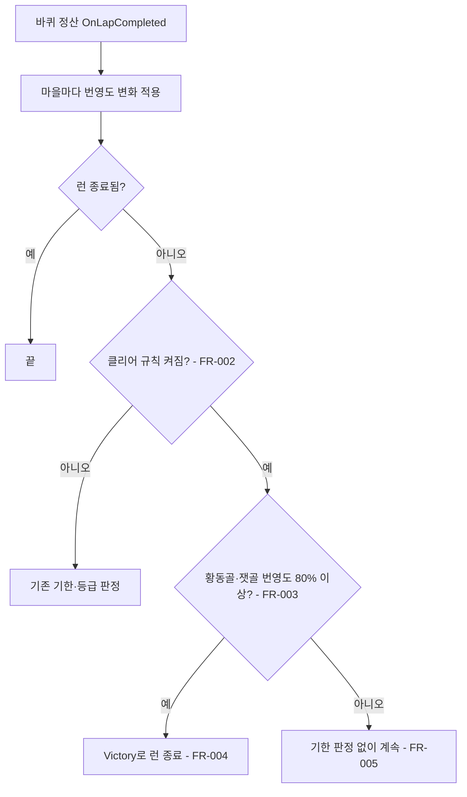
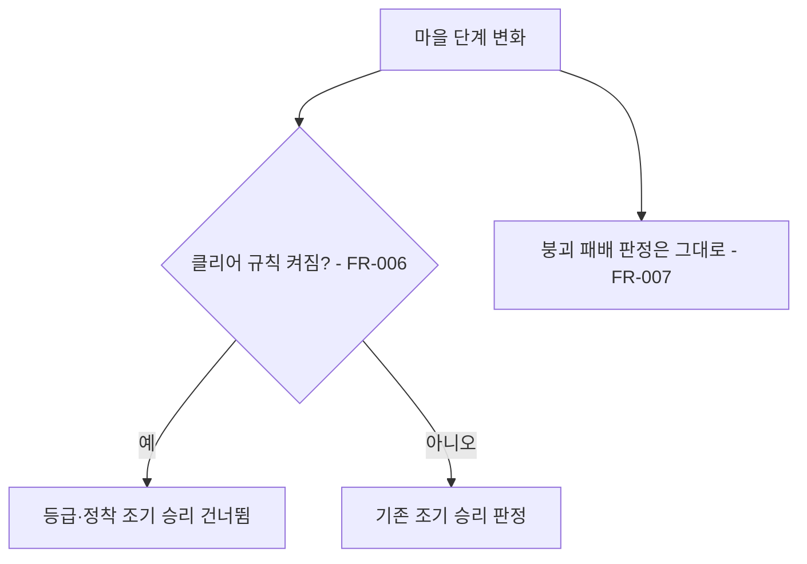

# 번영도 클리어 조건

## 1. 개요

- 목적: 게임 클리어 조건을 "바퀴 정산 때 황동골과 잿골의 번영도가 각각 최대치의 80% 이상"으로 바꾼다. 지금은 바퀴 기한이 끝날 때 마을 등급이나 정착 수로 승패를 가르거나, 목표 등급에 닿으면 곧바로 승리한다.
- 대상: 런 판정(`IronRing.Hub.RunState`), 데이터 제작자(`HubProfiles.json`), 결과 화면(기존 승리 결과를 그대로 받음).

## 2. 범위

- 포함:
  - `HubProfiles.json`에 클리어 비율 `_clearProsperityRatio`(0.8) 추가
  - 바퀴 정산 때 황동골·잿골(잿골이 잠겨 있어도 포함) 번영도 판정과 승리 처리
  - 클리어 규칙이 켜져 있을 때 바퀴 기한 판정, 마을 등급 승리, 전 거점 정착 조기 승리를 끄기
- 제외:
  - 결과 화면 UI 변경(기존 Victory 결과를 그대로 쓴다)
  - 번영도 계산식, 마을 붕괴·파산 패배 규칙(그대로 둔다)
  - 번영도 진행을 보여 주는 HUD

## 3. 기술 방향

- 사용 기술/API: 기존 `RunState.OnLapCompleted`, `HubState.Prosperity`, `HubDefinition.Maximum`, `HubRunRules`, `JsonUtility`.
- 핵심 방식:
  - 마을 하나의 비율은 `Prosperity / Definition.Maximum`이다. `HubIds`(런에 들어오는 마을: 황동골 hub-1, 잿골 hub-2. 잠긴 잿골도 포함)가 모두 비율 이상일 때만 클리어한다.
  - 판정은 `OnLapCompleted`에서 모든 마을의 바퀴 번영도 변화를 적용한 직후에 한 번 한다. 번영도가 바퀴 중간에 바뀌어도 그때는 판정하지 않는다.
  - 클리어하면 기존 `End(RunOutcome.Victory, RunLossReason.None, true)`로 런을 끝낸다. 결과 화면과 열차 정지는 기존 흐름을 탄다.
  - `_clearProsperityRatio`가 0 이하이거나 없으면 클리어 규칙이 꺼지고, 지금의 기한·등급 규칙이 그대로 동작한다.
- 선택하지 않은 방식:
  - `_deadlineLaps`를 0으로 바꿔 기한을 없애는 방식. `HubRunRules`가 1 미만을 예외로 막으므로, 값은 두고 클리어 규칙이 켜지면 기한 판정을 건너뛴다.
  - 번영도가 바뀔 때마다 판정하는 방식(사용자 결정: 바퀴 정산 때만).
- 외부 의존성: 없음(Hub 시스템 안에서 끝난다).

## 4. 구조

| 구분 | 이름 | 역할 |
|------|------|------|
| 클래스 | `IronRing.Hub.HubData` | `_clearProsperityRatio` 읽기 |
| 클래스 | `IronRing.Hub.HubRunRules` | `ClearProsperityRatio`, `UsesProsperityClear` 보관 |
| 클래스 | `IronRing.Hub.RunState` | 정산 때 클리어 판정, 클리어 규칙이 켜지면 기한·등급·정착 승리 건너뛰기 |
| 데이터 | `Assets/Scripts/Hub/Data/HubProfiles.json` | `_clearProsperityRatio: 0.8` |
| 프리팹 | 해당 없음 | |
| 씬 | 해당 없음 | |
| ScriptableObject | 해당 없음 | |

- 오브젝트 구성: 해당 없음(순수 C# 로직과 데이터).
- 클래스 간 관계: `HubData.Parse`가 `HubRunRules`에 비율을 넘기고, `RunState`가 `_rules.UsesProsperityClear`를 보고 판정한다.
- 실행 순서 의존성: 한 바퀴 안에서 모든 마을의 `ApplyDelta`가 끝난 뒤 판정한다. 그 사이 붕괴로 런이 끝났으면 판정하지 않는다.
- 기존 코드와의 접점(팀원 코드 수정, 수정한 곳에 한 줄 주석):
  - `HubData`: 필드 `_clearProsperityRatio` 추가, `HubRunRules` 생성 인자 추가
  - `HubRunRules`: 생성자 선택 인자 `clearProsperityRatio`(기본 0)와 프로퍼티 추가
  - `RunState.OnLapCompleted`: 번영도 적용 뒤 클리어 판정, 켜져 있으면 기한 판정 전에 반환
  - `RunState`의 단계 변화 처리(등급 조기 승리, 전 거점 정착 조기 승리): 클리어 규칙이 켜져 있으면 건너뛴다

## 5. 동작 플로우차트

## 6. 요구사항

- FR-001: 마을 데이터를 읽을 때 `HubData.Parse`는 `_clearProsperityRatio`를 `HubRunRules.ClearProsperityRatio`로 넘긴다. 값이 없거나 0 이하면 클리어 규칙은 꺼진다.
- FR-002: 바퀴 정산 때 클리어 규칙이 꺼져 있으면 `RunState`는 기존 기한·등급 판정을 그대로 한다.
- FR-003: 클리어 규칙이 켜진 상태로 바퀴 정산이 끝나면 `RunState`는 `HubIds`의 마을(황동골·잿골, 잠긴 잿골 포함)이 `Prosperity / Maximum ≥ ClearProsperityRatio`인지 판정한다.
- FR-004: FR-003 판정이 참일 때 `RunState`는 `RunOutcome.Victory`로 런을 끝낸다(조기 종료 표시 true). 로그에 `RUN END: outcome=Victory`가 남는다.
- FR-005: 클리어 규칙이 켜져 있으면 `RunState`는 바퀴 기한(`LapsUntilDeadline`)을 줄이지 않고, 기한으로 런을 끝내지 않는다.
- FR-006: 클리어 규칙이 켜져 있으면 `RunState`는 마을 등급 도달 조기 승리와 전 거점 정착 조기 승리를 하지 않는다.
- FR-007: 클리어 규칙이 켜져 있어도 마을 붕괴 패배와 파산 패배는 지금과 같이 동작한다.
- FR-008: `HubProfiles.json`의 `_clearProsperityRatio`는 0.8이다.

### 상태와 데이터

| 이름 | 타입 | 설명 | 초기값 |
|------|------|------|--------|
| `HubProfiles.json _clearProsperityRatio` | float | 클리어 비율(마을마다 번영도 / 최대치) | 0.8 |
| `HubRunRules.ClearProsperityRatio` | float | 위 값(0 이하면 꺼짐) | 0 |
| `HubRunRules.UsesProsperityClear` | bool | `ClearProsperityRatio > 0` | false |

### 예외 및 경계 조건

- 번영도가 정확히 80: 80 / 100 = 0.8이므로 클리어다(이상 비교).
- 잠긴 잿골: 열리지 않아 번영도가 오르지 않으면 클리어할 수 없다(사용자 결정: 황동골·잿골 둘 다).
- 붕괴한 마을: 번영도가 더 오르지 않으므로 클리어할 수 없다. 패배 판정은 기존 규칙을 따른다.
- 같은 바퀴에 붕괴 패배와 클리어 조건이 함께 생김: 마을별 변화 적용 중 붕괴로 런이 먼저 끝나므로 패배다.
- `Maximum`이 0인 마을: 데이터 검증(`HubDefinition`)에서 최대치가 최소치보다 커야 하므로 생기지 않는다.

## 7. Inspector 노출값

| 필드 | 타입 | 기본값 | 설명 |
|------|------|--------|------|
| `HubProfiles.json _clearProsperityRatio` | float | 0.8 | 클리어 비율. 0이면 기존 기한·등급 규칙으로 돌아간다 |

## 8. 인수 조건

- FR-001: 편집기 eval로 `HubData.Parse(HubProfiles.json)` 결과의 `ClearProsperityRatio`가 0.8인지 본다. `_clearProsperityRatio`를 지운 json으로 파싱하면 0이다.
- FR-002: `_clearProsperityRatio`를 0으로 두고 Play하면 기존처럼 기한 바퀴 수가 줄어든다(로그·HUD).
- FR-003: Play 중 eval로 황동골은 100, 잿골은 79로 두고 바퀴를 넘기면 런이 끝나지 않는다.
- FR-004: 잿골을 80으로 올리고 바퀴를 넘기면 `RUN END: outcome=Victory` 로그와 승리 결과 화면이 나온다. 캡처는 `production/qa/evidence/`에 둔다.
- FR-005: 클리어 규칙이 켜진 채 21바퀴 이상 진행해도 기한으로 런이 끝나지 않는다(데모 인자로 바퀴를 빠르게 넘긴다).
- FR-006: 황동골 등급이 목표 등급에 닿아도 런이 끝나지 않는다.
- FR-007: 마을이 붕괴하면 지금처럼 패배로 끝난다.
- FR-008: `HubProfiles.json`에 `"_clearProsperityRatio": 0.8`이 있다.

## 9. 미결 사항

- 없음
