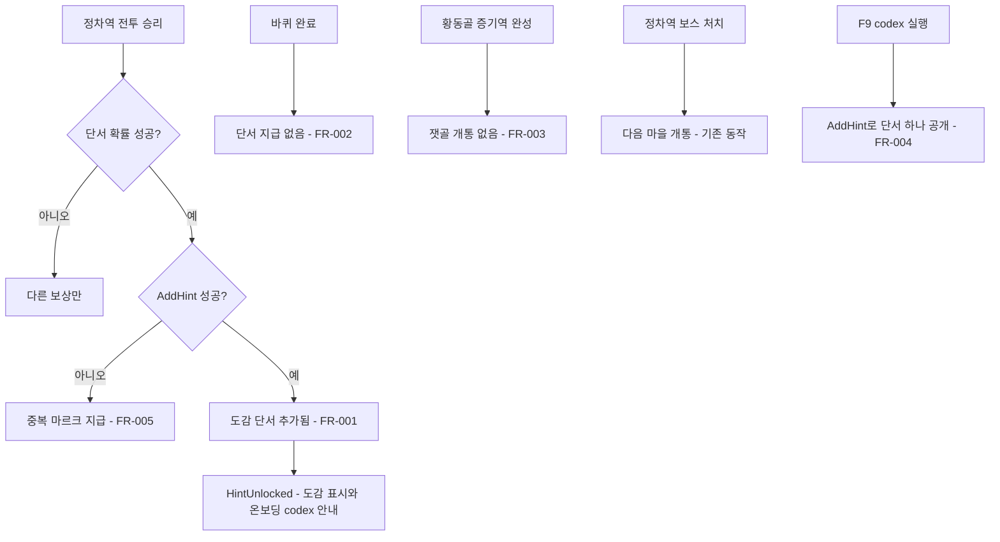

# 전투 보상 단서와 보스 개통 규칙 맞추기

## 1. 개요

- 목적: dev 병합으로 `design/game-brief.md` 규칙이 "설계 단서는 정차역 전투의 확률 보상", "다음 마을 선로는 정차역 보스 처치로 개통"으로 바뀌었지만, 코드에는 옛 경로(바퀴마다 단서 확정 지급, 증기역 완성으로 잿골 개통)가 남아 있고 전투 보상 단서가 도감에 반영되지 않는다. 코드를 바뀐 규칙에 맞춘다.
- 대상: 플레이어(도감에서 전투로 얻은 단서 확인), 온보딩(스펙 001의 `codex` 항목 발생과 F9 재현).

## 2. 범위

- 포함:
  - 전투 보상으로 얻은 설계 단서를 `HabitatCodex` 단서 상태에 넣고 `HintUnlocked`를 낸다.
  - 바퀴 완료 때 단서를 확정 지급하던 `HabitatCodex`의 `LapCompleted` 구독을 뺀다.
  - 황동골 증기역 완성으로 잿골을 열던 `EconomyInstaller`의 호출을 뺀다(보스 처치 개통은 `BattlePocDriver.Finish`에 이미 있다).
  - 스펙 001 F9 `codex` 재현을 새 단서 경로로 바꾼다.
- 제외:
  - 전투 보상 확률·마르크 수치 변경(`rules.Economy.HintChance` 등은 그대로)
  - 보스 전투 흐름, 포탑, 적 구성 변경
  - `BattleHintJournal`의 저장·새 게임 초기화(스펙 003 후속, 세션 C 담당)

## 3. 기술 방향

- 사용 기술/API: 기존 `HabitatCodex`, `BattleIntegration.ResolveReward`, `EconomyInstaller`, `OnboardingSituations`
- 핵심 방식:
  - `HabitatCodex`에 공개 메서드 `bool AddHint(string typeId)`를 추가한다. 이미 지었거나, 이미 단서가 있거나, 모르는 id면 false를 돌려준다. 아니면 단서 목록에 넣고 `HintUnlocked(typeId)`를 낸 뒤 true를 돌려준다. 저장·복원은 기존 단서 목록(`_hinted`)을 그대로 쓴다.
  - `BattleIntegration.ResolveReward`가 단서를 뽑으면 `BattleHintJournal.Record`와 함께 `AddHint`를 부른다. 중복 단서 마르크는 `AddHint`가 false일 때(이미 알거나, 이미 단서가 있거나, 이미 지은 건물) 지급한다. 단서가 어느 경로(전투, 저장 복원, F9)로 들어왔든 같은 판정을 쓴다.
  - `HabitatCodex` 생성자의 `LapCompleted` 구독을 지운다. `OnLapCompleted`의 다음 단서 고르기 로직은 공개 메서드 `NextHintCandidate()`로 남겨 F9 재현이 쓴다.
  - `EconomyInstaller.OnHabitatCompleted`의 잿골 개통 호출을 지운다.
- 선택하지 않은 방식: 단서 저장소를 `BattleHintJournal` 하나로 합치지 않는다(도감·저장·온보딩이 모두 `HabitatCodex`를 보므로 범위가 커진다).
- 외부 의존성: 스펙 006(디펜스 숨김)이 켜져 있는 동안에는 이 스펙을 구현하지 않는다. 숨긴 동안 단서와 잿골 개통은 이 스펙이 지우려는 옛 경로를 쓴다. `BattlePocDriver.Finish`(보스 처치 개통, 변경 없음), `CodexScreen`(`HasHint`·`HintUnlocked`로 단서 표시, 변경 없음), 스펙 001 `OnboardingDirector`(`HintUnlocked`로 codex 안내 발생, 변경 없음)

## 4. 구조

| 구분 | 이름 | 역할 |
|------|------|------|
| 클래스 | `HabitatCodex` | `AddHint`·`NextHintCandidate` 추가, 바퀴 단서 구독 제거 |
| 클래스 | `BattleIntegration` | 전투 보상 단서를 `AddHint`로 도감에 반영 |
| 클래스 | `EconomyInstaller` | 증기역 완성 잿골 개통 호출 제거 |
| 클래스 | `OnboardingSituations` | F9 `codex` 재현을 `AddHint(NextHintCandidate())`로 변경 |

- 오브젝트 구성: 해당 없음(새 GameObject·컴포넌트 없음)
- 클래스 간 관계: `BattlePocDriver.Finish` → `BattleIntegration.ResolveReward` → `HabitatCodex.AddHint` → `HintUnlocked` → `CodexScreen`, `OnboardingDirector`
- 실행 순서 의존성: 해당 없음(기존 서비스 등록 순서를 그대로 쓴다)
- 기존 코드와의 접점: 팀원 파일(`HabitatCodex`, `BattleIntegration`, `EconomyInstaller`)은 바꾼 줄에 무엇을 바꿨는지 한 줄 주석을 단다.

## 5. 동작 플로우차트

## 6. 요구사항

- FR-001: 전투 승리 보상으로 아직 짓지 않았고 단서도 없는 건물 단서가 나오면, `BattleIntegration.ResolveReward`는 `HabitatCodex.AddHint(typeId)`를 불러 도감 단서에 넣는다.
- FR-002: 바퀴를 마쳐도 `HabitatCodex`는 설계 단서를 주지 않는다.
- FR-003: 황동골에 증기역을 완성해도 `EconomyInstaller`는 잿골을 열지 않는다.
- FR-004: F9 메뉴에서 `codex`를 실행하면 `OnboardingSituations`는 `HabitatCodex.AddHint(NextHintCandidate())`로 단서 하나를 공개한다. 후보가 없으면 fallback 로그와 함께 팝업만 띄운다.
- FR-005: 전투 보상으로 뽑힌 단서에 대해 `AddHint`가 false를 돌려주면, `BattleIntegration.ResolveReward`는 중복 단서 마르크(`rules.Economy.DuplicateHintMarks`)를 지급한다.

### 상태와 데이터

| 이름 | 타입 | 설명 | 초기값 |
|------|------|------|--------|
| `HabitatCodex._hinted` / `_hintedSet` | `List<string>` / `HashSet<string>` | 단서를 얻은 건물 id(기존 필드, 저장 대상) | 비어 있음 |

### 예외 및 경계 조건

- 이미 지은 건물이나 이미 단서가 있는 건물: `AddHint`는 false를 돌려주고 이벤트를 내지 않는다.
- 모르는 typeId: `AddHint`는 false를 돌려준다.
- 저장 불러오기 중: 단서는 기존 `Restore` 경로로 복원하고 `AddHint`를 부르지 않는다.

## 7. Inspector 노출값

해당 없음

## 8. 인수 조건

- FR-001: 전투에서 이겨 미발견 건물 단서 보상이 나오면 도감에서 그 건물 칸에 단서가 보이고, 온보딩 `codex` 안내가 처음 한 번 뜬다(로그 `ONBOARDING: shown codex`).
- FR-002: 한 바퀴를 돌아 황동골에 도착해도 도감 단서 수가 늘지 않는다.
- FR-003: 황동골에 증기역을 완성해도 잿골이 열리지 않고, 정차역 보스를 이기면 열린다.
- FR-004: F9로 `codex`를 실행하면 `ONBOARDING DEV: codex ready` 로그 뒤 도감 안내가 뜬다.
- FR-005: F9로 단서를 공개한 건물이 전투 보상으로 다시 나오면 도감 단서 수는 그대로이고 중복 마르크가 지급된다(결과 화면·잔고).

## 9. 미결 사항

- 없음
