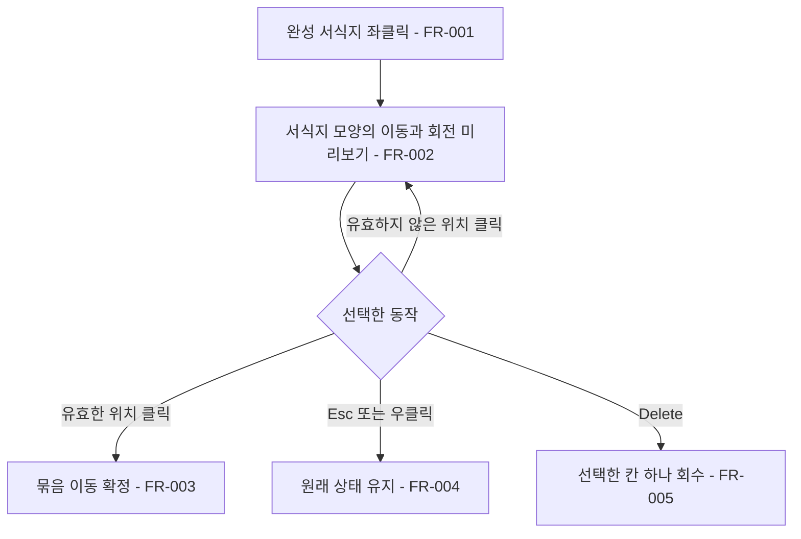

# 완성 서식지 이동과 제거

## 1. 개요

- 목적: 완성된 서식지의 위치와 방향을 바꾸고 구성 칸을 하나씩 회수한다.
- 대상: 마을 건설 화면의 플레이어.

## 2. 범위

- 포함: 완성 서식지 선택, 미리보기, 이동, 회전, 취소, 선택 칸 회수.
- 제외: 미완성 재료 묶음 이동, 다른 마을로 이동, 서식지 조합 규칙 변경.

## 3. 기술 방향

- 사용 기술/API: 기존 Input System, `IItemPlacement`, `IHabitatClusters`, 마을 칸 앵커와 UGUI.
- 핵심 방식: 선택 시 원본 칸과 재료를 보존하고 마우스가 가리키는 칸을 기준으로 구성 칸의 상대 좌표를 평행 이동·90도 회전해 미리 본다. 확정할 때 전체 목적지를 먼저 검증하고 한 묶음으로 적용한다.
- 선택하지 않은 방식: 선택 즉시 원본을 회수해 빈 칸으로 만드는 방식은 취소와 주민 상태에 영향을 주므로 사용하지 않는다.
- 외부 의존성: 기존 배치 비용·재고, 서식지 판정, 주민 집 배정 및 저장 시스템.

## 4. 구조

| 구분 | 이름 | 역할 |
|------|------|------|
| 클래스 | `PlacementGhost` | 선택과 입력, 미리보기 및 기존 제거 동작 연결 |
| 클래스 | `ItemPlacement` | 이동의 전체 검증과 원자적 적용 |
| 클래스 | `ClusterHabitatSystem` | 최종 배치에서 서식지 판정 및 변경 통지 |
| 프리팹 | 기존 마을 배치 표시 | 이동 가능 여부 표시 |
| 씬 | `Main` | 기존 마을 건설 화면 |
| ScriptableObject | 해당 없음 | |

- 오브젝트 구성: 기존 마을 화면과 배치 표시를 사용한다.
- 클래스 간 관계: 입력은 배치 서비스에 묶음 이동을 요청하고 서식지와 주민 시스템은 최종 상태를 반영한다.
- 실행 순서 의존성: 전체 목적지를 검증한 후에만 상태를 바꾸며, 중간의 불완전한 배치가 외부에 노출되지 않게 한다.
- 기존 코드와의 접점: `PlacementGhost`의 입력 및 미리보기, `ItemPlacement`의 칸 상태 변경, 서식지 갱신과 되돌리기 기록을 확장한다.

## 5. 동작 플로우차트

## 6. 요구사항

- FR-001: 마을에서 완성 서식지의 칸 또는 이름을 좌클릭하면 재료 선택 여부와 관계없이 그 서식지 전체를 선택한다. 드래그 중인 입력은 기존 드래그 규칙을 따른다.
- FR-002: 서식지를 선택한 동안 재료 아이콘 대신 서식지의 실제 칸 모양 외곽선을 마우스에 따라 표시하고 R키를 누를 때마다 시계 방향으로 90도 회전하며, 배치 가능 여부를 구분해 표시한다.
- FR-003: 선택한 서식지의 모든 목적지 칸이 유효할 때 좌클릭하면 재료의 상대 배치와 서식지 종류를 유지하면서 추가 비용이나 재고 변화 없이 한 번에 이동한다.
- FR-004: 선택 중 Esc 또는 우클릭하거나 마을 화면을 닫으면 원래 배치와 상태를 유지하고 선택을 취소한다. 재료 선택 중 우클릭해도 재료 선택만 해제한다.
- FR-005: 선택 중 Delete를 누르면 처음 선택한 원본 칸 하나만 회수하고 선택을 끝낸다. 선택하지 않은 상태에서 놓인 타일을 우클릭하면 완성 서식지를 포함해 해당 칸 하나만 회수한다. 회수는 기존 재료·땅 환급 규칙과 Ctrl+Z를 따른다.

### 상태와 데이터

| 이름 | 타입 | 설명 | 초기값 |
|------|------|------|--------|
| 선택 묶음 | 칸과 재료 목록 | 원래 위치와 기준 칸 | 없음 |
| 회전 | 정수 | 시계 방향 90도 회전 횟수 | 0 |

### 예외 및 경계 조건

- 목적지가 마을 밖이거나 배치 불가·다른 물건 점유 칸이면 확정하지 않는다. 원래 묶음과 겹치는 칸은 허용한다.
- 이동 결과가 주변 재료와 연결되어 선택한 서식지 종류를 유지할 수 없으면 확정하지 않는다.
- UI 위 클릭은 마을 입력으로 처리하지 않는다. 다른 배치 면과 재료 배치 조작은 기존대로 유지한다.
- 이동은 철거·재건 보상이나 추가 비용을 발생시키지 않고, 기존 주민·해금 상태를 보존한다. 제거는 기존 철거 규칙을 따른다.
- Ctrl+Z는 이동을 한 동작으로 되돌리고, 제거는 회수한 칸 하나를 되돌린다.

## 7. Inspector 노출값

해당 없음. 기존 배치 표시의 설정을 사용한다.

## 8. 인수 조건

- FR-001: 빈손 또는 재료를 선택한 상태에서 완성 서식지의 칸과 이름을 좌클릭하면 전체 묶음이 선택된다.
- FR-002: 마우스를 움직이고 R을 눌러 서식지의 실제 외곽선이 함께 이동·회전하며 유효한 위치와 무효한 위치가 구별되는지 확인한다.
- FR-003: 유효한 빈 위치와 원래 칸이 일부 겹치는 위치에 각각 확정해 재료·종류·재고·주민 상태와 Ctrl+Z 복원을 확인한다. 경계 밖과 다른 물건 위에서는 확정되지 않는다.
- FR-004: 재료 또는 서식지 선택 중 우클릭하면 타일을 회수하지 않고 선택이 해제되는지 확인한다. 서식지 이동·회전 중 Esc 또는 화면 닫기로 취소해 원래 배치가 남는지도 확인한다.
- FR-005: 선택 후 Delete 또는 선택 없이 타일 우클릭으로 대상 칸 하나만 회수하고 Ctrl+Z로 복원되는지 확인한다.

## 9. 미결 사항

- 없음
