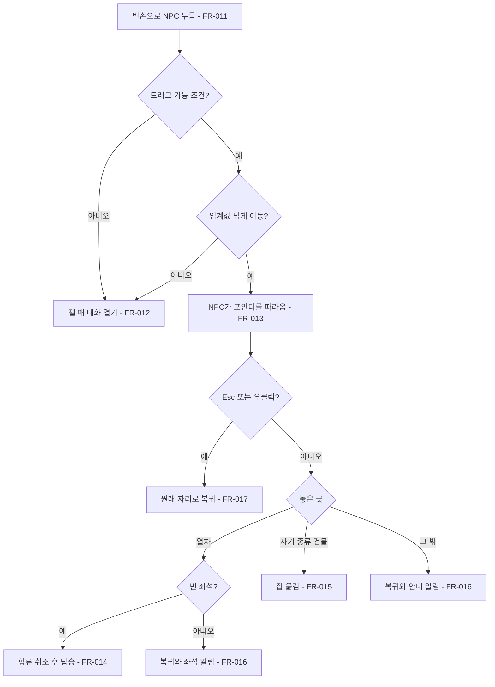
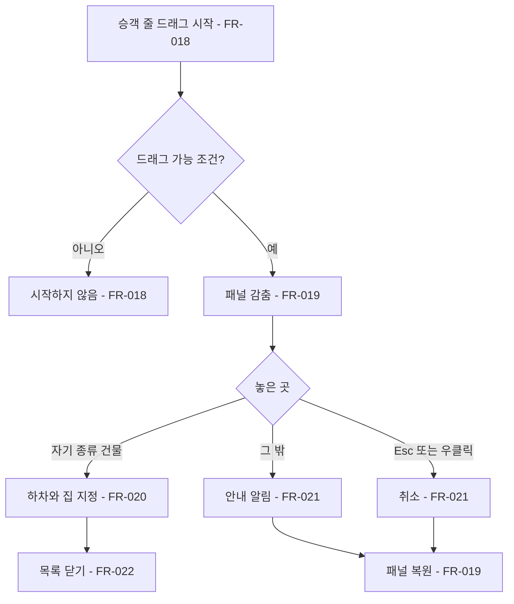

# NPC 끌어 옮기기

## 1. 개요

- 목적: 자동 하차·합류·집 배정을 유지하면서, 플레이어가 마을 NPC를 열차에 태우고, 같은 종류의 다른 건물로 옮기고, 열차 승객을 자기 서식지에 직접 내리게 한다.
- 대상: 플레이어

## 2. 범위

- 포함:
  - 마을에 보이는 NPC를 끌어 정차한 열차에 태우기
  - 마을에 보이는 NPC를 끌어 같은 서식지 종류의 다른 완성 건물로 옮기기
  - 승객 목록의 승객을 끌어 자기 서식지 종류의 완성 건물에 내리기
  - 합류 취소와 그에 따른 직무 효과·번영·포탑 강화 해제
  - 다시 탄 주민의 알림과 운임 제외
  - 열차 승객 저장·복원
- 제외:
  - 자동 하차·자동 집 배정·탑승 바퀴 제한 규칙의 변경
  - 승객 목록 줄의 클릭 동작
  - 좌석이 찼을 때 끌어서 승객을 교체하기
  - 빈 땅이나 다른 종류의 건물에 NPC 놓기
  - 다른 마을의 내부를 보면서 옮기기
  - 끌어 옮기기의 되돌리기(Ctrl+Z)

## 3. 기술 방향

- 사용 기술/API: Input System `Mouse.current`, `Keyboard.current`, UGUI `IBeginDragHandler`·`IDragHandler`·`IEndDragHandler`, `CanvasGroup`, `Physics2D.GetRayIntersectionAll`, `JsonUtility`.
- 핵심 방식:
  - 드래그 판정과 놓기 처리는 새 클래스 `NpcDragController` 하나가 맡는다. 필드 NPC와 승객 줄은 시작 입력만 다르고 같은 놓기 경로를 쓴다.
  - 놓을 건물은 포인터 아래 칸을 찾아 `IHabitatClusters.CompletedAt(hubId)`의 묶음 가운데 그 칸을 포함하고 `TypeId`가 NPC의 `HabitatTypeId`와 같은 것으로 판정한다. 건물 외형이 없는 개간지도 같은 경로로 처리한다.
  - 열차 판정은 `IInteriorAnchors.TrainAnchor(hubId)`를 중심으로 `hub_phase_view.json`의 가로·세로 크기(칸 단위) 사각형을 쓴다. 프리팹과 씬의 열차 오브젝트는 바꾸지 않는다.
  - 드래그 가능 조건은 `IViewMode.InteriorOpen`, `IPhaseLoop.CanDepart`, `ITrackRuntime.CurrentNode.HubId == IViewMode.InteriorHubId`를 모두 만족할 때다.
  - 끌리는 그림은 NPC 몸 스프라이트를 쓰는 월드 오브젝트다. 런타임에 UI를 만들지 않는다.
  - 다시 탄 주민은 `Rider.Returning`으로 구분한다. 내릴 때 `Disembarked` 대신 새 이벤트 `Returned`를 내서 운임이 지급되지 않게 한다.
- 선택하지 않은 방식:
  - 건물에 `BuildingPiece` 콜라이더로 놓기 판정: 개간지처럼 건물 외형이 없는 서식지를 놓칠 수 있어 쓰지 않는다.
  - `Settlement`에서 운임 지급 이력 관리: 저장 항목이 늘고 운임 규칙이 승객 상태에 묶여 쓰지 않는다.
  - 드래그 중 승객 화면 닫기: 비활성화되면 드래그 이벤트가 끊겨 `CanvasGroup`으로 패널만 감춘다.
- 외부 의존성: `NpcRecruiter`, `NpcHomes`, `Passengers`, `Population`, `InteriorNpcWalker`, `PassengersScreen`, `PlacementGhost`, `ToastScreen`, 스펙 003 `ISaveParticipant`.

## 4. 구조

| 구분 | 이름 | 역할 |
|------|------|------|
| 클래스 | `IronRing.Presentation.HubPhase.NpcDragController` | 드래그 상태, 끌리는 그림, 놓을 곳 판정, 놓기 실행, 알림 |
| 계약 | `INpcRecruiter.TryWithdraw`, `NpcWithdrawn` | 합류 취소와 그 알림(기본 구현, 인터페이스 끝에 추가) |
| 계약 | `INpcHomes.TryMoveHome` | 같은 거점의 같은 종류 완성 묶음으로 집 변경(기본 구현, 끝에 추가) |
| 계약 | `IPassengers.TryBoardResident`, `TryPlace`, `IsReturning`, `Returned` | 주민 재탑승, 손 하차, 재탑승 여부, 재탑승 주민 하차 알림(기본 구현, 끝에 추가) |
| 프리팹 | `Parts/PassengerRow.prefab` | 줄 프레임 `raycastTarget` 켜기, 드래그 받기 |
| 프리팹 | `Screens/Passengers.prefab` | 패널에 `CanvasGroup` 추가 |
| 씬 | 해당 없음 | |
| ScriptableObject | 해당 없음 | |

- 오브젝트 구성: `NpcDragController`는 `InteriorNpcWalker`처럼 `GameServices.Ready` 뒤 런타임 GameObject로 만든다. 승객 줄 드래그 처리는 `PassengerRowView`에 둔다.
- 클래스 간 관계: `InteriorNpcWalker`와 `PassengerRowView` → `NpcDragController` → `IPassengers`, `INpcHomes`. `IPassengers.TryBoardResident` → `INpcRecruiter.TryWithdraw` → `NpcHomes`·`Population`·`InteriorNpcWalker`가 `NpcWithdrawn` 구독.
- 실행 순서 의존성: 승객 복원은 `Order` 62로 `NpcRecruiter`(60)·`NpcHomes`(61) 뒤에 실행한다. 복원 때 `Boarded`를 내지 않는다(스펙 003의 항목별 이벤트 규칙).
- 기존 코드와의 접점:

| 파일 | 바꿀 내용 |
|------|-----------|
| `Assets/Scripts/Contracts/IronRingContracts.cs` | 위 계약 멤버를 각 인터페이스 끝에 기본 구현으로 추가 |
| `Assets/Scripts/Npc/NpcRecruiter.cs` | `TryWithdraw`, `NpcWithdrawn` |
| `Assets/Scripts/Npc/NpcHomes.cs` | `NpcWithdrawn` 구독으로 기록 제거, `TryMoveHome` |
| `Assets/Scripts/Npc/Passengers.cs` | `Rider.Returning`, `TryBoardResident`, `TryPlace`, `Returned`, 승객 저장 |
| `Assets/Scripts/Npc/PassengerAnnouncer.cs` | 재탑승·재하차 알림 |
| `Assets/Scripts/Npc/NpcPoolData.cs`, `Data/NpcPool.json` | `_reboardToastFormat`, `_returnToastFormat` |
| `Assets/Scripts/Economy/Population.cs` | `NpcWithdrawn` 구독 |
| `Assets/Scripts/Presentation/HubPhase/InteriorNpcWalker.cs` | NPC 클릭을 뗄 때 판정, 드래그 시작 전달, 끌리는 NPC 이동 멈춤, `NpcWithdrawn` 구독 |
| `Assets/Scripts/Presentation/HubPhase/HubPhaseViewSettings.cs`, `hub_phase_view.json` | 7번 항목의 값 |
| `Assets/Scripts/Presentation/Interior/PlacementGhost.cs` | `NearestCell`을 쓰는 공개 메서드 `CellAt(pointer)` 추가, 끌기 중 우클릭 회수·철거 막기 |
| `Assets/Scripts/Hud/GameMenuScreen.cs` | 끌기 취소에 쓴 Esc로 메뉴를 열지 않기 |
| `Assets/Scripts/Hud/Ui/ToastScreen.cs` | 승객 화면이 열려 있어도 바로 띄우는 `ShowNow` 추가 |
| `Assets/Scripts/Combat/TrainArmamentScreen.cs` | 열차 옆 NPC를 누를 때 정비창을 열지 않기 |
| `Assets/Scripts/Hud/Npc/PassengerRowView.cs` | npcId 보관, 드래그 핸들러 |
| `Assets/Scripts/Hud/Npc/PassengersScreen.cs` | 줄에 npcId 전달, 패널 감추기, `Returned` 구독 |
| `Assets/Scripts/Hud/TopBarScreen.cs` | `Returned` 구독으로 승객 수 갱신 |
| `Assets/Scripts/Hud/HubPanelScreen.cs` | `NpcWithdrawn` 구독으로 주민 수 갱신 |
| `Assets/Scripts/Hud/Editor/Screens/PassengersScreenBuilder.cs` | 줄 `raycastTarget` 켜기, 패널 `CanvasGroup` 바인딩, 안내 문구 `Hint` 추가 |
| `Assets/Scripts/Localization/Resources/ko.json` | `npc_drag_wrong_home`, `npc_drag_train_full`, `passengers_drag_hint` 키 추가 |
| `docs/specs/003-game-menu-save.md` | `Passengers.cs` 저장 범위에 탑승 중 승객 추가 |

## 5. 동작 플로우차트

필드 NPC 끌기

승객 줄 끌기

## 6. 요구사항

구현은 세 묶음으로 나눈다. 묶음마다 승인받고 순서대로 진행한다.

### 묶음 A: 게임 상태

- FR-001: `TryWithdraw(npcId)`가 합류한 NPC에 불릴 때 `NpcRecruiter`는 합류 기록을 지우고 `NpcWithdrawn(hubId, npcId)`를 낸다.
- FR-002: `NpcWithdrawn`을 받을 때 `NpcHomes`는 그 NPC의 집 기록을 지운다.
- FR-003: `NpcWithdrawn`을 받을 때 `Population`은 그 마을의 주거·빛·수입을 다시 계산한다.
- FR-004: `TryBoardResident(npcId, hubId)`가 빈 좌석이 있을 때 불리면 `Passengers`는 합류를 취소하고 `Returning`이 켜진 승객으로 태운다.
- FR-005: `TryPlace(npcId, hubId)`가 승객에게 불리고 `CanDisembark`가 참일 때 `Passengers`는 승객을 내려 그 거점에 합류시킨다.
- FR-006: `TryMoveHome(npcId, cells)`가 불리고 cells가 같은 거점의 같은 종류 완성 묶음일 때 `NpcHomes`는 집을 그 칸으로 바꾸고 `HomeChanged`를 낸다.
- FR-007: `Returning` 승객이 자동이나 손으로 내릴 때 `Passengers`는 `Disembarked` 대신 `Returned`를 낸다.
- FR-008: `Returning` 승객이 타거나 내릴 때 `PassengerAnnouncer`는 `NpcPool.json`의 재탑승·재하차 문구로 알림을 띄운다.
- FR-009: 슬롯을 저장할 때 `Passengers`는 승객마다 id, 탑승 위치, 탑승 바퀴, `Returning`을 함께 저장한다.
- FR-010: 슬롯을 불러올 때 `Passengers`는 저장된 승객을 이벤트 없이 복원한다.

### 묶음 B: 필드 NPC 끌기

- FR-011: 드래그 가능 조건에서 빈손으로 NPC를 누르고 임계값을 넘겨 움직일 때 `NpcDragController`는 드래그를 시작한다.
- FR-012: NPC를 누른 뒤 임계값을 넘지 않고 뗄 때 `InteriorNpcWalker`는 `NpcClicked`를 낸다.
- FR-013: 드래그 중일 때 `NpcDragController`는 NPC 그림을 포인터 위치에 두고 놓을 수 있는 곳이면 가능 색, 아니면 불가 색을 적용한다.
- FR-014: 열차 범위에 놓고 빈 좌석이 있을 때 `NpcDragController`는 `TryBoardResident`를 부른다.
- FR-015: 자기 종류의 완성 건물에 놓을 때 `NpcDragController`는 `TryMoveHome`을 부른다.
- FR-016: 그 밖의 곳에 놓거나 좌석이 없을 때 `NpcDragController`는 NPC를 원래 자리로 돌리고 이유에 맞는 알림을 띄운다.
- FR-017: 드래그 중 Esc나 우클릭이 들어올 때 `NpcDragController`는 상태를 바꾸지 않고 드래그를 끝낸다.

### 묶음 C: 승객 줄 끌기

- FR-018: 드래그 가능 조건에서 승객 줄을 끌 때 `PassengerRowView`는 그 npcId로 드래그를 시작한다. 조건이 아니면 시작하지 않는다.
- FR-019: 승객 줄 드래그 중일 때 `PassengersScreen`은 패널을 감추고 입력을 막지 않게 하며, 내리지 않고 끝나면 되돌린다.
- FR-020: 자기 종류의 완성 건물에 놓을 때 `NpcDragController`는 `TryPlace` 뒤 `TryMoveHome`을 불러 놓은 건물을 집으로 삼는다.
- FR-021: 그 밖의 곳에 놓거나 Esc·우클릭이 들어올 때 `NpcDragController`는 승객을 그대로 두고, 놓은 경우에만 안내 알림을 띄운다.
- FR-022: 승객을 건물에 내리는 데 성공할 때 `PassengersScreen`은 승객 목록을 닫는다.
- FR-023: 승객이 한 명 이상일 때 `PassengersScreen`은 패널 아래쪽에 끌어서 내릴 수 있다는 안내 문구를 표시한다.

### 상태와 데이터

| 이름 | 타입 | 설명 | 초기값 |
|------|------|------|--------|
| `Rider.Returning` | bool | 주민이었다가 다시 탄 승객인지 | false |
| `RiderSave` | 배열 | `NpcId`, `WaypointId`, `BoardLap`, `Returning`. `VisitSave`에 추가 | 빈 배열 |
| `_pressedNpc` | string | `InteriorNpcWalker`에서 눌렸지만 아직 클릭·끌기가 정해지지 않은 NPC | null |
| `_pressPointer` | Vector2 | `InteriorNpcWalker`에서 누른 화면 좌표 | zero |
| `_dragNpcId` | string | `NpcDragController`에서 지금 끌고 있는 NPC. 없으면 null | null |

### 예외 및 경계 조건

- 드래그 중 조건이 깨짐(출발, 내부 화면 닫힘): 취소로 처리한다.
- 드래그 중 놓을 건물이 무너짐: 놓을 때 다시 판정하므로 불가로 처리한다.
- 대화창이 열려 있음: 끌기를 시작하지 않고 뗄 때 클릭으로 처리한다.
- 자기 집 건물에 다시 놓음: 아무 변화 없이 끝내고 알림을 띄우지 않는다.
- 집이 없는 주민(건물이 무너져 열차 옆에 있음): 집 있는 주민과 같게 옮긴다.
- 승객 탑승 조건: 주민 재탑승에는 쓰지 않는다. 좌석 수만 본다.
- 재탑승 주민이 탑승 바퀴 제한을 넘김: 일반 승객처럼 `Left`로 떠나 후보로 돌아간다.
- 다시 합류할 때 `NpcJoined`가 또 나감: `HabitatCodex`는 이미 해금이면 건너뛰므로 추가 해금이 없다.
- 옛 슬롯에 승객 항목이 없음: 빈 배열로 읽어 승객 없이 시작한다.
- 승객 목록 스크롤: 줄이 드래그를 받으므로 스크롤은 휠로만 한다. 정원이 3명이라 끌어서 스크롤할 일이 없다.

## 7. Inspector 노출값

`hub_phase_view.json`에서 조절한다.

| 필드 | 타입 | 기본값 | 설명 |
|------|------|--------|------|
| `_npcDragThresholdPixels` | float | 8 | 클릭과 드래그를 가르는 이동 거리 |
| `_npcDragTrainWidthCells` | float | 5.2 | 열차 놓기 범위의 가로 크기(칸 단위) |
| `_npcDragTrainHeightCells` | float | 1.8 | 열차 놓기 범위의 세로 크기(칸 단위) |
| `_npcDragValidColor` | Color | 초록 | 놓을 수 있을 때 끌리는 NPC 색 |
| `_npcDragInvalidColor` | Color | 빨강 | 놓을 수 없을 때 끌리는 NPC 색 |
| `_npcDragToastSeconds` | float | 2 | 실패 알림 표시 시간 |

## 8. 인수 조건

- FR-001: 주민을 열차에 태운 뒤 `NpcsAt`과 마을 패널의 주민 수에서 빠지는지 로그와 화면으로 확인한다.
- FR-002: 태운 뒤 `HomeOf`가 null이고 그 건물을 클릭하면 빈 건물 알림이 뜨는지 확인한다.
- FR-003: 태우기 전후로 마을 수입·주거·빛 값이 직무 효과만큼 줄어드는지 확인한다.
- FR-004: 좌석이 남을 때 승객 수가 1 늘고 승객 목록에 나오는지 확인한다.
- FR-005: 승객을 자기 건물에 놓으면 승객 수가 1 줄고 마을 주민이 되는지 확인한다.
- FR-006: 같은 건물을 두 채 지은 뒤 NPC를 다른 쪽으로 옮기면 그 건물 문 앞으로 이동하는지 확인한다.
- FR-007: 재탑승 주민을 내릴 때 잔고와 장부에 운임이 늘지 않는지 확인한다.
- FR-008: 재탑승과 재하차 때 전용 문구가 뜨는지 확인한다.
- FR-009: 승객이 탄 채 저장하고 슬롯 파일의 `passengers` 항목에 승객이 있는지 확인한다.
- FR-010: 그 슬롯을 불러와 승객 목록과 상단 승객 수가 같고 탑승 알림이 뜨지 않는지 확인한다.
- FR-011: NPC를 눌러 임계값 넘게 움직이면 끌리기 시작하는지 확인한다.
- FR-012: NPC를 움직이지 않고 클릭하면 대화창이 열리는지 확인한다.
- FR-013: 끌면서 열차·자기 건물·다른 곳을 지날 때 색이 바뀌는지 확인한다.
- FR-014: 열차에 놓으면 NPC가 마을에서 사라지고 승객이 되는지 확인한다.
- FR-015: 다른 같은 종류 건물에 놓으면 집이 바뀌고 다른 상태는 그대로인지 확인한다.
- FR-016: 다른 종류 건물과 빈 땅에 놓고, 좌석이 찬 열차에 놓아 복귀와 알림을 확인한다.
- FR-017: 끄는 중 Esc와 우클릭으로 상태가 바뀌지 않는지 확인한다.
- FR-018: 출발 불가 상태에서 줄이 끌리지 않고, 정차 중에는 끌리는지 확인한다.
- FR-019: 끄는 동안 패널이 보이지 않고 건물을 가리지 않으며, 실패·취소 뒤 패널이 다시 보이는지 확인한다.
- FR-020: 승객을 건물이 두 채인 종류의 뒤쪽 건물에 놓으면 그 건물이 집이 되는지 확인한다.
- FR-021: 다른 곳에 놓거나 취소했을 때 승객이 목록에 남아 있는지 확인한다.
- FR-022: 승객을 건물에 내린 뒤 목록이 닫혀 있고, 다시 열면 정상으로 보이는지 확인한다.
- FR-023: 승객이 있을 때 안내 문구가 줄과 겹치지 않게 보이고, 승객이 없으면 보이지 않는지 확인한다.

## 9. 미결 사항

- 없음
