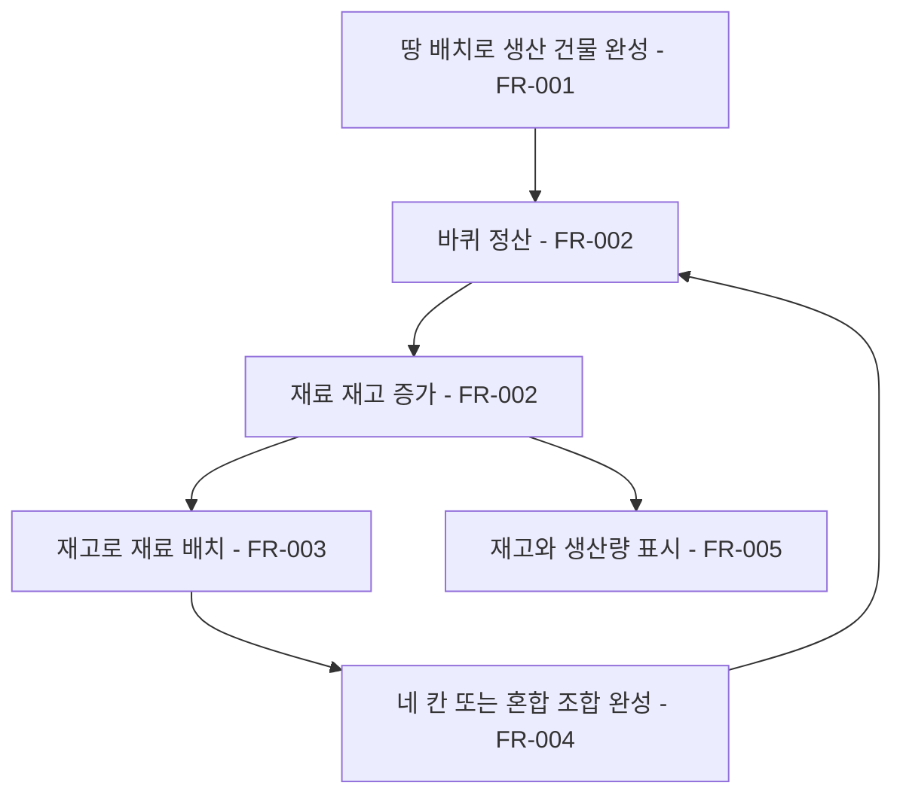

# 서식지 자원 생산과 네 칸 조합

## 1. 개요

- 목적: 생산 건물에서 얻은 재료로 새로운 건물을 지어 자원과 서식지의 연결을 강화한다.
- 대상: 마을 건설 화면의 플레이어.

## 2. 범위

- 포함: 생산 건물의 지속 생산, 재료 재고와 배치, 동일 재료 네 칸 건물, 생산 정보 표시.
- 제외: 추후 제작할 상인 이벤트의 구매·판매와 가격, 포탑 비용 변경, 자동 테스트.

## 3. 기술 방향

- 사용 기술/API: 기존 서식지 판정, `ITrackRuntime.LapCompleted`, `ITileStock`, UGUI.
- 핵심 방식: 바퀴 정산마다 완성된 생산 건물 각각의 산출물을 재고에 더하고 배치할 때 재고를 차감한다. 생산량과 건물별 산출물은 데이터로 관리한다.
- 선택하지 않은 방식: 건물 완성으로 재료의 상시 구매를 해금하거나 재료 부족 시 마르크로 자동 결제한다.
- 외부 의존성: 재료 재고 저장, 건물 판정, 마을 배치·철거, 도감과 빠른 칸.

## 4. 구조

| 구분 | 이름 | 역할 |
|------|------|------|
| 클래스 | `ClusterHabitatSystem` | 완성된 건물과 구성 칸을 제공한다. |
| 클래스 | 생산 정산 서비스 | 건물별 산출물을 재고에 추가한다. |
| 클래스 | `TileStock`, `ItemPlacement` | 재고와 배치 차감을 관리한다. |
| 데이터 | `HabitatRecipes.json`, `HabitatTypes.json` | 조합과 건물 정보를 정의한다. |
| 데이터 | 생산 설정 JSON | 건물별 산출 재료와 생산량을 정의한다. |
| 프리팹 | 기존 마을 HUD | 재고와 생산량을 표시한다. |
| 씬 | `Main` | 기존 마을 건설 화면. |
| ScriptableObject | 해당 없음 | |

- 오브젝트 구성: 기존 마을 화면과 HUD를 사용한다.
- 클래스 간 관계: 생산 정산 서비스가 완성 서식지와 생산 설정을 읽고 재고에 산출물을 추가한다.
- 실행 순서 의존성: 바퀴 정산 시점에 완성된 건물만 집계하며 저장 복원 자체는 생산으로 취급하지 않는다.
- 기존 코드와의 접점: 재료 상시 구매 경로, 빠른 칸, 서식지 도감과 데이터 카탈로그를 변경한다.

## 5. 동작 플로우차트

## 6. 요구사항

- FR-001: 땅을 배치할 때 기존 땅 가격만큼 마르크를 차감하고 부족하면 배치하지 않는다. 철거 환급은 기존 배치 비용 설정을 따른다. 건물 완성으로 재료의 상시 구매를 해금하지 않는다.
- FR-002: 바퀴 정산마다 완성된 재료형 건물 하나당 아래 표의 재료와 수량을 재고에 더하고 수입형 건물은 표의 마르크를 번다. 기존 생산형의 마르크 수입도 표대로 유지한다. 같은 건물이 여럿이면 각각 생산하고 철거된 건물은 생산하지 않는다. 개간지→돌, 벌목터→목재, 돌우물→물통, 계단식 밭→곡식, 석탄 갱도→석탄, 철 대장간→철재, 구리 갱도→구리, 보일러실→증기관, 기계 공방→톱니, 전선 공방→전선을 생산한다.
- FR-003: 땅 이외의 재료를 배치할 때 해당 재고를 1개 차감하고 재고가 없으면 배치하지 않는다. 재료 철거 시 기존 회수 규칙을 유지하며 일반 마을 화면에서 마르크로 재료를 구매하지 않는다.
- FR-004: 각 재료 네 칸 건물과 게임 기준 문서에 남긴 혼합 조합을 유지한다. 혼합 시설은 이름과 기능이 분명하고 필수 시스템 연결을 보존하는 조합으로 한정한다. 땅 네 칸은 개간지로 정하며 기존 세 칸 개간지 조건을 교체한다. 목재→제재소, 돌→채석장, 물통→저수장, 곡식→곡물 창고, 석탄→석탄 저장소, 철재→철재 공방, 구리→구리 공방, 증기관→증기관 공방, 톱니→톱니 공방, 전선→전선 작업장으로 정한다. 저수장·곡물 창고·석탄 저장소도 각각 해당 재료를 생산한다. 계단식 밭이 곡식을 생산하고 곡식 네 칸으로 곡물 창고를 짓는다. 게임 기준 문서에 열거한 두 재료 각 2칸의 혼합 생활 시설은 표에 따라 재료 또는 마르크를 산출한다. 첫 건물 안내도 네 칸으로 바꾼다.
- FR-005: 빠른 칸에는 재료별 보유 수량을 표시하고 오른쪽 마르크 및 재료 목록은 숫자 다음에 아이콘을 두며 숫자가 길면 왼쪽으로 늘어난다. 재료와 마르크 사이 및 재료 항목 사이의 간격은 좁게 유지한다. 완성된 서식지 위에 마우스를 올리면 그 이름, 실제 거주자 이름 또는 거주자 없음, 바퀴당 재료 생산량·마르크 수입을 작은 정보창에 표시한다. 산출이 없으면 생산 없음으로 표시하며 포인터가 벗어나거나 마을을 닫으면 숨긴다. 도감 카드는 조합을 3×3 아홉 칸에 보여주며 바퀴당 재료 생산과 마르크 수입을 번영과 같이 각각 별도 줄의 아이콘과 수량으로 표시한다. 표시값은 생산·수입 데이터에서 읽는다. 모양 조건이 있는 조합의 실제 패턴과 기존 공개 규칙은 유지한다. 도감은 건물 정보 JSON의 순서에 따라 재료가 생산되고 사용되는 진행 순서로 정렬한다.
- FR-006: 각 건물 종류를 한 게임에서 처음 완성하면 지정 재료 4개를 즉시 재고에 지급하고, 같은 종류를 다시 완성하거나 저장을 복원할 때 중복 지급하지 않는다. 생산형은 산출 재료를 지급하고 수입형은 레시피 순서에서 처음 나오는 땅 이외 조합 재료를 지급한다.
- FR-007: 서식지는 상하좌우로 연결된 타일이 레시피의 정확한 칸 수와 재료 수를 만족할 때 완성하며, 화면에서 붙은 위·아래 영역 경계도 연결된 것으로 본다. 모양 조건이 없는 조합은 연결 모양에 관계없이 판정하고, 패턴 조합은 지정 모양과 회전·대칭을 따른다. 완성된 건물은 추가 타일을 흡수하거나 다른 종류로 바뀌지 않는다.

### 생산과 수입 표

표의 첫 완성 보상은 산출물 또는 레시피 순서상 첫 비땅 재료 4개다. 기존 생산형 17종의 생산과 수입은 유지한다.

| 건물 | 제작 재료 | 칸 | 바퀴당 재료 | 바퀴당 마르크 | 첫 완성 보상 |
|------|-----------|---:|-------------|--------------:|--------------|
| 개간지 | 땅×4 | 4 | 돌 1개 | 2 | 돌 4개 |
| 벌목터 | 땅×2 + 돌×1 | 3 | 목재 1개 | 2 | 목재 4개 |
| 돌우물 | 땅×1 + 돌×2 | 3 | 물통 1개 | 1 | 물통 4개 |
| 임시 거처 | 땅×1 + 목재×2 + 돌×1 | 4 | 없음 | 3 | 목재 4개 |
| 계단식 밭 | 땅×1 + 목재×1 + 물통×2 | 4 | 곡식 2개 | 2 | 곡식 4개 |
| 석탄 갱도 | 땅×1 + 목재×2 + 물통×1 | 4 | 석탄 2개 | 3 | 석탄 4개 |
| 공동 취사장 | 목재×1 + 돌×2 + 물통×1 + 곡식×1 | 5 | 없음 | 4 | 목재 4개 |
| 철 대장간 | 목재×1 + 돌×2 + 석탄×1 | 4 | 철재 2개 | 4 | 철재 4개 |
| 구리 갱도 | 땅×1 + 돌×1 + 석탄×2 | 4 | 구리 2개 | 3 | 구리 4개 |
| 보일러실 | 돌×1 + 물통×1 + 석탄×2 + 철재×2 | 6 | 증기관 3개 | 5 | 증기관 4개 |
| 급수장 | 돌×1 + 물통×2 + 철재×1 + 증기관×2 | 6 | 물통 2개 | 0 | 물통 4개 |
| 기계 공방 | 석탄×1 + 철재×2 + 증기관×1 | 4 | 톱니 2개 | 5 | 톱니 4개 |
| 증기역 | 목재×1 + 돌×2 + 철재×2 + 증기관×1 + 톱니×1 | 7 | 없음 | 8 | 목재 4개 |
| 전선 공방 | 구리×2 + 철재×1 + 톱니×1 | 4 | 전선 2개 | 5 | 전선 4개 |
| 발전소 | 철재×1 + 톱니×2 + 증기관×2 + 물통×2 + 석탄×1 + 전선×1 | 9 | 없음 | 8 | 철재 4개 |
| 야시장 | 목재×2 + 돌×2 + 곡식×1 + 전선×1 | 6 | 없음 | 7 | 목재 4개 |
| 시계탑 | 돌×2 + 톱니×2 + 철재×2 + 전선×1 | 7 | 없음 | 6 | 돌 4개 |
| 제재소 | 목재×4 | 4 | 목재 3개 | 0 | 목재 4개 |
| 채석장 | 돌×4 | 4 | 돌 3개 | 0 | 돌 4개 |
| 저수장 | 물통×4 | 4 | 물통 1개 | 0 | 물통 4개 |
| 곡물 창고 | 곡식×4 | 4 | 곡식 1개 | 0 | 곡식 4개 |
| 석탄 저장소 | 석탄×4 | 4 | 석탄 1개 | 0 | 석탄 4개 |
| 철재 공방 | 철재×4 | 4 | 철재 3개 | 0 | 철재 4개 |
| 구리 공방 | 구리×4 | 4 | 구리 3개 | 0 | 구리 4개 |
| 증기관 공방 | 증기관×4 | 4 | 증기관 3개 | 0 | 증기관 4개 |
| 톱니 공방 | 톱니×4 | 4 | 톱니 3개 | 0 | 톱니 4개 |
| 전선 작업장 | 전선×4 | 4 | 전선 3개 | 0 | 전선 4개 |
| 목재 쉼터 | 땅×2 + 목재×2 | 4 | 없음 | 3 | 목재 4개 |
| 물가 쉼터 | 땅×2 + 물통×2 | 4 | 물통 1개 | 0 | 물통 4개 |
| 곡물 마당 | 땅×2 + 곡식×2 | 4 | 곡식 1개 | 0 | 곡식 4개 |
| 연료 마당 | 땅×2 + 석탄×2 | 4 | 석탄 1개 | 0 | 석탄 4개 |
| 철재 야적장 | 땅×2 + 철재×2 | 4 | 없음 | 3 | 철재 4개 |
| 구리 야적장 | 땅×2 + 구리×2 | 4 | 없음 | 3 | 구리 4개 |
| 관로 마당 | 땅×2 + 증기관×2 | 4 | 없음 | 3 | 증기관 4개 |
| 기계 마당 | 땅×2 + 톱니×2 | 4 | 없음 | 3 | 톱니 4개 |
| 전선 마당 | 땅×2 + 전선×2 | 4 | 없음 | 3 | 전선 4개 |
| 목조 우물집 | 목재×2 + 물통×2 | 4 | 물통 1개 | 0 | 물통 4개 |
| 곡물 건조장 | 목재×2 + 곡식×2 | 4 | 곡식 1개 | 0 | 곡식 4개 |
| 목재 연료고 | 목재×2 + 석탄×2 | 4 | 석탄 1개 | 0 | 석탄 4개 |
| 철물 창고 | 목재×2 + 철재×2 | 4 | 없음 | 3 | 목재 4개 |
| 구리 창고 | 목재×2 + 구리×2 | 4 | 없음 | 3 | 목재 4개 |
| 관로 창고 | 목재×2 + 증기관×2 | 4 | 없음 | 3 | 목재 4개 |
| 부품 창고 | 목재×2 + 톱니×2 | 4 | 없음 | 3 | 목재 4개 |
| 전선 창고 | 목재×2 + 전선×2 | 4 | 없음 | 3 | 목재 4개 |
| 석조 물탱크 | 돌×2 + 물통×2 | 4 | 물통 1개 | 0 | 물통 4개 |
| 석조 곡물고 | 돌×2 + 곡식×2 | 4 | 곡식 1개 | 0 | 곡식 4개 |
| 석조 연료고 | 돌×2 + 석탄×2 | 4 | 석탄 1개 | 0 | 석탄 4개 |
| 구리 기초 | 돌×2 + 구리×2 | 4 | 없음 | 3 | 돌 4개 |
| 관로 기초 | 돌×2 + 증기관×2 | 4 | 없음 | 3 | 돌 4개 |
| 식수 배급소 | 물통×2 + 곡식×2 | 4 | 없음 | 3 | 물통 4개 |
| 난방 시설 | 물통×2 + 석탄×2 | 4 | 없음 | 3 | 물통 4개 |
| 철제 물탱크 | 물통×2 + 철재×2 | 4 | 없음 | 3 | 물통 4개 |
| 구리 물탱크 | 물통×2 + 구리×2 | 4 | 없음 | 3 | 물통 4개 |
| 전기 세척장 | 물통×2 + 전선×2 | 4 | 없음 | 3 | 물통 4개 |
| 철제 곡물고 | 곡식×2 + 철재×2 | 4 | 없음 | 3 | 곡식 4개 |
| 증기 제분소 | 곡식×2 + 증기관×2 | 4 | 곡식 1개 | 0 | 곡식 4개 |
| 기계 제분소 | 곡식×2 + 톱니×2 | 4 | 곡식 1개 | 0 | 곡식 4개 |
| 전기 제분소 | 곡식×2 + 전선×2 | 4 | 곡식 1개 | 0 | 곡식 4개 |
| 구리 연료고 | 석탄×2 + 구리×2 | 4 | 없음 | 3 | 석탄 4개 |
| 증기 난방소 | 석탄×2 + 증기관×2 | 4 | 없음 | 3 | 석탄 4개 |
| 기계 난방소 | 석탄×2 + 톱니×2 | 4 | 없음 | 3 | 석탄 4개 |
| 전기 난방소 | 석탄×2 + 전선×2 | 4 | 없음 | 3 | 석탄 4개 |
| 전기 정비소 | 철재×2 + 전선×2 | 4 | 없음 | 3 | 철재 4개 |
| 구리 배관소 | 구리×2 + 증기관×2 | 4 | 없음 | 3 | 구리 4개 |
| 구리 기계소 | 구리×2 + 톱니×2 | 4 | 없음 | 3 | 구리 4개 |
| 배전 작업소 | 구리×2 + 전선×2 | 4 | 없음 | 3 | 구리 4개 |
| 증기 배전실 | 증기관×2 + 전선×2 | 4 | 없음 | 3 | 증기관 4개 |
| 기계 배전실 | 톱니×2 + 전선×2 | 4 | 없음 | 3 | 톱니 4개 |

### 상태와 데이터

| 이름 | 타입 | 설명 | 초기값 |
|------|------|------|--------|
| 재료 재고 | 재료 ID별 정수 | 배치에 사용할 생산물과 사건 보상 | 기존 새 게임 재고 |
| 생산 설정 | 건물 ID별 재료 ID와 정수 | 완성 건물의 바퀴당 산출 | 위 생산과 수입 표 |

### 예외 및 경계 조건

- 생산 건물이 없는 재료는 생산하지 않는다. 자원이 소진되면 기존 철거 회수나 땅에서 시작하는 생산 경로로 회복한다. 이전 저장의 기존 구매 재료는 철거하면 같은 재료 재고로 반환한다.
- 이동 중인 건물은 정산 시 실제 배치된 완성 건물 상태를 따른다.
- 상인 이벤트 전에는 마을 화면에서 재료를 구매하거나 판매하지 않는다.

## 7. Inspector 노출값

| 필드 | 타입 | 기본값 | 설명 |
|------|------|--------|------|
| 해당 없음 | | | 생산량은 데이터에서 조절한다. |

## 8. 인수 조건

- FR-001: 땅 배치 전후 마르크가 가격만큼 줄고 잔액 부족 시 배치되지 않으며 건물 완성으로 재료 상시 구매가 열리지 않는지 확인한다.
- FR-002: 벌목터 하나와 두 개를 각각 완성해 바퀴를 돌렸을 때 목재가 각각 1개와 2개 증가하고 철거 후에는 해당 건물의 생산이 멈추는지 확인한다. 계단식 밭과 채석장, 보일러실도 각각 바퀴당 2개, 3개, 3개를 생산하는지 확인한다.
- FR-003: 목재를 배치하면 재고가 줄고 0개일 때는 배치와 마르크 차감이 일어나지 않는지 확인한다.
- FR-004: 땅 네 칸과 확정된 각 재료 네 칸 조합이 지정된 건물이 되며 기존 혼합 조합과 새 혼합 생활 시설이 완성되는지, 곡물 창고가 곡식을 바퀴당 1개 생산하는지 확인한다.
- FR-005: 생산 전후 재고 표시가 일치하고 완성 서식지에 마우스를 올릴 때 이름·바퀴당 재료 생산량·마르크 수입이 데이터와 일치하며, 마우스를 떼거나 마을을 닫을 때 정보가 사라지는지 확인한다. 산출 없는 서식지와 미발견 조합도 확인한다.
- FR-006: 개간지 첫 완성 직후 돌 4개를 받고 같은 종류를 다시 짓거나 저장을 불러올 때 보상이 반복되지 않는지 확인한다.
- FR-007: 땅 네 칸 완성 뒤 옆에 땅을 더 놓아도 기존 건물 칸 수가 변하지 않고 돌 네 칸의 여러 연결 모양과 배치 순서가 같은 결과인지 확인한다.

## 9. 미결 사항

- 없음.
