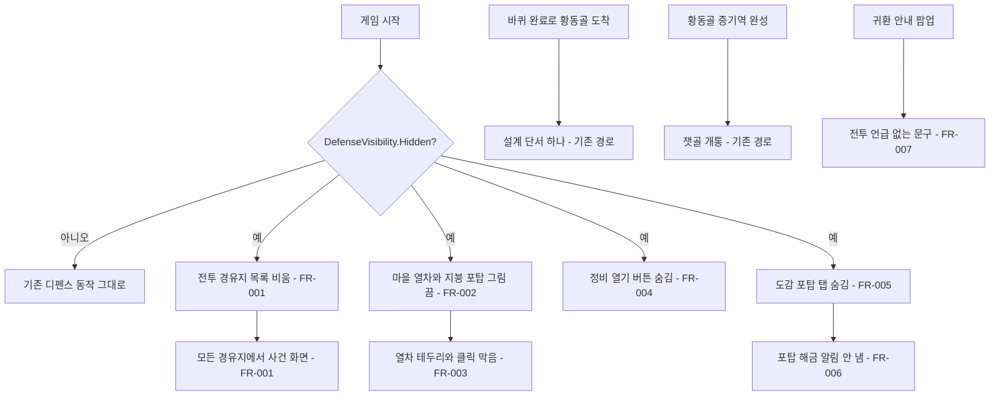

# 디펜스 화면 숨기기

## 1. 개요

- 목적: 정차역 방어전(디펜스)을 잠시 게임에서 보이지 않게 한다. 기능 코드는 지우지 않고 스위치 하나로 숨겨, 스위치를 끄면 바로 원래대로 돌아오게 한다.
- 대상: 플레이어(디펜스 관련 화면을 보지도 누르지도 않음), 제작자(스위치 하나로 숨김과 복구).

## 2. 범위

- 포함:
  - 숨김 스위치 `DefenseVisibility.Hidden` 하나
  - 전투로 지정한 경유지를 일반 사건 경유지로 처리
  - 마을 안 열차(`BattleStyleTrain`)와 지붕 포탑 그림 숨김
  - 열차 위 테두리 표시와 열차 클릭으로 포탑 정비 창 열기 막기
  - 포탑 정비 열기 버튼(`ArmamentOpen`) 숨김
  - 도감의 포탑 탭과 "포탑 기능 해금" 알림 숨김
  - 귀환 안내(`onboarding_return_town`) 문구에서 전투 언급 빼기(문구 값은 사용자 검수 뒤 넣는다)
- 제외:
  - 전투·포탑·정비 코드와 `BattleReference` 씬, 전투 프리팹, 리소스 삭제(모두 보존)
  - 포탑 저장·불러오기(`TrainArmament`·`BattleHintJournal` 저장 참여는 그대로 둔다)
  - 열차 아래 선로 그림(`Railway`)은 열차가 아니므로 그대로 보인다
  - 스펙 005 구현(디펜스를 다시 켤 때 진행하며, 그동안 보류)

## 3. 기술 방향

- 사용 기술/API: 기존 `MainRoot`, `PhaseLoop.SetBattleWaypoints`, `TrainArmamentScreen`, `TrainArmamentVisual`, `CodexScreen`, `SpriteRenderer.enabled`, `GameObject.SetActive`
- 핵심 방식:
  - `IronRing.Combat.DefenseVisibility` 정적 클래스에 `public const bool Hidden = true;`를 둔다. 숨김 판정은 모두 이 값 하나를 읽는다.
  - `MainRoot.Start`는 `Hidden`이면 전투 경유지 목록을 채우지 않는다. 그러면 `PhaseLoop`가 모든 경유지에서 사건을 열고, `MainRoot.OnArrived`도 전투 씬을 열지 않는다.
  - `TrainArmamentVisual.Refresh`는 `Hidden`이면 자기 `SpriteRenderer`와 지붕 포탑 렌더러를 모두 끈다(오브젝트는 켜 둔 채 그림만 끈다).
  - `TrainArmamentScreen`은 `Hidden`이면 `Awake`에서 `_open` 버튼 오브젝트를 끄고, `Update`의 열차 테두리·클릭 처리를 건너뛰며, `Open()`도 바로 돌아간다.
  - `CodexScreen`은 `Hidden`이면 `_turretsTab` 오브젝트를 끄고, `OnClustersChanged`에서 포탑 해금 알림을 큐에 넣지 않는다.
  - 설계 단서와 잿골 개통은 지금 코드에 남아 있는 경로를 그대로 쓴다. 단서는 `HabitatCodex.OnLapCompleted`(바퀴 완료로 황동골 도착), 잿골은 `EconomyInstaller.OnHabitatCompleted`(황동골 증기역 완성)이다. 코드 변경은 없다.
- 선택하지 않은 방식:
  - 프리팹·씬을 생성기로 다시 만들어 오브젝트를 지우는 방식은 쓰지 않는다(복구가 어렵다).
  - Inspector 값으로 숨김을 두지 않는다(여러 컴포넌트에 같은 값을 맞춰야 해서 하나를 빠뜨리기 쉽다).
- 외부 의존성: 스펙 005(보류), 스펙 001 `return_town` 안내(문구만 영향)

## 4. 구조

| 구분 | 이름 | 역할 |
|------|------|------|
| 클래스 | `DefenseVisibility` (새, `Assets/Scripts/Combat/`) | 숨김 스위치 `Hidden` |
| 클래스 | `MainRoot` | 숨김이면 전투 경유지를 모으지 않음 |
| 클래스 | `TrainArmamentVisual` | 숨김이면 열차·포탑 그림을 끔 |
| 클래스 | `TrainArmamentScreen` | 숨김이면 열기 버튼을 끄고 열차 테두리·클릭과 `Open()`을 막음 |
| 클래스 | `CodexScreen` | 숨김이면 포탑 탭과 포탑 해금 알림을 숨김 |
| 프리팹 | 해당 없음 | 프리팹 변경 없음 |
| 씬 | 해당 없음 | 씬 변경 없음 |
| ScriptableObject | 해당 없음 | 해당 없음 |

- 오브젝트 구성: 해당 없음(새 GameObject·컴포넌트 없음)
- 클래스 간 관계: `MainRoot`, `TrainArmamentVisual`, `TrainArmamentScreen`, `CodexScreen`이 `DefenseVisibility.Hidden`을 읽는다. 역방향 참조는 없다.
- 실행 순서 의존성: `MainRoot.Start`에서 `LoopInstaller.Loop?.SetBattleWaypoints` 호출 전에 목록이 비어 있어야 한다(같은 메서드 안에서 처리하므로 순서가 지켜진다).
- 기존 코드와의 접점: 팀원 파일(`MainRoot`, `TrainArmamentVisual`, `TrainArmamentScreen`, `CodexScreen`)은 바꾼 줄에 무엇을 바꿨는지 한 줄 주석을 단다. `ko.json`의 `onboarding_return_town` 값을 바꾼다.

## 5. 동작 플로우차트

## 6. 요구사항

- FR-001: `DefenseVisibility.Hidden`이 true일 때 `MainRoot`는 전투 경유지를 모으지 않아, 전투로 지정한 경유지에서도 전투 씬 대신 일반 사건 화면이 열린다.
- FR-002: `Hidden`이 true일 때 `TrainArmamentVisual`은 마을 안 열차 그림과 지붕 포탑 그림을 끈다.
- FR-003: `Hidden`이 true일 때 `TrainArmamentScreen`은 열차 위 테두리 표시와 클릭으로 정비 창을 여는 처리를 하지 않는다.
- FR-004: `Hidden`이 true일 때 `TrainArmamentScreen`은 포탑 정비 열기 버튼을 숨긴다.
- FR-005: `Hidden`이 true일 때 `CodexScreen`은 포탑 탭을 숨긴다.
- FR-006: `Hidden`이 true일 때 `CodexScreen`은 건물 완성으로 포탑이 열려도 해금 알림을 내지 않는다.
- FR-007: 귀환 안내 팝업 문구(`onboarding_return_town`)는 정차역 전투를 언급하지 않고, 마을 도착 때 수입과 설계 단서를 얻는다고 안내한다. 문구 값은 사용자 검수 뒤 넣는다. 제안 문구: "고생하셨어요! 다시 마을로 돌아오셨네요! 마을로 돌아올 때마다 수입을 얻고, 새 건물의 설계 단서도 하나씩 얻을 수 있어요!"

- 구현 순서: FR-001 → FR-002~004(마을 열차·정비) → FR-005~006(도감) → FR-007(문구, 검수 뒤)

### 상태와 데이터

| 이름 | 타입 | 설명 | 초기값 |
|------|------|------|--------|
| `DefenseVisibility.Hidden` | `const bool` | 디펜스 화면 숨김 스위치. false로 바꾸면 모든 숨김이 풀린다 | `true` |

### 예외 및 경계 조건

- 숨김 전에 만든 저장 파일에 포탑 장착이 있을 때: 저장·불러오기는 그대로 하고 그림만 보이지 않는다.
- 데모 인자(`--integration-demo`, `--interior-demo`) 실행: 원래 전투 경유지를 모으지 않으므로 영향이 없다.
- 도감 탭 상태: `_showTurrets` 기본값이 false이고 포탑 탭 버튼이 없으므로 포탑 목록이 열리지 않는다.

## 7. Inspector 노출값

해당 없음(숨김 스위치는 코드 상수 하나로 둔다)

## 8. 인수 조건

- FR-001: 플레이 모드에서 REST-2(전투 경유지)에 도착하면 `BattleReference` 씬이 열리지 않고 사건 화면이 뜬다.
- FR-002: 황동골 내부에서 열차와 지붕 포탑이 보이지 않고 선로 그림은 보인다(게임 뷰 캡처).
- FR-003: 열차가 있던 자리에 마우스를 올려도 테두리가 나오지 않고, 눌러도 포탑 정비 창이 열리지 않는다.
- FR-004: 퀵슬롯 쪽에 포탑 정비 열기 버튼이 없다(게임 뷰 캡처).
- FR-005: 도감을 열면 서식지 탭만 보인다.
- FR-006: 포탑과 연결된 건물(예: 대장간)을 완성해도 "포탑 기능 해금" 알림이 뜨지 않는다.
- FR-007: F9로 `return_town`을 실행하면 팝업 문구에 "전투"가 없다.

## 9. 미결 사항

- 없음
