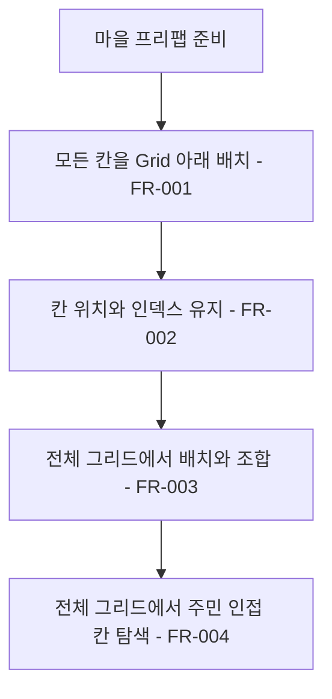

# 마을 건설 그리드 통합

## 1. 개요

- 목적: 모든 마을에서 위·아래 경계 없이 건설 칸을 하나의 그리드로 다룬다.
- 대상: 플레이어와 씬 제작자.

## 2. 범위

- 포함: 마을 프리팹의 Unity Grid, 화면 좌표 변환과 배치 스냅, 조합·이동·주민 인접 판정, 기존 칸 보존.
- 제외: 그리드 크기, 비용, 열차와 카메라 위치 변경.

## 3. 기술 방향

- 사용 기술/API: 기존 칸 모델, 서식지 판정기, Unity Grid의 좌표 변환 API와 프리팹 편집 API.
- 핵심 방식: 기존 칸 인덱스와 호환 좌표를 유지하고 연속 행 좌표로 인접 판정한다. 프리팹의 단일 Grid 컴포넌트에 기존 칸을 연결하고 월드 좌표를 Grid 셀 좌표로 변환해 배치 대상을 찾는다. 칸별 앵커와 데이터의 인덱스 대응을 유지한다.
- 선택하지 않은 방식: 저장 데이터의 칸 번호를 재배열하거나 씬 인스턴스를 교체하지 않는다.
- 외부 의존성: 마을 프리팹, `IInteriorCell`, 서식지 판정과 주민 이동.

## 4. 구조

| 구분 | 이름 | 역할 |
|------|------|------|
| 클래스 | `HabitatMatcher` | 연속 그리드 조합 판정 |
| 클래스 | `PlacementGhost` | 연속 그리드 이동과 회전 |
| 클래스 | `InteriorNpcWalker` | 경계를 넘는 인접 판정 |
| 클래스 | `Story012Build` | 그리드 생성과 프리팹 변환 |
| 프리팹 | `HubInterior` | 마을의 칸 배치 |
| 씬 | 마을 프리팹 사용 씬 | 프리팹 변경 반영 |
| ScriptableObject | 해당 없음 | |

- 오브젝트 구성: 모든 칸을 `Grid` 아래에 둔다.
- 클래스 간 관계: 기존 인덱스를 유지하면서 연속 행으로 판정한다.
- 실행 순서 의존성: Play Mode를 종료하고 씬 저장 상태 확인 후 프리팹을 변환한다.
- 기존 코드와의 접점: 프리팹 생성과 주민 인접 판정을 수정하고 기존 조합·이동 판정을 확인한다.

## 5. 동작 플로우차트

## 6. 요구사항

- FR-001: 마을 프리팹을 생성하거나 변환할 때 모든 건설 칸을 하나의 `Grid` 아래에 둔다.
- FR-002: 기존 프리팹을 변환할 때 칸 위치와 인덱스 및 씬의 제작자 설정을 유지한다.
- FR-003: 조합을 판정하거나 서식지를 이동할 때 기존 위·아래 경계를 일반 인접 행처럼 취급한다.
- FR-004: 주민의 집 주변 빈 칸을 찾을 때 기존 위·아래 경계를 일반 인접 행처럼 취급한다.
- FR-005: 마을 건설 화면에서 포인터의 월드 좌표를 Unity Grid의 셀 좌표로 변환해 기존 칸 인덱스를 찾고 해당 칸에 배치 미리보기와 입력을 맞춘다.
- FR-006: 기존 마을 프리팹에 Unity Grid를 설정할 때 칸의 월드 위치·인덱스와 기존 저장 데이터, 카메라·열차 설정을 유지한다.

### 상태와 데이터

| 이름 | 타입 | 설명 | 초기값 |
|------|------|------|--------|
| 칸 인덱스 | 정수 | 저장과 씬 참조에 사용하는 칸 번호 | 기존 값 유지 |

### 예외 및 경계 조건

- 기존 칸이 없는 씬은 변경하지 않는다. 저장된 칸 번호와 호환 필드는 유지한다.
- 그리드 경계 밖이나 점유된 칸은 기존 배치 규칙을 따른다.
- 칸이 없는 Grid 좌표는 배치 대상으로 선택하지 않는다. UI와 다른 배치 면의 입력은 기존 규칙을 따른다.
- 기존 칸이 서로 같은 Grid 좌표에 대응하거나 셀 중심에 맞지 않으면 자동으로 칸을 이동하지 않고 설정 오류를 알린다.

## 7. Inspector 노출값

Unity Grid의 셀 크기와 Transform은 프리팹에서 제작자가 조절한다.

## 8. 인수 조건

- FR-001: 마을 프리팹과 사용 씬에서 모든 칸이 하나의 `Grid`에 속한다.
- FR-002: 변환 전후 각 칸의 위치·인덱스와 마을 루트 설정이 같다.
- FR-003: 옛 경계 양쪽에 붙은 재료로 서식지를 완성하고 경계를 가로질러 이동·회전한다.
- FR-004: 옛 경계를 사이에 둔 집과 빈 칸이 인접 대상으로 인식된다.
- FR-005: 각 칸의 중심과 경계에서 포인터를 움직이며 표시와 실제 배치가 같은 칸에 맞고, 그리드 밖과 UI 위에서는 배치되지 않는지 확인한다. 서식지 이동·회전과 되돌리기도 확인한다.
- FR-006: 변환 전후 각 칸의 월드 위치·인덱스, 저장 데이터와 마을·카메라·열차 설정이 유지되는지 확인한다.

## 9. 미결 사항

- 없음
