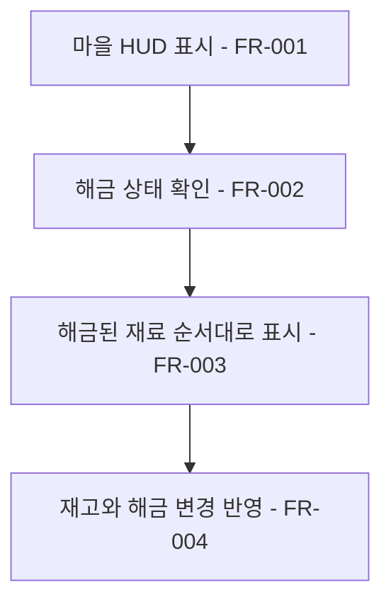

# 마을 재화 HUD

## 1. 개요

- 목적: 마을 버튼을 왼쪽에 모으고 해금된 재료의 보유량을 오른쪽에서 확인한다.
- 대상: 마을 화면의 플레이어.

## 2. 범위

- 포함: 도감·승객·메뉴·출발 버튼 위치, 마르크와 재료 재고 표시, 해금 및 재고 변경 반영.
- 제외: 재료 획득·해금 규칙과 빠른 칸 조작 변경.

## 3. 기술 방향

- 사용 기술/API: 기존 UGUI TopBar 프리팹과 빌더, `ITileStock`, `IHabitatCodex`, 기존 재료 이름 데이터.
- 핵심 방식: 버튼은 왼쪽에 배치하고 마르크와 재료별 작은 아이콘·숫자를 오른쪽에 세로로 놓는다. 미리 제작한 재료 표시를 해금 여부에 따라 켜고 끄며 재고 이벤트로 수량을 갱신한다.
- 선택하지 않은 방식: 잠긴 재료의 이름이나 아이콘을 미리 보여주거나 런타임에 UI 오브젝트를 생성하지 않는다.
- 외부 의존성: 기존 도감 해금·저장 복원, 재료 재고와 UI 테마.

## 4. 구조

| 구분 | 이름 | 역할 |
|------|------|------|
| 클래스 | `TopBarScreen` | 재고·해금 상태를 HUD에 반영 |
| 클래스 | `TopBarScreenBuilder` | 버튼 배치와 재료 표시 프리팹 제작 |
| 프리팹 | `TopBar` | 버튼과 재화 표시 보관 |
| 씬 | `Main` | 마을 HUD 표시 |
| ScriptableObject | 기존 `UiTheme`, 아이콘 자산 | 기존 UI 스타일과 재료 아이콘 |

- 오브젝트 구성: 기존 TopBar 아래 버튼과 재료별 표시를 둔다.
- 클래스 간 관계: TopBar가 재고와 도감 서비스를 읽고 변경 통지를 구독한다.
- 실행 순서 의존성: 서비스 준비 후 초기 해금·재고를 읽고 이벤트를 구독한다.
- 기존 코드와의 접점: TopBar 빌더·화면과 기존 MainCanvas 연결을 사용한다.

## 5. 동작 플로우차트

## 6. 요구사항

- FR-001: 마을 HUD의 도감·승객·메뉴·열차 정비·인벤토리·출발 버튼을 왼쪽에 배치하고 여섯 아이콘 크기를 34×34로 통일하며 각 버튼의 기존 동작을 유지한다.
- FR-002: 마르크와 해금된 생산 재료만 오른쪽에 표시하고 잠긴 재료는 표시하지 않는다.
- FR-003: 마르크와 해금된 재료는 작은 아이콘과 숫자로 오른쪽에 세로 표시한다. 재료 순서는 돌, 목재, 물통, 곡식, 석탄, 철재, 구리, 증기관, 톱니, 전선이며 재고가 0이어도 숨기지 않는다.
- FR-004: 재료 해금, 재고 증감과 저장 불러오기가 발생하면 표시 여부와 수량을 현재 상태로 갱신한다.
- FR-005: 해금된 각 재료의 보유량 옆에 모든 마을의 완성 서식지가 한 바퀴에 생산하는 해당 재료의 합계를 `(+숫자)`로 표시한다. 합계가 0이어도 `(+0)`으로 표시한다.
- FR-006: 서식지 완성·해체와 저장 복원 후 생산량을 갱신하며, 바퀴 정산에 사용하는 생산 데이터와 같은 건물 및 수치를 집계한다.

### 상태와 데이터

| 이름 | 타입 | 설명 | 초기값 |
|------|------|------|--------|
| 재료 해금 | 기존 도감 상태 | 재료 표시 여부 | 기존 저장 상태 |
| 재료 재고 | 기존 재고 상태 | 표시할 수량 | 기존 저장 상태 |

### 예외 및 경계 조건

- 땅은 재고가 없는 시작 재료이므로 재료 수량 목록에 넣지 않는다.
- 잠긴 재료는 공간을 차지하지 않는다. 버튼과 재화는 서로 겹치지 않는다.
- UI 참조와 서비스는 기존 구성 및 수명주기를 따른다.

## 7. Inspector 노출값

재료 표시와 아이콘 참조는 TopBar 프리팹에 저장한다. 배치와 크기는 프리팹에서 편집한다.

## 8. 인수 조건

- FR-001: 마을에서 각 버튼이 왼쪽에 보이고 여섯 아이콘의 크기가 같으며 기존 화면 열기와 출발이 동작하는지 확인한다.
- FR-002: 새 게임과 해금 후 오른쪽에 잠긴 재료가 없는지 확인한다.
- FR-003: 여러 재료를 해금해 정해진 순서와 각 수량을 확인하고 0개가 된 재료도 보이는지 확인한다.
- FR-004: 재료를 얻고 배치·회수하고 저장을 불러온 뒤 HUD와 실제 재고가 일치하는지 확인한다.
- FR-005: 서로 다른 두 마을의 같은 재료 생산 건물 수를 바꾸고 HUD의 `(+숫자)`가 양쪽 생산량 합계와 일치하는지 확인한다.
- FR-006: 건물 완성·해체 및 저장 복원 직후 표시가 갱신되고 한 바퀴 완료 시 실제 지급량과 일치하는지 확인한다.

## 9. 미결 사항

- 없음
