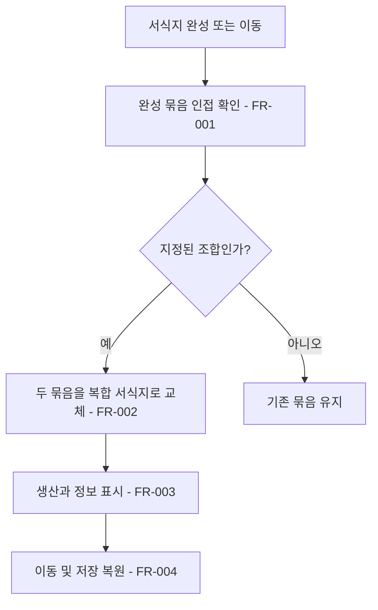

# 완성 서식지 조합

## 1. 개요

- 목적: 완성된 서식지 두 개를 연결하여 새로운 복합 서식지를 발견한다.
- 대상: 마을 건설 화면의 플레이어.

## 2. 범위

- 포함: 세 조합의 인접 판정, 복합 서식지와 생산, 표시, 이동·저장 복원.
- 제외: 자동 테스트, 추가 조합, 기존 서식지 레시피 변경.

## 3. 기술 방향

- 사용 기술/API: 기존 `ClusterHabitatSystem`, 서식지 카탈로그, 생산 데이터와 저장 계약.
- 핵심 방식: 완성 묶음의 칸이 상하좌우로 인접하면 조합 데이터에 따라 두 잠금 묶음을 모든 칸을 포함한 새 잠금 묶음으로 교체한다. 원본 타일은 보존한다.
- 선택하지 않은 방식: 원본 건물의 생산을 복합 서식지 생산과 중복 집계하지 않는다.
- 외부 의존성: 마을 그리드, 배치·이동, 서식지 표시, 생산·수입, 주민, 도감, 저장 복원.

## 4. 구조

| 구분 | 이름 | 역할 |
|------|------|------|
| 클래스 | `ClusterHabitatSystem` | 완성 묶음 조합과 변경 이벤트, 저장 복원 |
| 클래스 | `HabitatCatalog` | 복합 서식지 조합 데이터 제공 |
| 데이터 | 서식지 JSON | 원본 조합, 복합 종류와 생산·수입 정의 |
| 프리팹 | 기존 서식지 표시 | 완성된 복합 서식지 표시 |
| 씬 | `Main` | 기존 마을 화면 |
| ScriptableObject | 해당 없음 | 해당 없음 |

- 오브젝트 구성: 기존 마을 오브젝트를 사용한다.
- 클래스 간 관계: 판정 서비스가 카탈로그의 복합 조합을 읽고 기존 완성·파괴 이벤트로 변경을 알린다.
- 실행 순서 의존성: 개별 서식지를 판정한 뒤 조합하고 최종 목록을 저장한 다음 변경 이벤트를 보낸다. 저장 복원 시 저장된 복합 묶음을 먼저 복원한다.
- 기존 코드와의 접점: 서식지 판정·저장, 카탈로그, 생산과 수입, 도감과 건물 표시, 묶음 이동.

## 5. 동작 플로우차트

## 6. 요구사항

- FR-001: 같은 마을의 완성 서식지 두 개가 상하좌우로 맞닿을 때 아래 표에 있는 조합이면 인접 순서와 관계없이 조합한다. 여러 쌍이 가능하면 표 순서와 칸 인덱스 오름차순으로 한 쌍씩 판정한다.
- FR-002: 조합할 때 두 원본을 제거하고 모든 원본 칸과 재료를 유지하는 복합 서식지 하나를 완성한다. 원본 파괴 이벤트 다음 복합 완성 이벤트를 기존 계약에 따라 발행한다. 복합 서식지는 다른 조합에 재사용하지 않는다.
- FR-003: 복합 서식지가 완성된 동안 원본의 생산과 수입 대신 아래 표의 생산과 수입을 적용하고 기존 건물 테두리와 정보창에 복합 이름과 산출을 표시한다. 최초 완성 보상은 생산 재료 중 표에서 첫 번째 재료 4개를 기존 중복 방지 규칙에 따라 지급한다.
- FR-004: 복합 서식지는 기존 완성 서식지처럼 전체를 이동·회전·회수할 수 있으며 저장과 불러오기 후 종류와 칸을 유지한다. 칸 하나를 회수하면 복합 묶음을 해제하고 남은 재료를 기존 규칙으로 다시 판정한다. 주민 배정은 원본 파괴 및 복합 완성에 대한 기존 규칙을 따른다.

| 원본 서식지 | 복합 서식지 | 바퀴당 생산 | 바퀴당 수입 |
|------------|------------|-------------|-------------|
| 벌목터 + 돌우물 | 목재 가공장 | 목재 2개, 물통 1개 | 3마르크 |
| 계단식 밭 + 공동 취사장 | 식량 생산지 | 곡식 3개 | 6마르크 |
| 석탄 갱도 + 철 대장간 | 제철 단지 | 석탄 2개, 철재 3개 | 7마르크 |

### 상태와 데이터

| 이름 | 타입 | 설명 | 초기값 |
|------|------|------|--------|
| 복합 조합 | 원본 종류 두 개와 결과 종류의 목록 | 조합 가능한 완성 서식지 | 위 표의 세 조합 |
| 잠금 묶음 | 종류와 칸 목록 | 복합 서식지의 보존 상태 | 없음 |

### 예외 및 경계 조건

- 대각선 접촉이나 서로 다른 마을은 인접으로 보지 않는다.
- 복합 서식지는 추가 타일이나 다른 완성 서식지에 닿아도 크기와 종류를 유지한다.
- 저장 복원과 이동만으로 첫 완성 보상을 다시 지급하지 않는다.
- 도감은 기존 공개 규칙을 따르며 복합 조합을 재료 3×3 배치로 잘못 표시하지 않는다.

## 7. Inspector 노출값

해당 없음. 조합과 생산량은 데이터에서 조절한다.

## 8. 인수 조건

- FR-001: 각 조합을 두 순서로 만들거나 이동해 맞닿게 하면 조합된다. 대각선 및 비대상 서식지는 유지된다.
- FR-002: 두 원본의 칸과 재료가 모두 하나의 복합 서식지에 남고 원본 두 개의 효과가 중복되지 않는다.
- FR-003: 세 복합 서식지의 이름, 생산량, 수입 및 최초 완성 보상이 표와 일치하며 같은 종류를 다시 만들 때 보상이 반복되지 않는다.
- FR-004: 복합 서식지를 이동·회전하고 저장 후 불러와 종류와 칸을 확인한다. 칸 하나를 회수하면 남은 재료가 다시 판정된다.

## 9. 미결 사항

- 없음
