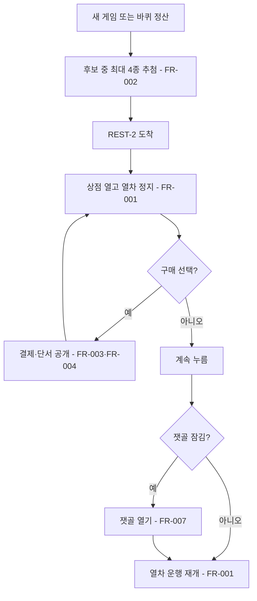
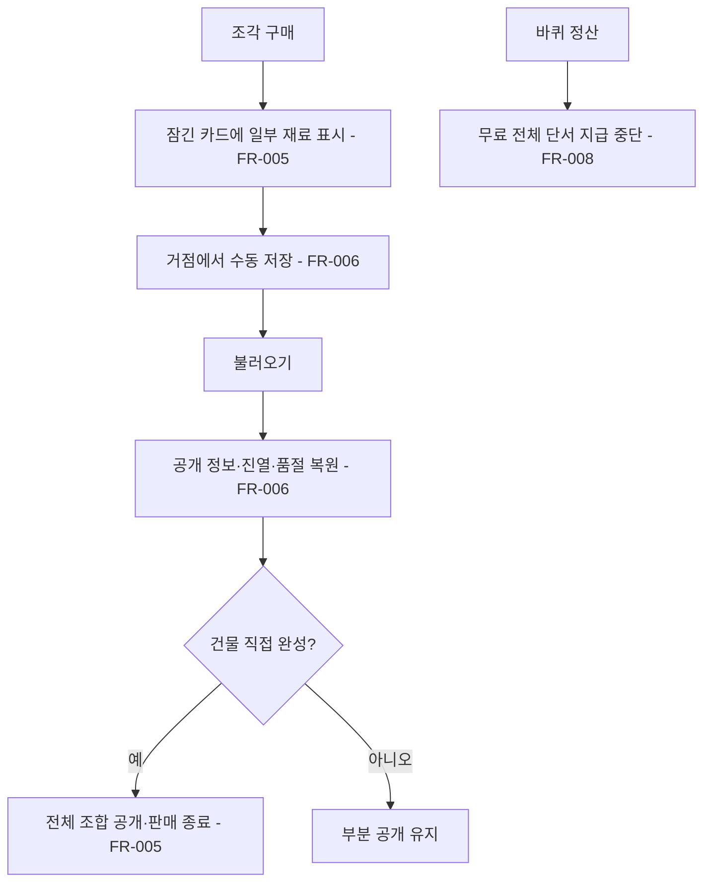

# 녹슨 다리 찢어진 설계도 상점

## 1. 개요

- 목적: 녹슨 다리에서 마르크를 내고 미완성 건물의 조합 정보를 조금씩 얻는다. 상점을 방문하면 다음 마을로 진행할 수 있다.
- 대상: 플레이어, 설계 도감, 선로·경제·저장 시스템, 상점 데이터를 조절하는 제작자.

## 2. 범위

- 포함:
  - `REST-2` 녹슨 다리의 전투 진입을 별도 상점 화면으로 교체하고 [계속]으로 운행 재개
  - 새 게임 시작과 바퀴 정산 때 미완성 건물의 조각 최대 4종을 무작위 비중복 진열
  - 조각 구매·품절·마르크 차감·바퀴 장부 기록
  - 구매당 미공개 재료 종류와 수량 조건 하나 공개, 도감 부분 표시, 직접 완성 시 전체 표시
  - 진열·품절·구매한 정보의 수동 저장 슬롯 보존
  - 바퀴 정산의 무료 전체 설계 단서 중단과 전투에서 얻은 전체 단서의 중복 판매 방지
  - 녹슨 다리 상점을 처음 마칠 때 `hub-2` 잿골 해금
- 제외:
  - 재료·자원의 추가, 재료 구매·판매, 번영도 거래, 포탑·열차 수리 상품
  - `REST-2` 이외의 전투 코드와 단독 전투 씬 제거
  - 기존 사건 경유지의 선택지와 보상 변경
  - 자동 저장과 순환 중 수동 저장 허용

구현 승인 묶음은 번호 순서대로 `FR-001~FR-004`, 이어서 `FR-005~FR-008`이다. 각 묶음은 별도로 승인받는다.

## 3. 기술 방향

- 사용 기술/API: UGUI(`Button`, `TMP_Text`), `UiScreens`·`UiTheme`, `GameServices`, `ITrackRuntime.RequestHold/ReleaseHold`, `IMoney`, `ILedger`, `IHabitatCodex`, `ILineOpener`, `ISaveParticipant`, `JsonUtility`.
- 핵심 방식:
  - `MapNode`의 경유지 콘텐츠에 `Shop`을 추가하고 `Main.unity`의 `REST-2`만 Inspector에서 `Shop`으로 지정한다. `MainRoot`는 도착한 노드의 콘텐츠가 `Shop`이면 열차를 붙잡고 `Shop` 화면을 연다. 전투용 분기와 `PhaseLoop` 사건 제외 대상에는 `Shop`도 포함한다.
  - `BlueprintShop`은 현재 바퀴 진열, 품절, 건물별 공개 재료 ID를 보관한다. `HabitatCatalog`·`ItemCatalog`·`HabitatCodex`의 실제 레시피·완성·전체 단서 상태와 `BattleHintJournal`의 전투 단서 기록을 조회한다. `ResourceInventory`는 타일 조합 단서의 원본이 아니므로 상점 재고로 쓰지 않는다.
  - 조합의 공개 단위는 **서로 다른 타일 ID 하나와 그 타일의 총 필요 수량**이다. `cluster`·`set`·`pattern` 모두 실제 레시피에서 타일 ID별 수량을 센다. 패턴의 빈 칸과 칸 위치는 공개하지 않는다. 구매 때 아직 공개되지 않은 ID 중 하나를 무작위로 고른다.
  - 후보는 카탈로그의 미완성 건물 중 미공개 타일 ID가 남고 전체 설계 단서가 없는 건물이다. 전체 단서는 `HabitatCodex.HasHint`와 `BattleHintJournal.Has`를 모두 확인한다. 필요 타일의 해금 여부는 후보를 제한하지 않는다. 새 게임 시작과 바퀴 정산마다 후보를 섞어 앞의 최대 4종을 선택하며 같은 바퀴에는 유지한다. 이미 산 건물도 미공개 조건이 남으면 다음 추첨에 다시 참여한다.
  - 구매는 열려 있는 상점의 진열 상품이 미품절이고 가격이 유효하며 잔고가 충분할 때 한 번만 성공한다. `IMoney.TrySpend` 성공 뒤 `ILedger.Record(LedgerKind.Purchase, -price, recipeId)`로 기록하고, 공개 재료 ID를 저장한 뒤 그 상품을 품절로 바꾼다. 실패하면 돈·장부·공개 상태·품절 상태가 모두 그대로다.
  - 건물별 조각 가격은 `Assets/Scripts/Shop/Resources/Shop/FragmentShop.json`의 건물 ID·가격 목록에 둔다. 같은 파일의 진열 수 기본값은 4다. 초기값은 개간 20, 정착 30, 금속 40, 증기 50, 전기 60마르크다. 단계별 건물 배정은 아래 상태·데이터 표를 따른다. 가격은 같은 건물의 후속 조각에도 동일하다.
  - 기존 `HabitatCodex.OnLapCompleted`의 전체 단서 지급은 중단한다. 전투 보상으로 얻은 전체 단서가 남아 있는 과도기에는 그 건물을 후보에서 제외한다. 부분 단서는 건물 해금이나 타일 해금을 발생시키지 않는다.
- 선택하지 않은 방식: 타일을 상점에서 선구매하거나 `TileStock`에 넣는 방식, 모든 건물을 한 번에 나열하는 방식, 조각을 사면 패턴 배치를 공개하는 방식.
- 외부 의존성: `Assets/Scripts/Habitats/Resources/Habitats/HabitatRecipes.json`, `HabitatTypes.json`, `Assets/Scripts/Items/Resources/Items/ItemCatalog.json`, `CodexUnlocks.json`, 기존 저장 슬롯(스펙 003).

## 4. 구조

| 구분 | 이름 | 역할 |
|------|------|------|
| 계약 | `IronRing.Contracts.IBlueprintShop` | 현재 진열·품절 조회, `TryBuy(recipeId)`, `Continue()`, 화면 갱신 이벤트 |
| 클래스 | `IronRing.Shop.BlueprintShop` | 후보 추첨, 결제, 부분 단서, 품절, 바퀴 교체, 저장·복원 |
| 클래스 | `IronRing.Shop.ShopInstaller` | `GameServices.Composing`에서 상점과 JSON을 만들고 서비스 등록 |
| 클래스 | `IronRing.Hud.ShopScreen` | 상품 4칸·잔고·구매 결과·[계속] 표시와 입력 |
| 클래스 | `IronRing.Hud.Editor.Screens.ShopScreenBuilder` | `UiTheme`으로 상점 화면 프리팹 생성 |
| 프리팹 | `Assets/Prefabs/UI/Screens/Shop.prefab` | `MainCanvas`의 전면 상점 화면 |
| 씬 | `Assets/Scenes/Main.unity` | `REST-2`의 `MapNode` 콘텐츠를 `Shop`으로 설정하고 상점 프리팹 배치 |

- 오브젝트 구성: `MainCanvas/Shop` 아래에 제목, 잔고, 상품 카드 최대 4개(건물명·가격·구매 버튼·품절 표시), 구매 결과, [계속] 버튼을 둔다. 상점 화면이 열릴 때 월드 입력을 가리고 닫으면 원래 열차 화면을 복원한다. 색·글꼴·레이아웃은 `UiTheme`과 프리팹의 제작값을 따른다.
- 클래스 간 관계: `MainRoot` → `IBlueprintShop`(녹슨 다리 진입), `ShopScreen` → `IBlueprintShop`(상품·구매·계속), `BlueprintShop` → 카탈로그·도감·돈·장부·선로 해금. 도감 카드가 부분 단서를 읽어 공개 재료·수량만 보여준다.
- 실행 순서 의존성: `ShopInstaller`는 `GameServices.Composing`에서 자체 JSON·카탈로그를 읽어 상점 서비스와 새 게임의 첫 진열을 만들고 등록한다. `SaveInstaller`가 `Ready`에서 저장 슬롯을 불러오면 이 초기 진열을 저장값으로 덮어쓴다. 상점은 돈·장부·도감 등 다른 서비스는 구매·후보 재검사 시점에 조회해 설치기 구독 순서에 의존하지 않는다. 화면은 열릴 때 복원된 상태를 다시 그린다. 바퀴 정산 이벤트마다 다음 바퀴 진열을 한 번만 만든다.
- 기존 코드와의 접점: `MapNode.WaypointContent`, `MainRoot`의 도착·전투 분기, `PhaseLoop.SetBattleWaypoints`의 사건 제외, `HabitatCodex`의 바퀴 단서·부분 단서 저장, `BattleHintJournal.Has`, `CodexScreen`·`CodexCardView`의 잠긴 카드, `BuildMainCanvas.SCREEN_IDS`, `SaveInstaller.CollectParticipants`, `LineOpener.Open("hub-2")`. `IBlueprintShop`은 `IronRingContracts.cs` 끝에 추가하고 기존 계약 멤버 순서는 바꾸지 않는다.

## 5. 동작 플로우차트

### 진입·진열·이탈

### 도감·저장

## 6. 요구사항

- FR-001: `REST-2` 녹슨 다리에 도착할 때 상점 화면을 열고 열차를 붙잡으며, [계속]을 누를 때 구매 여부와 관계없이 화면을 닫고 운행을 재개한다.
- FR-002: 새 게임 시작 또는 바퀴 정산 때 미완성·부분 미공개·전체 단서 없음 조건의 건물에서 최대 4종을 무작위로 중복 없이 진열하며, 같은 바퀴에는 목록을 바꾸지 않는다.
- FR-003: 열려 있는 상점의 미품절 조각을 구매할 때 잔고가 가격 이상이면 해당 마르크를 차감하고 바퀴 장부에 `Purchase` 지출을 기록한다.
- FR-004: FR-003의 구매가 성공할 때 해당 건물의 미공개 재료 ID 하나와 총 필요 수량을 무작위로 공개하고 그 상품을 이번 바퀴에 품절 처리한다.
- FR-005: 조각 공개 상태의 건물 카드를 열 때 건물 이름과 공개된 재료·수량만 보여주고 나머지 재료와 배치는 숨기며, 건물을 직접 완성하면 전체 조합을 보여주고 판매 후보에서 제외한다.
- FR-006: 거점에서 수동 저장할 때 공개 재료·현재 진열·품절 상태를 슬롯에 보존하고, 불러올 때 같은 상태로 복원한다.
- FR-007: (대체됨) 상점은 잿골을 열지 않는다. 마을 개통은 `HubUnlocks.json` 규칙을 따른다(`design/game-brief.md`).
- FR-008: 바퀴 정산이 일어날 때 기존 무료 전체 설계 단서를 지급하지 않는다.

### 상태와 데이터

| 이름 | 타입 | 설명 | 초기값 |
|------|------|------|--------|
| 진열 건물 ID | `List<string>` | 이번 바퀴에 고른 최대 4종; 카탈로그 ID 사용 | 새 게임 시작 때 추첨 |
| 품절 건물 ID | `HashSet<string>` | 이번 바퀴에 이미 구매한 진열 상품 | 비어 있음 |
| 공개 재료 ID | `Dictionary<string, List<string>>` | 건물 ID별로 구매해 안 타일 ID; 수량은 레시피 원본에서 조회 | 비어 있음 |
| 진열 바퀴 | `int` | 같은 바퀴의 중복 추첨 방지 | 현재 진행 바퀴 |
| 건물별 조각 가격 | JSON의 `{ recipeId, price }[]` | 건물 ID마다 양의 정수 가격 | 아래 단계별 첫 값 |

`BlueprintShop`의 저장 키는 `fragmentShop`, 복원 순서는 도감(50) 다음인 51로 둔다. `JsonUtility`용 저장 형식은 진열 바퀴·진열 ID 배열·품절 ID 배열·건물 ID와 공개 타일 ID 배열의 짝으로 두며, 딕셔너리와 집합은 복원 때 다시 만든다.

| 단계·가격 | 건물 ID |
|------|------|
| 개간 20 | `cleared_lot`, `logging_site`, `temporary_shelter` |
| 정착 30 | `stone_well`, `terrace_field`, `communal_kitchen` |
| 금속 40 | `coal_shaft`, `iron_forge`, `copper_pit` |
| 증기 50 | `steam_boiler`, `pump_station`, `gear_workshop`, `steam_station` |
| 전기 60 | `wire_workshop`, `electric_works`, `night_market`, `clock_tower` |

### 예외 및 경계 조건

- 잔고 부족·품절·상점 닫힘·진열되지 않은 건물: 구매를 거부하고 잔고·장부·단서·품절 상태를 바꾸지 않는다. 잔고 부족과 품절 이유는 상품 카드에 표시한다.
- 후보가 4종보다 적음: 있는 후보만 보여준다. 후보가 0종이면 빈 상점 안내와 [계속] 버튼을 보여준다.
- 모든 재료 조건 공개: 배치는 여전히 숨긴다. 이후 그 건물은 상점 후보에서 제외한다.
- 새 게임에서 시작하는 한 종류 재료 조합(`cleared_lot`): 첫 조각 구매로 땅×3을 알 수 있으며 추가 조각은 판매하지 않는다.
- 전투 전체 단서 또는 직접 완성으로 조합 전체를 알게 됨: 남은 조각을 판매하지 않고 현재 진열에 있다면 구매 불가로 표시한다. 이미 구매한 부분 정보와 마르크는 되돌리지 않는다.
- 저장은 거점에서만 가능하므로 녹슨 다리 상점에서 구매한 뒤 거점에 도착하기 전에 종료하면 저장하지 않은 진행은 기존 저장 규칙을 따른다.
- 잘못된 가격·카탈로그에 없는 건물 ID: 상점 데이터 로딩을 실패로 보고 오류를 출력한다. 결제 불가 상태로 진행해 무료 구매를 허용하지 않는다.

## 7. Inspector 노출값

| 필드 | 타입 | 기본값 | 설명 |
|------|------|--------|------|
| `REST-2 MapNode._waypointContent` | `WaypointContent` | `Shop` | 해당 경유지의 콘텐츠 종류. 씬에서 제작자가 지정한다. |

가격·진열 수는 Inspector가 아닌 시스템 `Resources` JSON에서 조절한다. 상점 화면의 위치·크기·색·글꼴은 프리팹과 `UiTheme`의 저장값을 따른다.

## 8. 인수 조건

- FR-001: Play Mode에서 열차를 `REST-2`에 보내면 전투 씬 대신 상점이 열리고 열차가 멈춘다. 아무것도 사지 않고 [계속]을 누르면 상점이 닫히고 다음 노드로 진행한다.
- FR-002: 새 게임의 첫 상점에서 최대 4개가 중복 없이 보인다. 같은 바퀴에 다시 열어도 목록은 같고, 바퀴 정산 뒤에는 후보에서 새 목록을 추첨한다. 필요한 타일이 아직 잠긴 건물도 후보에 포함된다.
- FR-003: 잔고보다 싼 조각을 사면 표시 잔고가 가격만큼 줄고 장부에 해당 건물 ID와 음수 구매액 한 줄이 보인다. 부족한 잔고에서는 구매 버튼이 비활성화되고 수치는 그대로다.
- FR-004: 구매 뒤 상품이 품절로 표시되고, 도감에 그 건물의 재료 종류·수량 한 조건만 새로 보인다. 다음 바퀴에 재등장해 다시 사면 이전에 공개된 조건과 중복되지 않는다.
- FR-005: 조각을 산 미완성 건물의 도감 카드에는 이름과 공개 조건만 보이고 패턴 칸 배치는 보이지 않는다. 모든 조건을 산 뒤에도 배치는 숨는다. 그 건물을 직접 완성하면 전체 조합이 보이고 상점에서 사라진다.
- FR-006: 한 바퀴의 상점에서 조각을 구매한 뒤 거점에서 수동 저장하고 슬롯을 불러오면 공개 조건·진열 목록·품절 상태가 일치한다. 새 게임에서는 구매 정보가 비어 있다.
- FR-007: (대체됨) 상점에서 [계속]을 눌러도 `hub-2`가 열리지 않는다.
- FR-008: 바퀴를 마친 뒤 무료 전체 설계 단서가 새로 생기지 않고 상점 진열만 교체된다.

## 9. 미결 사항

- 없음
